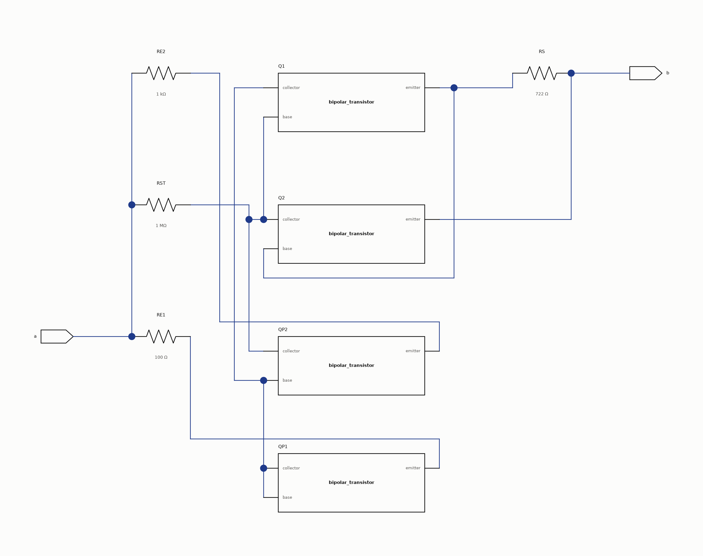
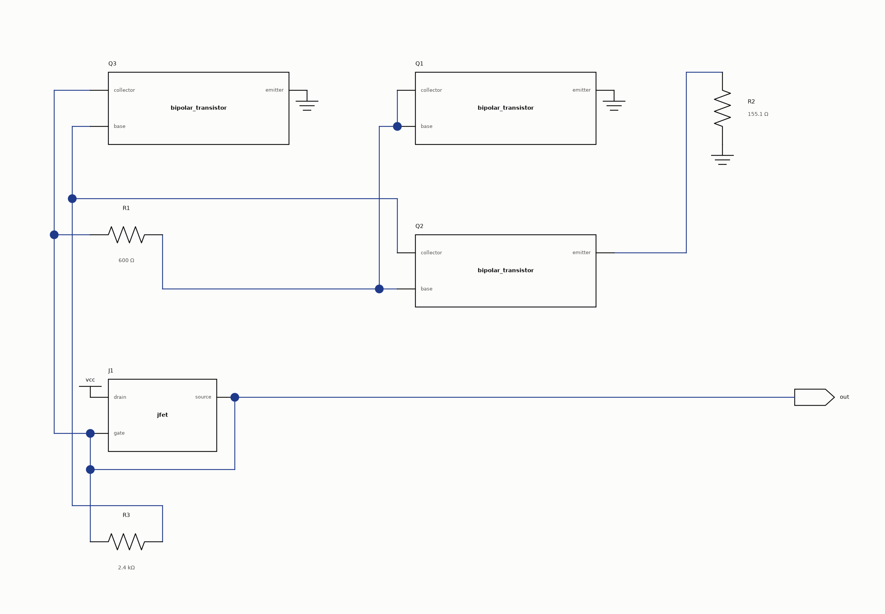
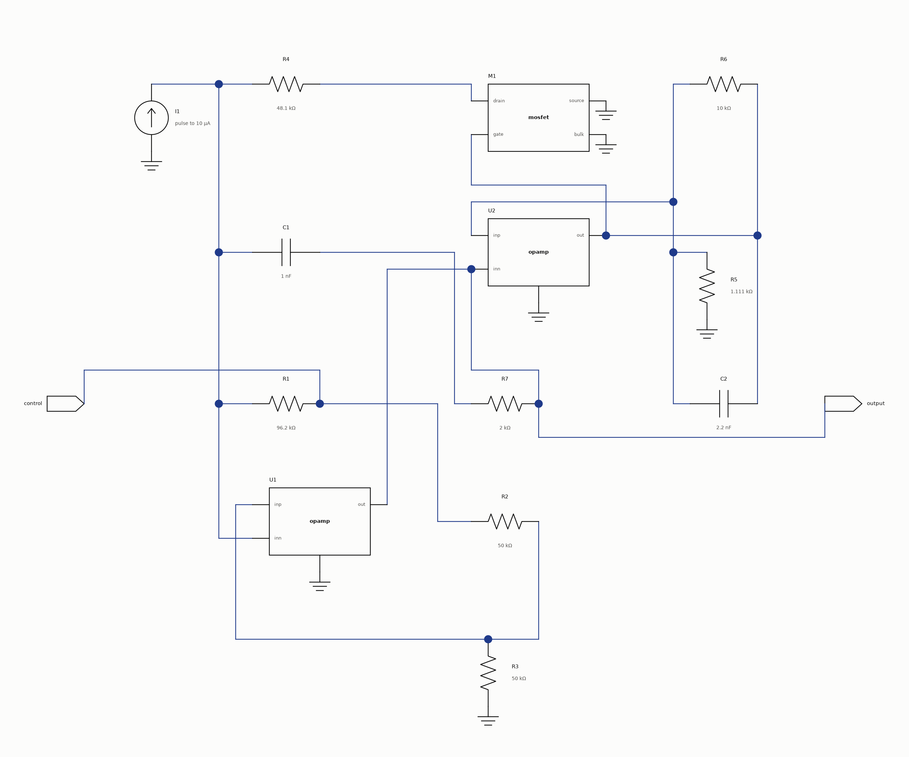

# Discovery

Some circuits are famous for being hard to get right with few parts: a current source that ignores its supply and its temperature, a sine wave that holds its amplitude without distorting it, a notch that stays deep with real tolerances, a reference without an op-amp, an oscillator whose frequency follows its control in a straight line, a logic gate of memristors that tolerates its drive.
For each, a prompt states the bounds as an engineer would, and an agent, Claude, searched for a circuit with nothing but jolty: it wrote candidates as components, ran experiments with jolty's Python API and command line, read the exact currents, delays and drifts jolty reports, and kept what the numbers supported.
Each page holds the prompt, every experiment's result and what it showed; the final design runs through `jolty simulate` and again in ngspice.
Where no design met a bound, the page says so, and why.
None of these runs was blind: the agent wrote each prompt knowing the textbook answers, so they show what jolty lets an agent see rather than what an agent can invent, and each page's limits say what a built circuit would add.
The prompts, candidates, experiments and designs are all in [`discovery/`](https://github.com/maxencefaldor/jolty/tree/main/discovery).

-   

    **[A two-terminal current source](discovery/current-source.md)** · 0/3 specs · ngspice within 7.3e-06

    The prompt asks for 1 mA from 3 V to 24 V within 1 %, drifting less than 2 % from -40 °C to 85 °C, from 2N3904s, 2N3906s, 1N4148s and resistors.
    No design of ten parts or fewer met both bounds; the best traded line regulation against drift, and jolty showed which device parameter set each limit.

    [Open in 3D](discovery/current-source.view.html#view=X1) · [Script](https://github.com/maxencefaldor/jolty/blob/main/discovery/current_source/design.py)

-   

    **[A clean, steady sine oscillator](discovery/sine-oscillator.md)** · 1/2 specs · ngspice agrees on its specs

    The prompt asks for 1 kHz within 1 %, 2 V peak within 5 % over -40 °C to 85 °C, less than 0.5 % distortion, and settling within 100 ms. A JFET-controlled Wien bridge met the frequency, the amplitude at 27 °C, the distortion by a factor of seven and the settling time; no design of the parts allowed met the drift bound, and jolty located why.

    [Open in 3D](discovery/sine-oscillator.view.html#view=X1) · [Script](https://github.com/maxencefaldor/jolty/blob/main/discovery/sine_oscillator/design.py)

-   

    **[A notch that survives its tolerances](discovery/notch.md)** · 2/2 specs · ngspice within 9.5e-12

    The prompt asks for a notch at least 50 dB deep somewhere between 45 Hz and 55 Hz, a passband within 3 dB at 25 Hz and 100 Hz, from 1 % resistors and 5 % capacitors, on 95 % of the circuits built.
    A notch whose depth is set by phase rather than by a balance of values met it on every one of 200 samples, at least 65 dB deep; the twin-T, the textbook notch, met it on none.

    [Open in 3D](discovery/notch.view.html#view=X1) · [Script](https://github.com/maxencefaldor/jolty/blob/main/discovery/notch/design.py)

-   

    **[A reference without an op-amp](discovery/bandgap.md)** · 3/3 specs · ngspice within 3.7e-06

    The prompt asks for a reference near 1.2 V from 5 V, drifting less than 50 ppm/K from -40 °C to 125 °C and moving less than 1 mV per volt of supply, with ten parts or fewer and no op-amp.
    Widlar's three-transistor bandgap fed by a JFET met both bounds with seven parts and a wide margin: 5.3 ppm/K and 0.31 mV/V.

    [Open in 3D](discovery/bandgap.view.html#view=X1) · [Script](https://github.com/maxencefaldor/jolty/blob/main/discovery/bandgap/design.py)

-   

    **[A linear voltage-controlled oscillator](discovery/vco.md)** · 6/6 specs · ngspice agrees on its specs

    The prompt asks for 1 kHz per volt from 0.5 V to 5 V, every frequency within 1 % of the line through the origin that fits them best, with at most two op-amps.
    The textbook integrator and Schmitt trigger missed the linearity by a factor of three; jolty traced the error to the Schmitt trigger's delay, and two parts that cancel it brought every frequency within 0.1 % of 996 Hz/V.

    [Open in 3D](discovery/vco.view.html#view=X1) · [Script](https://github.com/maxencefaldor/jolty/blob/main/discovery/vco/design.py)

-   

    **[A NOR gate of three memristors](discovery/memristive-nor.md)** · 12/12 specs · ngspice within 4.9e-09

    The prompt asks for a NOR gate of three VTEAM memristors and one pulse of at most 10 ns, every output within 0.1 of its NOR and every input within 0.05 of its bit, with the pulse's amplitude 10 % off either way.
    MAGIC's gate, the textbook answer, works only between 1.30 V and 1.32 V, ±0.8 %; a 2.2 kΩ resistor across its inputs widens that to 1.14 V to 1.91 V, ±25 %, and meets the prompt.

    [Open in 3D](discovery/memristive-nor.view.html#view=X1) · [Script](https://github.com/maxencefaldor/jolty/blob/main/discovery/memristive_nor/design.py)

