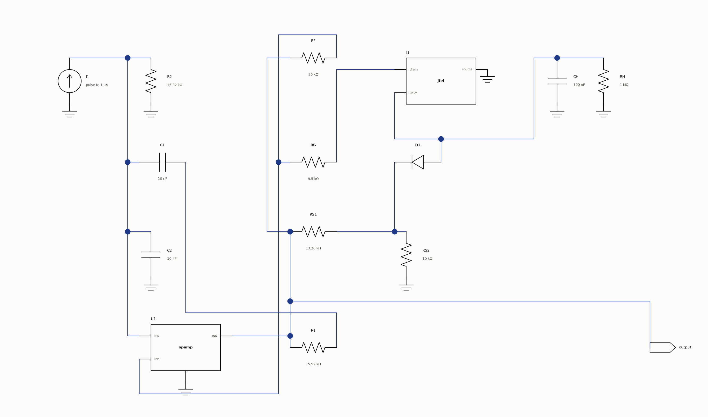
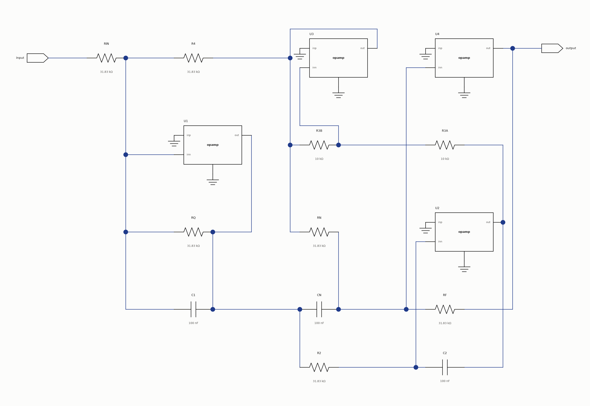
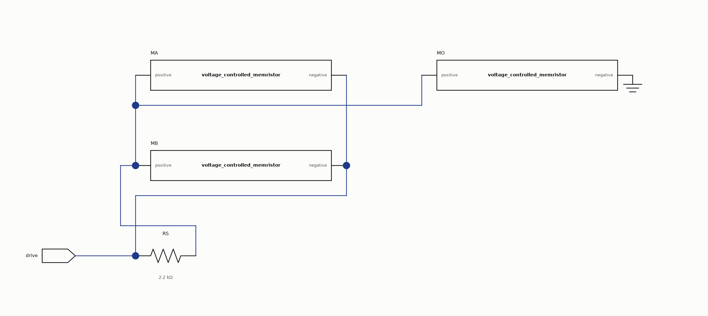

# Discovery

Classic analog and mixed-signal design problems become difficult under strict part budgets: supply- and temperature-insensitive current sources, low-distortion sine oscillators, and tolerance-immune notch filters.
Three additional problems cover op-amp-free voltage references, linear voltage-controlled oscillators, and three-memristor NOR gates with wide pulse-amplitude margins.
For each problem, an engineering prompt states quantitative bounds, and Claude searched for a circuit using only jolty.
Claude wrote candidate components, ran Python API and CLI experiments, inspected reported currents, delays, and drifts, and kept designs backed by measurements.
Each page presents the prompt, experimental results, and findings, running the final design through `jolty simulate` and replicating every analog analysis in ngspice.
Missed bounds and limiting physical mechanisms are documented explicitly.
None of the runs was blind: the agent wrote each prompt knowing textbook topologies, demonstrating what jolty reveals during design rather than autonomous invention.
Each page ends with hardware caveats, and all prompts, candidates, experiments, and designs live in [`docs/discovery/`](https://github.com/maxencefaldor/jolty/tree/main/docs/discovery).

-   

    **[A two-terminal current source](discovery/current-source.md)** · 0/3 specs · ngspice within 7.3e-06

    The prompt requires 1 mA across 3 V to 24 V within 1%, drifting under 2% from -40 °C to 85 °C, built from 2N3904, 2N3906, 1N4148, and resistors.
    No topology with ten parts or fewer satisfied both bounds; the best candidates traded line regulation against temperature drift, and jolty pinpointed the limiting device parameters.

    [Open in 3D](discovery/current-source.view.html#view=X1) · [Script](https://github.com/maxencefaldor/jolty/blob/main/docs/discovery/current_source/design.py)

-   

    **[A clean, steady sine oscillator](discovery/sine-oscillator.md)** · 1/2 specs · ngspice agrees on its specs

    The prompt requires a 1 kHz (±1%) sine wave at 2 V peak (±5% across -40 °C to 85 °C) with under 0.5% distortion settling within 100 milliseconds.
    A JFET-controlled Wien bridge met frequency, 27 °C amplitude, distortion (7× margin), and settling time; no single-op-amp design met the temperature drift bound, and jolty isolated the cause.

    [Open in 3D](discovery/sine-oscillator.view.html#view=X1) · [Script](https://github.com/maxencefaldor/jolty/blob/main/docs/discovery/sine_oscillator/design.py)

-   

    **[A notch that survives its tolerances](discovery/notch.md)** · 2/2 specs · ngspice within 9.4e-12

    The prompt requires a notch at least 50 dB deep between 45 Hz and 55 Hz with passband gain within 3 dB at 25 Hz and 100 Hz on at least 95% of builds using 1% resistors and 5% capacitors.
    A phase-cancellation notch achieved 100% yield across 200 Monte Carlo samples (worst-case depth 65.5 dB), whereas the textbook twin-T achieved 0% yield.

    [Open in 3D](discovery/notch.view.html#view=X1) · [Script](https://github.com/maxencefaldor/jolty/blob/main/docs/discovery/notch/design.py)

-   

    **[A reference without an op-amp](discovery/bandgap.md)** · 3/3 specs · ngspice within 3.7e-06

    The prompt requires a ~1.2 V reference from 5 V using at most ten parts and no op-amp, drifting under 50 ppm/K (-40 °C to 125 °C) and under 1 mV/V on the supply.
    Widlar's three-transistor bandgap fed by a JFET met both bounds using seven parts with wide margin: 5.3 ppm/K and 0.31 mV/V.

    [Open in 3D](discovery/bandgap.view.html#view=X1) · [Script](https://github.com/maxencefaldor/jolty/blob/main/docs/discovery/bandgap/design.py)

-   

    **[A linear voltage-controlled oscillator](discovery/vco.md)** · 6/6 specs · ngspice agrees on its specs

    The prompt requires 1 kHz/V from 0.5 V to 5 V with every frequency within 1% of the best-fit line through the origin, using at most two op-amps.
    The textbook integrator plus Schmitt trigger missed linearity by 3×; jolty traced the error to Schmitt trigger regeneration delay, and two compensating parts brought linearity within 0.1% of 996 Hz/V.

    [Open in 3D](discovery/vco.view.html#view=X1) · [Script](https://github.com/maxencefaldor/jolty/blob/main/docs/discovery/vco/design.py)

-   

    **[A NOR gate of three memristors](discovery/memristive-nor.md)** · 12/12 specs · ngspice within 9.3e-06

    The prompt requires a three-memristor VTEAM NOR gate driven by a single pulse up to 10 ns, holding every output within 0.1 and every input within 0.05 across ±10% pulse amplitude variation.
    The textbook MAGIC gate operates only from 1.30 V to 1.32 V (±0.8%), whereas a 2.2 kΩ input shunt widens the window to 1.14 V through 1.91 V (±25%) and passes all bounds.

    [Open in 3D](discovery/memristive-nor.view.html#view=X1) · [Script](https://github.com/maxencefaldor/jolty/blob/main/docs/discovery/memristive_nor/design.py)

