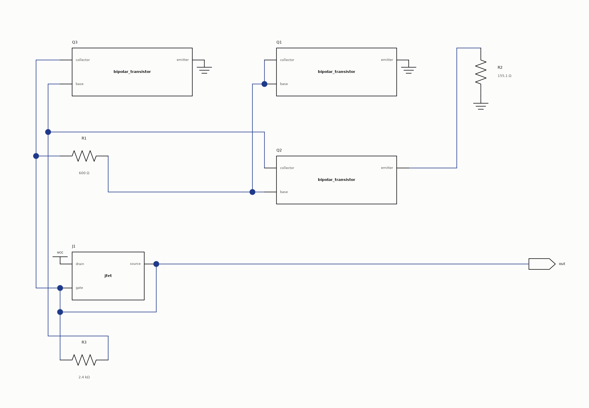
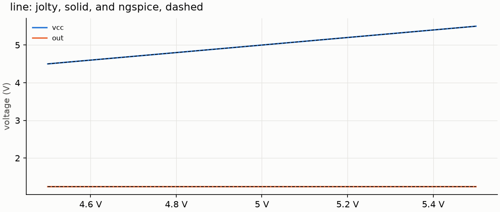
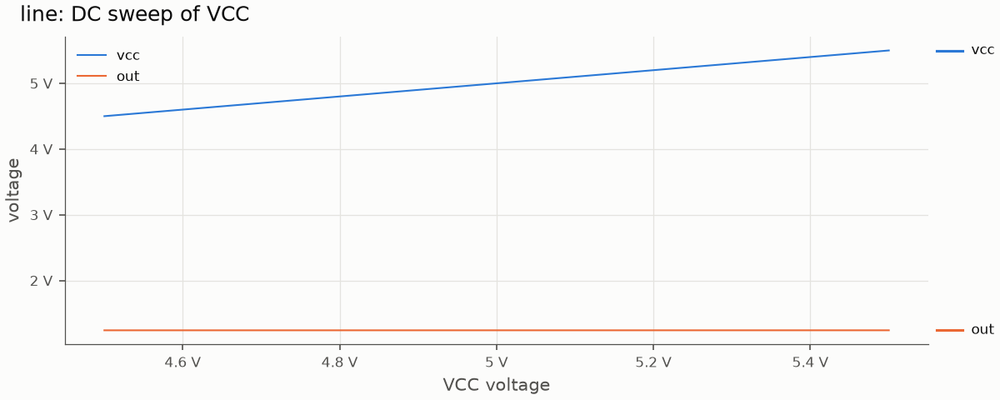

# A reference without an op-amp

JFET-fed Widlar three-transistor bandgap voltage reference.

Diode-connected Q1 and Q2 over 155 Ω form a Widlar current source, dropping Vt·ln(I1/I2) across R2.
Transistor Q3 sums its Vbe with Q2 collector current across 2.4 kΩ to produce a temperature-compensated output near the silicon bandgap.
Resistor bias moves the output by 44 mV/V on the supply, whereas a zero-Vgs 2N5457 JFET bias reduces line sensitivity to 0.31 mV/V.
Thermal drift in JFET current also straightens bandgap curvature to 1.2414 V within 1.08 mV from -40 °C to 125 °C (5.3 ppm/K) using seven parts.
Simulate via `jolty simulate docs/discovery/bandgap/design.py`.

[Open in 3D](bandgap.view.html#view=X1){ .md-button .md-button--primary } [Script](https://github.com/maxencefaldor/jolty/blob/main/docs/discovery/bandgap/design.py){ .md-button } [Every experiment](https://github.com/maxencefaldor/jolty/tree/main/docs/discovery/bandgap){ .md-button }

9 devices and 14 unknowns.

## The prompt

> Design a voltage reference near 1.2 V from a 5 V supply without an op-amp.
>
> - Output drift stays below 50 ppm/K from -40 °C to 125 °C (a span under 10 mV).
> - Line regulation stays below 1 mV per volt across 4.5 V to 5.5 V.
> - The reference self-starts reliably and uses ten parts or fewer from `examples/common.py` (transistors, diodes, and resistors) plus the 2N5457 JFET.
>
> Use jolty to find the best design you can, and report what limits performance.

The prompt requires a ~1.2 V reference from 5 V using at most ten parts and no op-amp, drifting under 50 ppm/K (-40 °C to 125 °C) and under 1 mV/V on the supply.
Widlar's three-transistor bandgap fed by a JFET met both bounds using seven parts with wide margin: 5.3 ppm/K and 0.31 mV/V.

## Method

`candidates.py` implements each reference as a component exposing `vcc`, `out`, and `ground`.
`explore.py` measures output voltage at eight temperatures and over a 4.5 V to 5.5 V supply DC sweep under a 100 kΩ load.
To flatten each bandgap for a given `R3/R1` ratio, `explore.py` bisects Widlar resistor R2 until the 125 °C output equals the -40 °C output.

## Results

| Reference | Parts | Output | Span, -40 °C to 125 °C | Drift | Line |
| --- | --- | --- | --- | --- | --- |
| A diode fed by 4.3 kΩ | 2 | 0.586 V | 329 mV | 3400 ppm/K | 10.4 mV/V |
| Widlar bandgap, R3 = 6 kΩ, R2 = 500 Ω, fed by 1 kΩ | 7 | 1.510 V | 10.8 mV | 43.5 ppm/K | 57.7 mV/V |
| Same topology, R3 = 3.6 kΩ, R2 flattened to 255 Ω | 7 | 1.422 V | 6.0 mV | 25.7 ppm/K | 44.4 mV/V |
| Same topology, fed by a JFET instead, R2 kept | 7 | 1.341 V | 45.7 mV | 207 ppm/K | 0.36 mV/V |
| Fed by a JFET, R3 = 2.4 kΩ, R2 flattened to 155.0 Ω | 7 | 1.2417 V | 1.12 mV | 5.5 ppm/K | 0.31 mV/V |
| **Fed by a JFET, R3 = 2.4 kΩ, R2 = 155.1 Ω** | **7** | **1.2414 V** | **1.08 mV** | **5.3 ppm/K** | **0.31 mV/V** |
| Fed by a JFET, R3 = 3.6 kΩ, R2 = 298 Ω | 7 | 1.261 V | 2.2 mV | 10.4 ppm/K | 0.32 mV/V |
| Fed by a JFET, R3 = 6 kΩ, R2 = 618 Ω | 7 | 1.299 V | 3.9 mV | 18.2 ppm/K | 0.38 mV/V |

Endpoint flattening leaves a span 0.04 mV wider than the final `R2 = 155.1 Ω` design.
A 1% error in R2 or R1 still keeps drift within 14.2 ppm/K.

## What the experiments showed

1. **A resistor-fed Widlar bandgap cannot regulate line voltage.**
    Output impedance equals `1/gm` of Q3 times the loop PTAT gain, and Q3 current tracks the feed resistor directly.
    Regardless of feed resistance, output shifts by roughly loop gain times `Vt` over headroom (44 to 58 mV/V).
1. **A JFET's `Idss` forms a single-part current source.**
    With gate tied to source, the JFET draws 2 mA across drain voltages within `2.3e-3`/V channel-length modulation, cutting line regulation 140× to 0.31 mV/V.
1. **Feed temperature drift participates in the bandgap balance.**
    Q3 `Vbe` varies with bias current, so swapping the resistor feed for a JFET shifted the flat point and left the old R2 at 207 ppm/K.
    Reflattening with the JFET dropped the span to 1 mV because JFET `Idss` drift bends Q3 `Vbe` against the 6 mV bandgap curvature bowl.
1. **Flat output voltage depends on the PTAT ratio.**
    Lowering R3 lowers the zero-TC voltage from 1.30 V to 1.24 V and reduces residual curvature.

## Conclusion

`design.py` meets every specification with seven parts: 1.2414 V at 27 °C, 5.3 ppm/K drift, and 0.31 mV/V line regulation, verified across all corners.
Curvature cancellation relies on JFET and 2N3904 temperature models; real-part `Idss` variation shifts the flat point and would require trimming R2.

## Limits

The agent that wrote the prompt also designed the circuit using textbook knowledge and judged the output, making this a capability showcase rather than a blind benchmark.
Widlar's three-transistor cell dates to 1971, and JFET `Idss` current feeds are standard practice.
Achieving 5.3 ppm/K requires trimming R2 to 0.1 Ω on nominal models; part-to-part `Vbe`/`Idss` spread and thermal gradients would raise untrimmed drift substantially.

## Specs

| Requirement | jolty | ngspice | Difference |
| --- | --- | --- | --- |
| out in op ≥ 1.237 V and ≤ 1.246 V | 1.24252 V at cold, passed | 1.24252 V at cold, passed | 1.7e-07 |
| out at 4.5 V in line ≥ 1.236 V and ≤ 1.247 V | 1.24238 V at cold, passed | 1.24238 V at cold, passed | 2.0e-08 |
| out at 5.5 V in line ≥ 1.236 V and ≤ 1.247 V | 1.24265 V at cold, passed | 1.24265 V at cold, passed | 9.3e-09 |

## Replicated in ngspice

jolty writes the circuit as a SPICE netlist, ngspice runs every analysis of the plan, and each signal both report is compared, relative to its largest value.
A transient compares each of ngspice's points with jolty's waveform within one of jolty's steps.

| Analysis | Voltages | Largest deviation | Currents | Largest deviation |
| --- | --- | --- | --- | --- |
| `op` | 5 | 3.7e-06 | 1 | 9.7e-09 |
| `line` | 5 | 6.2e-07 | 1 | 7.3e-10 |

## Plots

