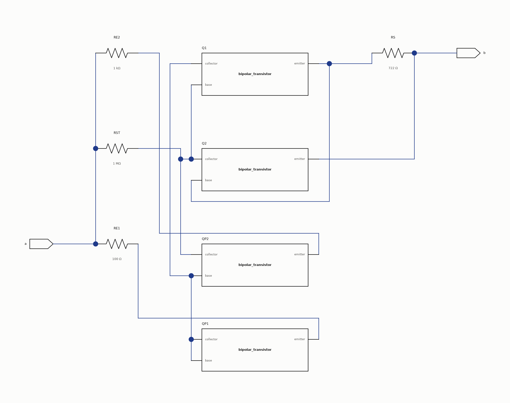
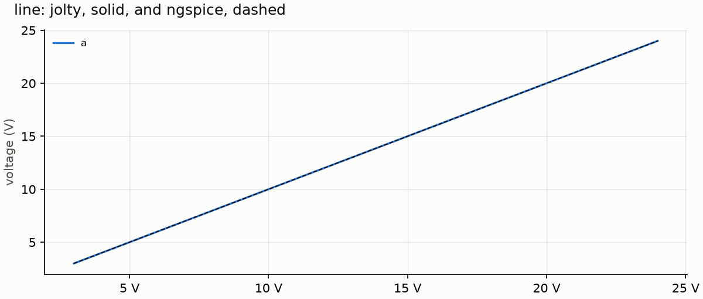

# A two-terminal current source

The best two-terminal 1 mA source found: a limiter fed by a mirror of its current.

Q1 passes the current, and Q2 steals Q1's base drive once the current holds a Vbe across Rs.
A plain limiter feeds Q2 through a resistor from the line, so Q2's current, and its Vbe, follow the line: 17 % over 3 V to 24 V. Here a PNP mirror feeds Q2 a tenth of the source's own current instead, and the line regulation falls to 2.6 %, what the 2N3906's 18.7 V Early voltage leaves.
The current is Vbe/Rs, so it still falls 0.3 %/K with temperature.
Simulate it with `jolty simulate discovery/current_source/design.py`.

[Open in 3D](current-source.view.html#view=X1){ .md-button .md-button--primary } [Script](https://github.com/maxencefaldor/jolty/blob/main/discovery/current_source/design.py){ .md-button } [Every experiment](https://github.com/maxencefaldor/jolty/tree/main/discovery/current_source){ .md-button }

9 devices and 15 unknowns.

## The prompt

> Design a two-terminal current source: two terminals, `a` and `b`, carrying 1 mA from `a` to `b` whenever 3 V to 24 V lie across them.
>
> - The current stays within 1 % of its value at 12 V over that whole range: its line regulation.
> - At 12 V, it stays within 2 % of its value at 27 °C from -40 °C to 85 °C.
> - It takes no supply but the two terminals, and as few parts as it can: 2N3904 and 2N3906 transistors, 1N4148 diodes and resistors, the parts in `examples/common.py`.
>
> Use jolty to find the best design you can.
> Report the design, its line regulation and its drift, and what you learned on the way.

The prompt asks for 1 mA from 3 V to 24 V within 1 %, drifting less than 2 % from -40 °C to 85 °C, from 2N3904s, 2N3906s, 1N4148s and resistors.
No design of ten parts or fewer met both bounds; the best traded line regulation against drift, and jolty showed which device parameter set each limit.

## Method

`candidates.py` writes each topology as a component with its resistors as arguments.
`explore.py` tunes each to 1 mA at 12 V and 27 °C by bisection on its resistor, then measures the line regulation over a DC sweep from 3 V to 24 V and the drift at six temperatures, each from the exact terminal currents jolty reports.
The final design runs through the command line, `jolty simulate discovery/current_source/design.py`, with its corners and the prompt's bound as specs.

## Results

| Design | Parts | Line, 3 V to 24 V | Drift, -40 °C to 85 °C |
| --- | --- | --- | --- |
| A resistor, 12 kΩ | 1 | 100 % | 0 % |
| Two-transistor limiter, Rs = 675 Ω, Rb = 100 kΩ | 4 | 17.3 % | 18.1 % |
| The same, Rb = 1 MΩ | 4 | 74.6 % | 21.4 % |
| ΔVbe cell, one NPN against four, R = 131 Ω | 9 | 56.4 % | 23.7 % |
| Limiter biased by a PNP mirror of its own current, Rs = 722 Ω | 7 | **2.6 %** | 17.7 % |
| Limiter, Rs = 1118 Ω and Rb = 1 MΩ, beside a ΔVbe cell of 260 Ω | 13 | 45.8 % | **0.39 %** |

## What the experiments showed

1. **The limiter's line regulation is Q2's Vbe.**
    Rb feeds Q2's collector from the line, so its current grows thirteenfold from 3 V to 24 V, and its Vbe by Vt·ln 13 = 67 mV, 10 % of the 0.65 V across Rs.
    A larger Rb starves Q1's base at 3 V instead: 75 %.
1. **Feeding Q2 from a mirror of the source's own current removes that term** (`mirrored_limiter`): line regulation 17 % to 2.6 %, for three more parts.
    What remains grows linearly with the voltage, 0.12 %/V, as the 2N3906's Early voltage of 18.7 V predicts for the mirror's output transistor, which takes the line.
1. **Every Vbe/R current falls 0.3 %/K**, 18 % over the range, and every ΔVbe current rises 0.33 %/K, 24 %.
    The ΔVbe cell also takes the line across its PNP mirror's output, 56 %.
1. **A limiter beside a ΔVbe cell cancels their drifts** (`compensated`): retuned to 1 mA, the limiter's falling share and the cell's rising one hold the current within 0.39 % from -40 °C to 85 °C.
    But both take the line, the limiter through its megohm and the cell across its mirror, 46 %, and the pair needs thirteen parts.

## Conclusion

The 1 % and 2 % bounds need both a cascode against the 2N3906's Early effect and a balance of Vbe/R and ΔVbe currents in near-equal shares, as a bandgap balances voltages: roughly a dozen parts.
The best design of seven, `design.py`, holds 2.6 % across the line and fails the drift bound by 16 points, as its specs report at the cold corner.

## Limits

The agent that wrote this prompt also designed the circuit, knowing the textbook answers, and judged the result itself: this is a showcase of what jolty lets an agent see, not a blind result.
Every topology here is in the textbooks: the two-transistor limiter, the PNP mirror, the ΔVbe cell.
The results come from the makers' nominal SPICE models: the spread of Vbe and β between parts, and the self-heating jolty does not yet simulate, would move both the current and its drift in a built circuit.

## Specs

| Requirement | jolty | ngspice | Difference |
| --- | --- | --- | --- |
| V1:current at 3 V in line ≥ -1.02 mA and ≤ -980 µA | -811.395 µA at hot, failed | -811.395 µA at hot, failed | 2.7e-08 |
| V1:current at 12 V in line ≥ -1.02 mA and ≤ -980 µA | -1.17757 mA at cold, failed | -1.17757 mA at cold, failed | 4.5e-10 |
| V1:current at 24 V in line ≥ -1.02 mA and ≤ -980 µA | -1.20143 mA at cold, failed | -1.20143 mA at cold, failed | 1.1e-10 |

## Replicated in ngspice

jolty writes the circuit as a SPICE netlist, ngspice runs every analysis of the plan, and each signal both report is compared, relative to its largest value.
A transient compares each of ngspice's points with jolty's waveform within one of jolty's steps.

| Analysis | Voltages | Largest deviation | Currents | Largest deviation |
| --- | --- | --- | --- | --- |
| `op` | 6 | 3.4e-06 | 1 | 3.2e-06 |
| `line` | 6 | 7.3e-06 | 1 | 6.7e-06 |

## Plots

