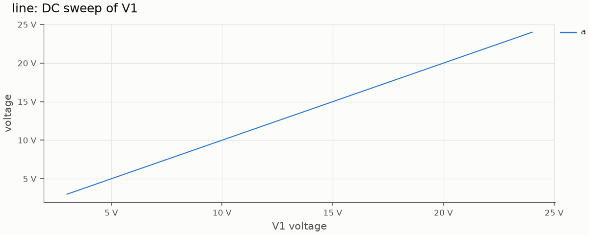

# A two-terminal current source

Mirror-fed two-transistor 1 mA current source.

Transistor Q1 passes the load current while Q2 shunts Q1 base drive once sense resistor Rs drops one Vbe.
Feeding Q2 through a supply resistor causes Q2 current and Vbe to track the line, yielding 17% regulation error across 3 to 24 volts.
Replacing the resistor with a 1:10 PNP mirror lowers line regulation error to 2.6%, limited by the 2N3906 18.7 V Early voltage.
Output current equals Vbe/Rs and still falls at 0.3%/K with temperature.
Simulate via `jolty simulate docs/discovery/current_source/design.py`.

[Open in 3D](current-source.view.html#view=X1){ .md-button .md-button--primary } [Script](https://github.com/maxencefaldor/jolty/blob/main/docs/discovery/current_source/design.py){ .md-button } [Every experiment](https://github.com/maxencefaldor/jolty/tree/main/docs/discovery/current_source){ .md-button }

9 devices and 15 unknowns.

## The prompt

> Design a two-terminal current source across terminals `a` and `b` carrying 1 mA from `a` to `b` for applied voltages from 3 V to 24 V.
>
> - Current stays within 1% of the 12 V value across the full 3 V to 24 V range (line regulation).
> - At 12 V, current stays within 2% of the 27 °C value from -40 °C to 85 °C.
> - The circuit draws no auxiliary supply and uses as few parts as possible from `examples/common.py` (2N3904, 2N3906, 1N4148, and resistors).
>
> Use jolty to find the best design you can.
> Report the design, line regulation, temperature drift, and experimental findings.

The prompt requires 1 mA across 3 V to 24 V within 1%, drifting under 2% from -40 °C to 85 °C, built from 2N3904, 2N3906, 1N4148, and resistors.
No topology with ten parts or fewer satisfied both bounds; the best candidates traded line regulation against temperature drift, and jolty pinpointed the limiting device parameters.

## Method

`candidates.py` defines each topology as a parameterized component accepting resistor values.
`explore.py` tunes each candidate to 1 mA at 12 V and 27 °C via resistor bisection, then measures 3 V to 24 V line regulation and six-point temperature drift from exact terminal currents.
The selected design runs via `jolty simulate docs/discovery/current_source/design.py` with temperature corners and prompt specifications.

## Results

| Design | Parts | Line, 3 V to 24 V | Drift, -40 °C to 85 °C |
| --- | --- | --- | --- |
| Resistor, 12 kΩ | 1 | 100 % | 0 % |
| Two-transistor limiter, Rs = 675 Ω, Rb = 100 kΩ | 4 | 17.3 % | 18.1 % |
| Two-transistor limiter, Rb = 1 MΩ | 4 | 74.6 % | 21.4 % |
| ΔVbe cell, one NPN against four, R = 131 Ω | 9 | 56.4 % | 23.7 % |
| Limiter biased by a self-mirrored PNP current source, Rs = 722 Ω | 7 | **2.6 %** | 17.7 % |
| Limiter (Rs = 1118 Ω, Rb = 1 MΩ) in parallel with a 260 Ω ΔVbe cell | 13 | 45.8 % | **0.39 %** |

## What the experiments showed

1. **Limiter line regulation is governed by Q2 `Vbe`.**
    Rb biases Q2 directly from the terminal voltage, so collector current grows thirteenfold from 3 V to 24 V and `Vbe` rises by `Vt · ln 13 = 67` mV (10% of the 0.65 V across Rs).
    Raising Rb instead starves Q1's base at 3 V, worsening line regulation to 75%.
1. **Self-biasing Q2 through a PNP current mirror (`mirrored_limiter`) removes the Rb term**, cutting line regulation from 17% to 2.6% for three extra parts.
    Remaining line slope (0.12%/V) matches the 2N3906 Early voltage (18.7 V) on the mirror output transistor holding full line voltage.
1. **Every `Vbe/R` current falls 0.3%/K** (18% total), while every `ΔVbe` current rises 0.33%/K (24% total).
    The standalone `ΔVbe` cell also exposes its PNP mirror to the line, yielding 56% line variation.
1. **Combining a limiter and a `ΔVbe` cell in parallel (`compensated`) cancels temperature drift**, holding current within 0.39% from -40 °C to 85 °C after retuning to 1 mA.
    Both subcircuits still absorb full line variation (46% total) and require thirteen parts.

## Conclusion

Meeting both 1% line and 2% drift targets requires cascoding against 2N3906 Early voltage alongside balanced `Vbe/R` and `ΔVbe` currents (roughly a dozen parts).
The best seven-part design (`design.py`) achieves 2.6% line regulation while missing the drift bound by 16 percentage points at the cold corner.

## Limits

The agent that wrote the prompt also designed the circuit using textbook knowledge and judged the output, making this a capability showcase rather than a blind benchmark.
Every evaluated topology comes from standard textbooks: two-transistor limiter, PNP mirror, and `ΔVbe` cell.
Simulations use nominal vendor SPICE models without part-to-part `Vbe`/`β` spread or electrothermal self-heating, both of which shift current and drift in hardware.

## Specs

| Requirement | jolty | ngspice | Difference |
| --- | --- | --- | --- |
| V1:current at 3 V in line ≥ -1.02 mA and ≤ -980 µA | -811.395 µA at hot, failed | -811.395 µA at hot, failed | 2.7e-08 |
| V1:current at 12 V in line ≥ -1.02 mA and ≤ -980 µA | -1.17757 mA at cold, failed | -1.17757 mA at cold, failed | 4.5e-10 |
| V1:current at 24 V in line ≥ -1.02 mA and ≤ -980 µA | -1.20143 mA at cold, failed | -1.20143 mA at cold, failed | 7.9e-11 |

## Replicated in ngspice

jolty writes the circuit as a SPICE netlist, ngspice runs every analysis of the plan, and each signal both report is compared, relative to its largest value.
A transient compares each of ngspice's points with jolty's waveform within one of jolty's steps.

| Analysis | Voltages | Largest deviation | Currents | Largest deviation |
| --- | --- | --- | --- | --- |
| `op` | 6 | 3.4e-06 | 1 | 3.2e-06 |
| `line` | 6 | 7.3e-06 | 1 | 6.7e-06 |

## Plots

