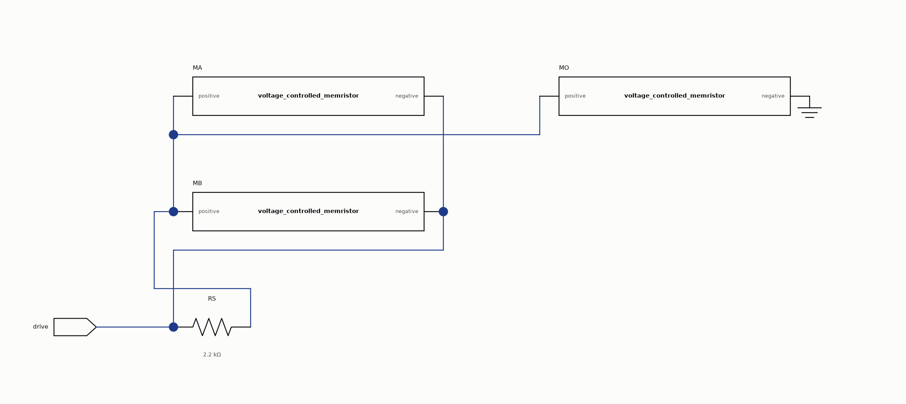
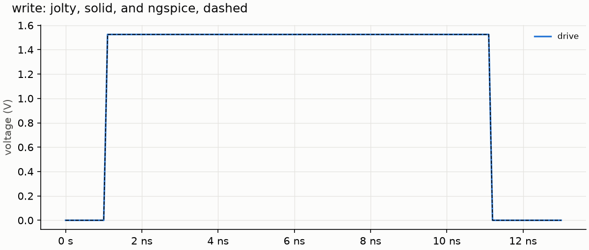
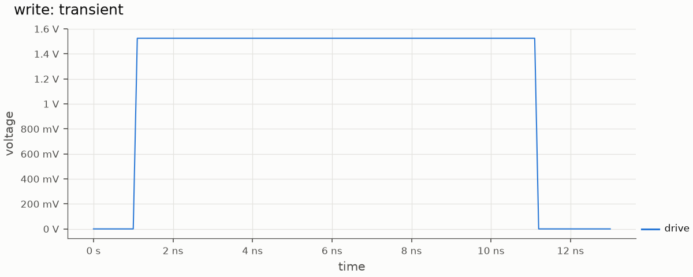

# A NOR gate of three memristors

The best NOR gate of three memristors found: MAGIC's, its inputs shunted by 2.2 kΩ.

MAGIC's gate puts the two inputs in parallel, in series with the output, and turns the output off unless both inputs are off.
With these memristors, whose on threshold is twice their off one, it works only between 1.30 V and 1.32 V: a gate with one input on needs the pulse above twice the output's threshold, and a gate with both inputs off turns them on just above their own.
A resistor across the inputs takes the voltage off both-off inputs while barely changing a gate with one input on, and 2.2 kΩ balances the inputs' turning on against the output's turning off: every input computes NOR from 1.14 V to 1.91 V, ±25 % about 1.525 V. Simulate it with `jolty simulate docs/discovery/memristive_nor/design.py`.

[Open in 3D](memristive-nor.view.html#view=X1){ .md-button .md-button--primary } [Script](https://github.com/maxencefaldor/jolty/blob/main/docs/discovery/memristive_nor/design.py){ .md-button } [Every experiment](https://github.com/maxencefaldor/jolty/tree/main/docs/discovery/memristive_nor){ .md-button }

17 devices and 18 unknowns.

## The prompt

> Compute NOR inside memory, with no transistor: two memristors hold the inputs, a third holds the output, and one voltage pulse writes the output from the inputs.
> A bit is a memristor's state: on, at its low resistance, is 1, and off is 0.
>
> - The memristors are VTEAM's: 1 kΩ on and 100 kΩ off, exponential between; their state moves toward off above 0.5 V and toward on below -1 V, at 2·10⁸ full ranges a second at twice either threshold, growing as the third power of the excess.
> - The output starts at 1.
>   After one pulse of at most 10 ns, it must hold the NOR of the inputs, within 0.1 of a full range, for all four inputs, and neither input may move by more than 0.05.
> - Resistors may be added; nothing else.
> - The gate must work with the pulse's amplitude 10 % above and below its nominal, as a driver's varies.
>
> Use jolty to find a gate that meets this, the widest range of amplitudes it works over, and what bounds that range.

The prompt asks for a NOR gate of three VTEAM memristors and one pulse of at most 10 ns, every output within 0.1 of its NOR and every input within 0.05 of its bit, with the pulse's amplitude 10 % off either way.
MAGIC's gate, the textbook answer, works only between 1.30 V and 1.32 V, ±0.8 %; a 2.2 kΩ resistor across its inputs widens that to 1.14 V to 1.91 V, ±25 %, and meets the prompt.

## Method

`candidates.py` writes MAGIC's NOR gate with its inputs and its output oriented as Kvatinsky et al. give them, and a bench of four gates, one per pair of inputs, written by one pulse.
`explore.py` scans the pulse's amplitude in steps of 10 mV, runs a transient of each, and reads every memristor's state where the pulse has ended; a gate works where every output and input lies within its bound, and what fails a step beyond each end of the range is named.
Beside each range stands the one the thresholds alone allow, before any state moves, from the resistances each gate starts with.

## Results

| Gate | Pulse | Works from | to | Margin | Fails below | Fails above |
| --- | --- | --- | --- | --- | --- | --- |
| MAGIC's | 10 ns | 1.30 V | 1.32 V | ±0.8 % | output of 01 and 10 | inputs of 00 |
| MAGIC's | 100 ns | 1.10 V | 1.16 V | ±2.7 % | output of 01 and 10 | inputs of 00 |
| MAGIC's | 1 µs | 1.03 V | 1.08 V | ±2.4 % | output of 01 and 10 | inputs of 00 |
| Shunted by 20 kΩ | 10 ns | 1.27 V | 1.38 V | ±4.2 % | output of 01 and 10 | inputs of 00 |
| Shunted by 5 kΩ | 10 ns | 1.21 V | 1.57 V | ±12.9 % | output of 01 and 10 | inputs of 00 |
| Shunted by 3 kΩ | 10 ns | 1.17 V | 1.75 V | ±19.9 % | output of 01 and 10 | inputs of 00 |
| Shunted by 2.5 kΩ | 10 ns | 1.15 V | 1.84 V | ±23.1 % | output of 01 and 10 | inputs of 00 |
| **Shunted by 2.2 kΩ** | **10 ns** | **1.14 V** | **1.91 V** | **±25.2 %** | **output of 01 and 10** | **output of 00** |
| Shunted by 2 kΩ | 10 ns | 1.13 V | 1.80 V | ±22.9 % | output of 01 and 10 | output of 00 |
| Shunted by 1.5 kΩ | 10 ns | 1.10 V | 1.52 V | ±16 % | output of 01 and 10 | output of 00 |
| Shunted by 1 kΩ | 10 ns | 1.05 V | 1.24 V | ±8.3 % | output of 01 and 10 | output of 00 |

## What the experiments showed

1. **MAGIC's window is a coincidence of thresholds.**
    A gate with one input on starts as two 1 kΩ resistances in series, so its output turns off only once the pulse passes twice its 0.5 V threshold; a gate with both inputs off starts as 50 kΩ over 1 kΩ, so its inputs take 98 % of the pulse and turn on past 1 V. With these memristors, whose on threshold is twice their off one, the thresholds alone leave 0.995 V to 1.02 V.
1. **Time moves the window but does not open it.**
    In 10 ns the output turns only when driven well past its threshold, its speed growing as the cube of the excess, while inputs barely past theirs move little: the window rises to 1.30 V and 1.32 V. Longer pulses bring it back toward the thresholds' and widen it to ±2.7 % at 100 ns, but no pulse length reaches ±10 %.
1. **A resistor across the inputs separates the two bounds.**
    It takes the voltage off a gate whose inputs are both off, raising the upper bound, while a gate with one input on, already 1 kΩ, barely changes.
    Too small, it leaves so much of the pulse across the output of a gate with both inputs off that the output turns off; too large, the inputs still turn on.
    The thresholds alone balance at 2.1 kΩ, where the inputs' share of the pulse is 2 kΩ; the transients put the best at 2.2 kΩ, where the upper bound passes from the inputs to the output.

## Conclusion

`design.py` is the gate: MAGIC's NOR of three memristors with 2.2 kΩ across its inputs, written by a 10 ns pulse of 1.525 V, working from 1.14 V to 1.91 V, ±25 %.
At 10 % below and above the nominal amplitude, every output ends within 0.002 of its NOR and no input moves by more than 0.006, and ngspice agrees within 1e-4 at each.

## Limits

The agent that wrote this prompt also designed the gate, knowing MAGIC's, and judged the result itself: this is a showcase of what jolty lets an agent see, not a blind result.
The memristors are VTEAM's model with one set of parameters and no spread; a real memristor's thresholds and resistances vary from device to device and from one write to the next, which would narrow the window, and VTEAM's thresholds are sharper than many devices'.
The shunt draws current through every write, and a gate in a crossbar would need it switched out, or shared, which this bench does not model.

## Specs

| Requirement | jolty | ngspice | Difference |
| --- | --- | --- | --- |
| X1/MO:state at 12.5 ns in write ≥ -0.1 and ≤ 0.1 | 0.00109992 at high, passed | - at high, unmeasured | - |
| X1/MA:state at 12.5 ns in write ≥ 0.95 and ≤ 1.05 | 0.994904 at high, passed | - at high, unmeasured | - |
| X1/MB:state at 12.5 ns in write ≥ 0.95 and ≤ 1.05 | 0.994904 at high, passed | - at high, unmeasured | - |
| X2/MO:state at 12.5 ns in write ≥ 0.9 and ≤ 1.1 | 1 at low, passed | - at high, unmeasured | - |
| X2/MA:state at 12.5 ns in write ≥ 0.95 and ≤ 1.05 | 1, passed | - at high, unmeasured | - |
| X2/MB:state at 12.5 ns in write ≥ -0.05 and ≤ 0.05 | 0, passed | - at high, unmeasured | - |
| X3/MO:state at 12.5 ns in write ≥ 0.9 and ≤ 1.1 | 1 at low, passed | - at high, unmeasured | - |
| X3/MA:state at 12.5 ns in write ≥ -0.05 and ≤ 0.05 | 0, passed | - at high, unmeasured | - |
| X3/MB:state at 12.5 ns in write ≥ 0.95 and ≤ 1.05 | 1, passed | - at high, unmeasured | - |
| X4/MO:state at 12.5 ns in write ≥ 0.9 and ≤ 1.1 | 1, passed | - at high, unmeasured | - |
| X4/MA:state at 12.5 ns in write ≥ -0.05 and ≤ 0.05 | 0, passed | - at high, unmeasured | - |
| X4/MB:state at 12.5 ns in write ≥ -0.05 and ≤ 0.05 | 0, passed | - at high, unmeasured | - |

## Replicated in ngspice

jolty writes the circuit as a SPICE netlist, ngspice runs every analysis of the plan, and each signal both report is compared, relative to its largest value.
A transient compares each of ngspice's points with jolty's waveform within one of jolty's steps.

| Analysis | Voltages | Largest deviation | Currents | Largest deviation |
| --- | --- | --- | --- | --- |
| `write` | 5 | 9.3e-06 | 1 | 1.2e-05 |

ngspice could not finish `write` with tolerances as tight as jolty's, so it ran with its own defaults.

ngspice finished `write` at the corner `high` neither with tolerances as tight as jolty's nor with its own defaults, within 300 s, so it judges no spec on them.

## Plots

