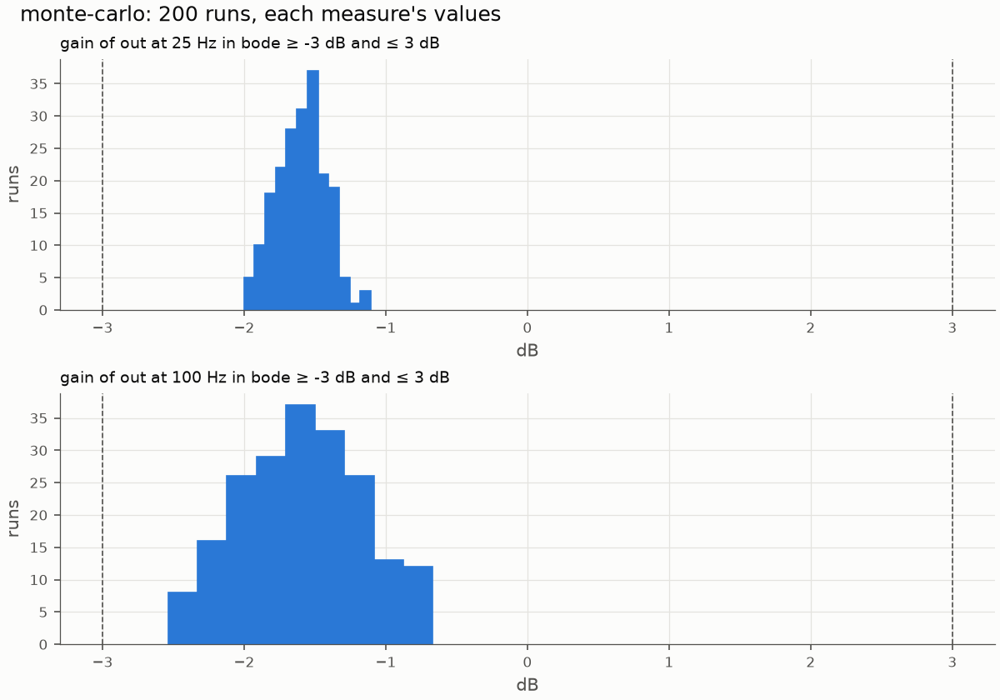
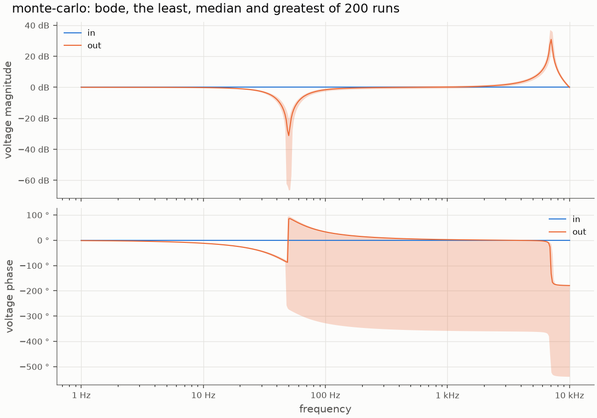

# A notch that survives its tolerances

Tolerance-immune 50 Hz notch filter summing biquad band-pass and low-pass outputs.

A Q = 1 Tow-Thomas biquad generates a band-pass output and an inverted low-pass output exactly 90° apart at every frequency.
Summing both outputs into a virtual ground through a capacitor and resistor adds another 90° shift, forcing exact cancellation where current magnitudes match.
Component tolerances shift notch frequency without making the notch shallow.
Across 200 Monte Carlo samples of 1% resistors and 5% capacitors, every circuit notches deeper than 65 dB between 45 Hz and 55 Hz.
Simulate via `jolty simulate docs/discovery/notch/design.py`.

[Open in 3D](notch.view.html#view=X1){ .md-button .md-button--primary } [Script](https://github.com/maxencefaldor/jolty/blob/main/docs/discovery/notch/design.py){ .md-button } [Every experiment](https://github.com/maxencefaldor/jolty/tree/main/docs/discovery/notch){ .md-button }

18 devices and 18 unknowns.

## The prompt

> Design a filter that removes 50 Hz hum: its notch at least 50 dB deep somewhere between 45 Hz and 55 Hz, and its gain within 3 dB of unity at 25 Hz and 100 Hz.
>
> - Use 1 % resistors and 5 % capacitors, and the op-amps of `examples/common.py`.
> - At least 95 % of the circuits built from those parts must meet the specification.
> - Use as few parts as the yield allows.
>
> Use jolty to find the best design you can, its yield over Monte Carlo samples of its tolerances, and what sets that yield.

The prompt requires a notch at least 50 dB deep between 45 Hz and 55 Hz with passband gain within 3 dB at 25 Hz and 100 Hz on at least 95% of builds using 1% resistors and 5% capacitors.
A phase-cancellation notch achieved 100% yield across 200 Monte Carlo samples (worst-case depth 65.5 dB), whereas the textbook twin-T achieved 0% yield.

## Method

`candidates.py` defines each notch topology with part tolerances, and `explore.py` draws 200 Monte Carlo samples via `jolty.variation` matching `jolty simulate`.
For each sample, `explore.py` evaluates AC responses at 401 points between 45 Hz and 55 Hz plus 25 Hz and 100 Hz, measuring notch depth as the minimum band gain.
No built-in spec measures a minimum over a frequency band, so the exploration script computes band depth directly.

## Results

| Notch | Op-amps | Parts | Nominal depth | Depth over 200 samples | Passband | Yield |
| --- | --- | --- | --- | --- | --- | --- |
| Passive twin-T | 0 | 6 | 326 dB | 39.6 to 60 dB, median 49.7 | 9.3 dB down | 0 % |
| Twin-T bootstrapped to Q = 1 | 2 | 10 | infinite | 27.7 dB and up, median 36.9 | 1.6 dB | 11 % |
| Band-pass and low-pass summed, Q = 0.5 | 4 | 15 | 81.9 dB | 71.5 dB and up, median 76.8 | 4.4 dB | 0 % |
| **Band-pass and low-pass summed, Q = 1** | **4** | **15** | **75.8 dB** | **65.5 dB and up, median 70.8** | **1.6 dB** | **100 %** |

## What the experiments showed

1. **Twin-T notch depth relies on exact component cancellation.**
    Infinite attenuation occurs only when both arms balance exactly; 1% resistors and 5% capacitors reduce median depth to 50 dB, while the passive Q of 1/4 attenuates the passband by 9 dB an octave away.
1. **Raising twin-T Q degrades notch depth further.**
    Bootstrapping the ground leg sharpens the passband to meet 25 Hz and 100 Hz bounds, yet amplifies arm imbalance and drops median depth to 37 dB.
1. **Summing quadrature outputs makes depth insensitive to tolerances.**
    An integrator lags by 90° regardless of component values, so summing a capacitive band-pass path with a resistive inverted low-pass path always cancels at some frequency within ±5%.
    Finite 100 dB op-amp open-loop gain sets the remaining floor: 75.8 dB nominal and 65.5 dB worst case.
1. **Filter Q governs passband width independently of notch depth.**
    Setting Q = 0.5 attenuates 25 Hz and 100 Hz by 4.4 dB, while Q = 1 keeps attenuation at 1.6 dB.

## Conclusion

`design.py` builds the phase-cancellation notch with four op-amps, eight resistors, and three capacitors, achieving 100% yield over 200 samples with at least 65.5 dB depth.
Although a twin-T uses fewer parts, achieving 95% yield at 50 dB depth with 1%/5% parts requires matched components or trimming.

## Limits

The agent that wrote the prompt also designed the circuit using textbook knowledge and judged the output, making this a capability showcase rather than a blind benchmark.
Summing biquad band-pass and low-pass outputs is the textbook state-variable notch; the contribution here is quantifying yield against the twin-T.
Monte Carlo samples vary only resistors and capacitors; the op-amp macromodel omits offset, noise, and parameter spread present in hardware.

## Specs

| Requirement | jolty | ngspice | Difference |
| --- | --- | --- | --- |
| gain of out at 25 Hz in bode ≥ -3 dB and ≤ 3 dB | -1.59743 dB, passed | -1.59743 dB, passed | 7.0e-16 |
| gain of out at 100 Hz in bode ≥ -3 dB and ≤ 3 dB | -1.59581 dB, passed | -1.59581 dB, passed | 2.1e-15 |

## Replicated in ngspice

jolty writes the circuit as a SPICE netlist, ngspice runs every analysis of the plan, and each signal both report is compared, relative to its largest value.
A transient compares each of ngspice's points with jolty's waveform within one of jolty's steps.

| Analysis | Voltages | Largest deviation | Currents | Largest deviation |
| --- | --- | --- | --- | --- |
| `bode` | 13 | 9.4e-12 | 5 | 1.5e-12 |

## Plots

  
