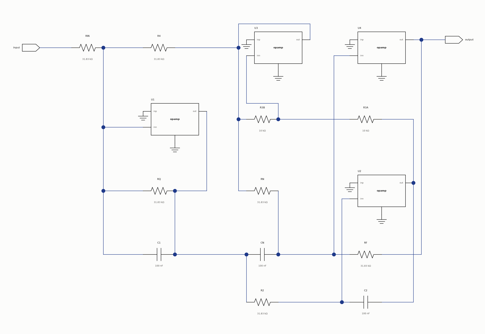
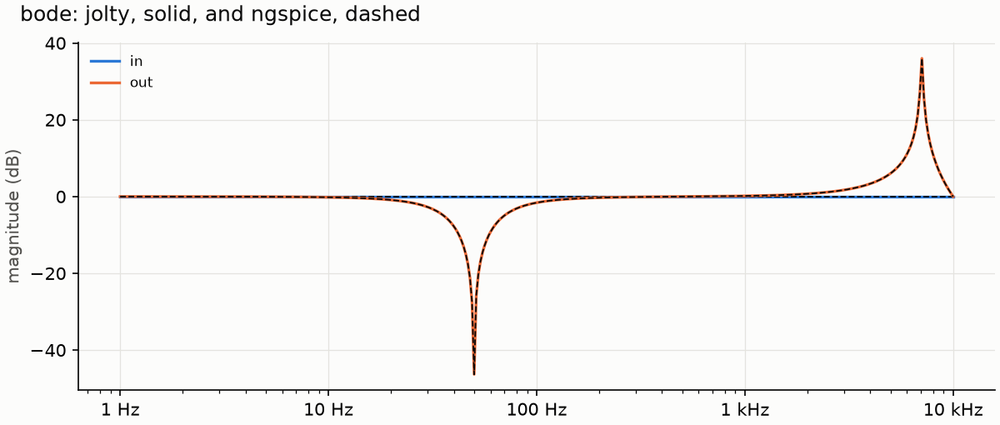
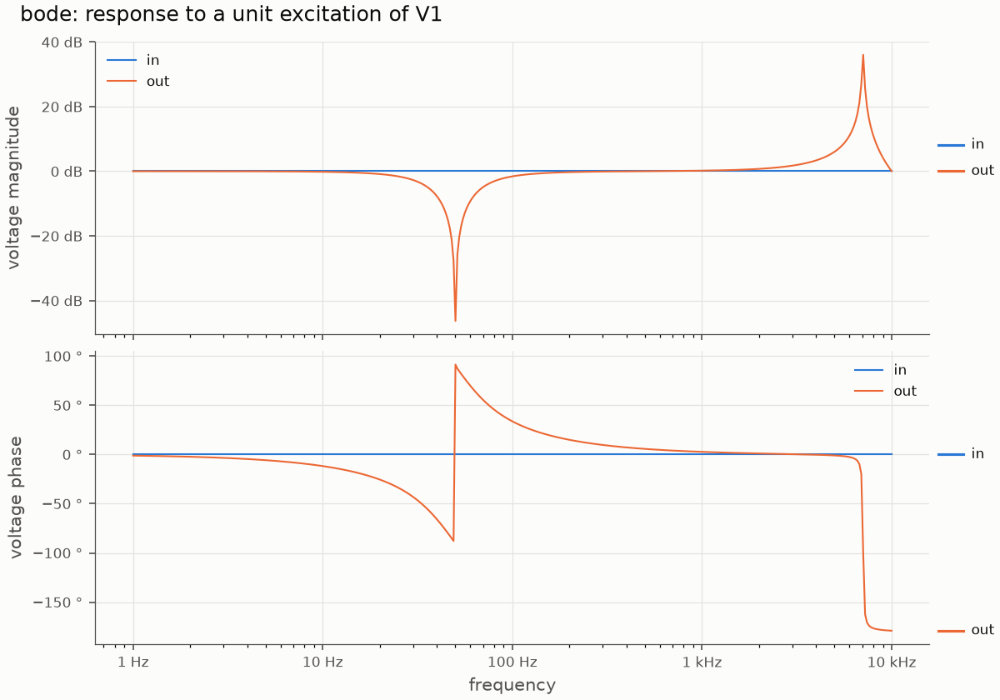

# A notch that survives its tolerances

The best 50 Hz notch found: band-pass and inverted low-pass, summed through C and R.

A Tow-Thomas biquad, Q = 1, gives a band-pass output and, two integrations on, an inverted low-pass output exactly 90° behind it at every frequency.
Summed into a virtual ground through a capacitor and a resistor, which turn them 90° further apart, their currents cancel at the frequency where their magnitudes meet: the parts' values place the notch, but cannot make it shallow.
Over 200 samples of 1 % resistors and 5 % capacitors, every one notches deeper than 65 dB between 45 Hz and 55 Hz.
Simulate it with `jolty simulate discovery/notch/design.py`.

[Open in 3D](notch.view.html#view=X1){ .md-button .md-button--primary } [Script](https://github.com/maxencefaldor/jolty/blob/main/discovery/notch/design.py){ .md-button } [Every experiment](https://github.com/maxencefaldor/jolty/tree/main/discovery/notch){ .md-button }

18 devices, 18 unknowns, simulated in 2.38 s.

## The prompt

> Design a filter that removes 50 Hz hum: its notch at least 50 dB deep somewhere between 45 Hz and 55 Hz, and its gain within 3 dB of unity at 25 Hz and 100 Hz.
>
> - Use 1 % resistors and 5 % capacitors, and the op-amps of `examples/common.py`.
> - At least 95 % of the circuits built from those parts must meet the specification.
> - Use as few parts as the yield allows.
>
> Use jolty to find the best design you can, its yield over Monte Carlo samples of its tolerances, and what sets that yield.

The prompt asks for a notch at least 50 dB deep somewhere between 45 Hz and 55 Hz, a passband within 3 dB at 25 Hz and 100 Hz, from 1 % resistors and 5 % capacitors, on 95 % of the circuits built.
A notch whose depth is set by phase rather than by a balance of values met it on every one of 200 samples, at least 65 dB deep; the twin-T, the textbook notch, met it on none.

## Method

`candidates.py` writes each notch with its parts' tolerances, and `explore.py` draws 200 Monte Carlo samples of them with `jolty.variation`, the same sampling `jolty simulate` uses, runs each sample's frequency response at 401 frequencies from 45 Hz to 55 Hz and at 25 Hz and 100 Hz, and reads the notch's depth as the response's lowest point there.
No spec of jolty measures a response's minimum over a band, so the agent's own code does.

## Results

| Notch | Op-amps | Parts | Nominal depth | Depth over 200 samples | Passband | Yield |
| --- | --- | --- | --- | --- | --- | --- |
| Passive twin-T | 0 | 6 | 326 dB | 39.6 to 60 dB, median 49.7 | 9.3 dB down | 0 % |
| Twin-T bootstrapped to Q = 1 | 2 | 10 | infinite | 27.7 dB and up, median 36.9 | 1.6 dB | 11 % |
| Band-pass and low-pass summed, Q = 0.5 | 4 | 15 | 81.9 dB | 71.5 dB and up, median 76.8 | 4.4 dB | 0 % |
| **Band-pass and low-pass summed, Q = 1** | **4** | **15** | **75.8 dB** | **65.5 dB and up, median 70.8** | **1.6 dB** | **100 %** |

## What the experiments showed

1. **A twin-T's depth is a balance.**
    It is infinite only when its two arms' values match exactly; 1 % and 5 % parts leave the median sample at 50 dB, and the passive network's Q of 1/4 takes 9 dB off the passband an octave away.
1. **Raising the twin-T's Q makes it worse.**
    Bootstrapping its ground leg narrows the notch to pass 25 Hz and 100 Hz, but magnifies the same imbalance: the median falls to 37 dB.
1. **Summing two outputs 90° apart makes the depth a matter of phase.**
    An integrator's output lags its input by exactly 90° whatever its values, so a band-pass output through a capacitor and the inverted low-pass output through a resistor always cancel at some frequency; the tolerances only move it, by up to 5 %.
    What limits the depth is the op-amps' finite gain, 100 dB: 75.8 dB nominal, 65.5 dB at worst.
1. **The Q sets the passband, not the depth.**
    At Q = 0.5 the notch is wide enough to cut 4.4 dB at 25 Hz and 100 Hz; at Q = 1 it cuts 1.6 dB.

## Conclusion

`design.py` is the notch: four op-amps, eight resistors and three capacitors, 100 % yield over 200 samples, and at least 65 dB at its worst.
The twin-T has fewer parts, but no twin-T of 1 % and 5 % parts meets the depth on 95 % of samples; holding a balance takes matched parts, or a trimmer.

## Limits

The agent that wrote this prompt also designed the circuit, knowing the textbook answers, and judged the result itself: this is a showcase of what jolty lets an agent see, not a blind result.
Summing a biquad's band-pass and low-pass outputs is the textbook state-variable notch; what is new here is only the yield measured against the twin-T's.
The Monte Carlo varies the resistors and capacitors; the op-amp macromodel has no offset, noise or spread, which a built notch would add.

## Specs

| Requirement | jolty | ngspice | Difference |
| --- | --- | --- | --- |
| gain of out at 25 Hz in bode ≥ -3 dB and ≤ 3 dB | -1.59743 dB, passed | -1.59743 dB, passed | 2.8e-15 |
| gain of out at 100 Hz in bode ≥ -3 dB and ≤ 3 dB | -1.59581 dB, passed | -1.59581 dB, passed | 0 |

## Replicated in ngspice

jolty writes the circuit as a SPICE netlist, ngspice runs every analysis of the plan, and each signal both report is compared, relative to its largest value.
A transient compares each of ngspice's points with jolty's waveform within one of jolty's steps.

| Analysis | Voltages | Largest deviation | Currents | Largest deviation |
| --- | --- | --- | --- | --- |
| `bode` | 13 | 9.5e-12 | 5 | 1.6e-12 |

## Plots

