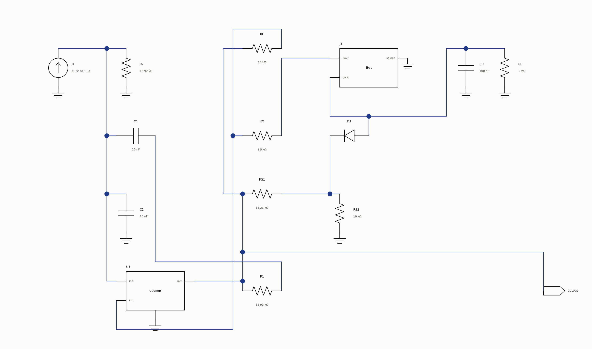
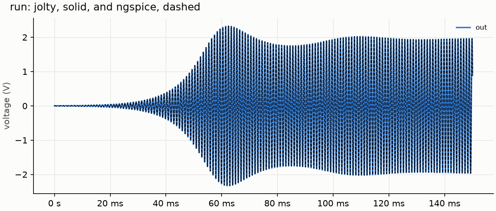
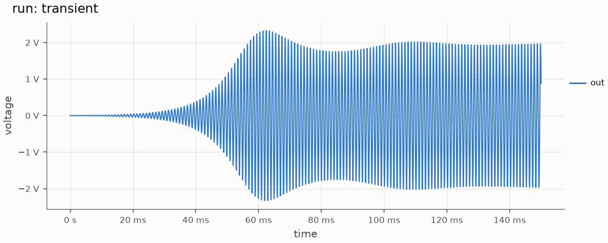

# A clean, steady sine oscillator

The best 1 kHz sine oscillator found: a Wien bridge whose gain a JFET controls.

The JFET's channel sits in the gain leg, and its gate follows the negative peak of 43 % of the output, so a larger swing pinches the channel and lowers the gain to exactly three.
Dividing before the detector scales the JFET's threshold and the diode's drop alike.
It settles within 100 ms to 2.02 V peak at 995.5 Hz with 0.068 % distortion, and drifts +16 % at -40 °C and -11 % at 85 °C, the detector diode's -2 mV/K.
Simulate it with `jolty simulate discovery/sine_oscillator/design.py`.

[Open in 3D](sine-oscillator.view.html#view=X1){ .md-button .md-button--primary } [Script](https://github.com/maxencefaldor/jolty/blob/main/discovery/sine_oscillator/design.py){ .md-button } [Every experiment](https://github.com/maxencefaldor/jolty/tree/main/discovery/sine_oscillator){ .md-button }

18 devices and 13 unknowns.

## The prompt

> Design a 1 kHz sine oscillator around the op-amp of `examples/common.py`.
>
> - Its frequency is within 1 % of 1 kHz.
> - Its amplitude is 2 V peak, within 5 %, and holds within 5 % from -40 °C to 85 °C.
> - Its total harmonic distortion is below 0.5 %.
> - It starts by itself and settles within 100 ms.
>
> Use any of the parts of `examples/common.py`, resistors, capacitors and a 2N5457 JFET, as few as you can.
> Use jolty to find the best design you can, and report what limits it.

The prompt asks for 1 kHz within 1 %, 2 V peak within 5 % over -40 °C to 85 °C, less than 0.5 % distortion, and settling within 100 ms. A JFET-controlled Wien bridge met the frequency, the amplitude at 27 °C, the distortion by a factor of seven and the settling time; no design of the parts allowed met the drift bound, and jolty located why.

## Method

`candidates.py` builds a Wien bridge, 15.9 kΩ and 10 nF in each arm, around the op-amp macromodel, with three amplitude controls.
`explore.py` simulates 150 ms from power-on with 1 µs steps, then reads the frequency from the zero crossings of the last 40 ms, the amplitude from their extremes, and the distortion from the spectrum of the last 40 periods resampled evenly under a Hann window: the root sum of the 2nd to the 10th harmonics over the fundamental.
It runs again at -40 °C and 85 °C for the drift.

## Results

| Amplitude control | Frequency | Amplitude | Distortion | Settled | At -40 °C | At 85 °C |
| --- | --- | --- | --- | --- | --- | --- |
| Two diodes across 10 kΩ of the feedback | 991.8 Hz | 1.59 V | 3.98 % | 10 ms | +51 % | -53 % |
| JFET, gate at half the detector's output, linearized | 995.5 Hz | 7.17 V | 0.18 % | 79 ms | -10 % | +10 % |
| JFET, gate at half the detector's output | 995.5 Hz | 1.13 V | 0.037 % | over 150 ms | | |
| JFET, detector on 45 % of the output, 0.1 µF | 995.5 Hz | 1.93 V | 0.064 % | 98 ms | +15 % | -11 % |
| JFET, detector on 45 % of the output, 0.47 µF | 995.5 Hz | 0.37 V, growing | 0.010 % | over 150 ms | | |
| **JFET, detector on 43 % of the output, 0.1 µF** | **995.5 Hz** | **2.02 V** | **0.068 %** | **99 ms** | **+16 %** | **-11 %** |

## What the experiments showed

1. **Diodes limit hard.**
    They hold the amplitude within a cycle or two, settling in 10 ms, but they clip each peak, 4 % distortion, and their knee moves with temperature, the amplitude by half.
1. **A JFET in the gain leg is a resistor the loop can turn**, and a resistor does not distort: 0.04 % when its gate is steady.
    The distortion that remains is the gate's ripple, the detector recharging once a period, which a larger hold capacitor smooths.
1. **The hold capacitor trades distortion for settling.**
    At 0.47 µF the distortion falls to 0.010 %, but the loop's time constant, the capacitor over its megohm, leaves the amplitude still growing after 150 ms; at 0.1 µF it settles in 99 ms with 0.068 %.
1. **Feeding half the drain's voltage to the gate**, which linearizes a JFET used as a resistor, here shifts its operating point so far that the amplitude settles at 7.2 V, and adds distortion rather than removing it.
1. **Dividing the output before the detector** lets the divider set the amplitude without amplifying the gate's drift, as dividing after it does.
    What still drifts is the detector diode's drop, -2 mV/K: the amplitude follows (|Vgs| + Vd)/k, and the JFET's own drift nearly cancels, so the diode's 0.13 V over the range sets the 27 % swing.
1. **The frequency sits 0.45 % low** in every design: the op-amp's 1 MHz bandwidth adds phase in the loop, which the bridge corrects by moving off f₀.

## Conclusion

`design.py` meets the frequency, the 27 °C amplitude, the distortion with a factor of seven to spare and the settling time, and fails the drift bound at both corners, as its specs report.
Holding 5 % over the range needs the detector's drop out of the loop: a precision rectifier around a second op-amp, or a diode-compensated reference for the gate.

## Limits

The agent that wrote this prompt also designed the circuit, knowing the textbook answers, and judged the result itself: this is a showcase of what jolty lets an agent see, not a blind result.
The JFET-controlled Wien bridge is a classic.
Its distortion comes from nominal models: the resistors' and capacitors' own nonlinearity is not simulated, and the spread of a real 2N5457's pinch-off voltage would move the amplitude it settles at.

## Specs

| Requirement | jolty | ngspice | Difference |
| --- | --- | --- | --- |
| frequency of out from 110 ms in run ≥ 990 Hz and ≤ 1.01 kHz | 995.541 Hz at cold, passed | 995.541 Hz at cold, passed | 1.1e-08 |
| peak-to-peak of out from 110 ms in run ≥ 3.8 V and ≤ 4.2 V | 4.68238 V at cold, failed | 4.68203 V at cold, failed | 7.5e-05 |

## Replicated in ngspice

jolty writes the circuit as a SPICE netlist, ngspice runs every analysis of the plan, and each signal both report is compared, relative to its largest value.
A transient compares each of ngspice's points with jolty's waveform within one of jolty's steps.

A free-running oscillator's phase drifts with the least difference in two engines' numerics, so its waveforms compare through the specs' readings, its period and its swing, rather than point by point.

## Plots

