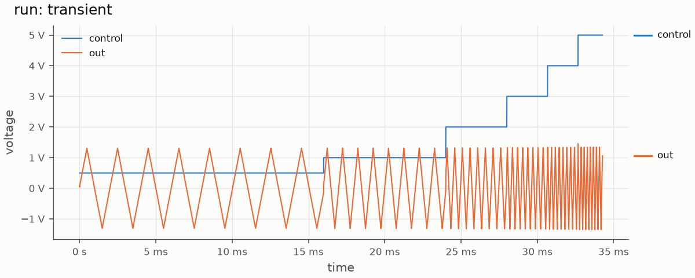

# A linear voltage-controlled oscillator

The best VCO found: an integrator and a Schmitt trigger, their delays cancelled.

A MOSFET reverses the integrator's current, so its channel, a resistance, only scales the current.
A 2.2 nF capacitor across the Schmitt trigger's 10 kΩ feedback hurries its regeneration, which cuts its delay from 6-9 µs to about 2 µs, and 2 kΩ in series with the 1 nF integrating capacitor steps the triangle towards the next threshold by twice its current times 2 kΩ at each reversal, the voltage it would have travelled in 2 µs: a time advance that cancels the delay at every frequency.
Every frequency from 0.5 V to 5 V lies within 0.1 % of 996 Hz/V.
Simulate it with `jolty simulate discovery/vco/design.py`.

[Open in 3D](vco.view.html#view=X1){ .md-button .md-button--primary } [Script](https://github.com/maxencefaldor/jolty/blob/main/discovery/vco/design.py){ .md-button } [Every experiment](https://github.com/maxencefaldor/jolty/tree/main/discovery/vco){ .md-button }

17 devices, 16 unknowns, simulated in 26.44 s.

## The prompt

> Design an oscillator whose frequency is proportional to a control voltage: 1 kHz per volt from 0.5 V to 5 V.
>
> - Each frequency lies within 1 % of the straight line through the origin that fits them best: its linearity.
> - The slope is within 5 % of 1 kHz/V.
> - Use at most two op-amps of `examples/common.py`, its transistors, diodes, resistors and capacitors, as few as you can.
>
> Use jolty to find the best design you can, and report what limits its linearity.

The prompt asks for 1 kHz per volt from 0.5 V to 5 V, every frequency within 1 % of the line through the origin that fits them best, with at most two op-amps.
The textbook integrator and Schmitt trigger missed the linearity by a factor of three; jolty traced the error to the Schmitt trigger's delay, and two parts that cancel it brought every frequency within 0.1 % of 996 Hz/V.

## Method

`candidates.py` writes each VCO as a component of `control`, `output` and `ground`: an integrator whose non-inverting input sits at half the control, fed through R from the control, and a switch that draws twice that current through R/2, reversed by an inverting Schmitt trigger at ±10 % of its ±13 V swing.
A 10 µA pulse at 1 µs starts the oscillation, as noise would.
`explore.py` simulates 16 periods at each control, 4000 steps a period, and reads the frequency over the last 12 from the triangle's rises, then fits the line through the origin.
It also reads the trigger's delay: the time from the triangle crossing the trigger's threshold to the trigger's output crossing zero.

## Results

| Design | Slope | Worst deviation from the line |
| --- | --- | --- |
| 2N3904 switch | 889.7 Hz/V | 3.08 % |
| MOSFET switch | 905.0 Hz/V | 8.05 % |
| MOSFET, 5.8 kΩ in series with the 1 nF capacitor | | stalls from 2 V |
| MOSFET, 100 pF across the trigger's feedback | 935.3 Hz/V | 5.35 % |
| MOSFET, 1 nF across the trigger's feedback | 963.1 Hz/V | 2.93 % |
| MOSFET, 100 pF across the feedback, 1 kΩ in series | | stalls from 4 V |
| MOSFET, 1 nF across the feedback, 2 kΩ in series with the capacitor | 994.1 Hz/V | 0.22 % |
| MOSFET, 2.2 nF across the feedback, 1.5 kΩ in series | 988.5 Hz/V | 0.71 % |
| **MOSFET, 2.2 nF across the feedback, 2 kΩ in series** | **996.1 Hz/V** | **0.096 %** |
| MOSFET, 2.2 nF across the feedback, 2.5 kΩ in series | 1003.7 Hz/V | 0.72 % |

The first six rows read six controls, 0.5 V to 5 V; the last four read nineteen, every 0.25 V.

| Trigger | Delay at 0.5 V | Delay at 5 V |
| --- | --- | --- |
| 10 kΩ feedback alone | 9.06 µs | 5.82 µs |
| 1 nF across it | 2.21 µs | 1.96 µs |
| 2.2 nF across it | 2.27 µs | 1.93 µs |

## What the experiments showed

1. **The error is a delay, not a nonlinearity.**
    Every half period, the triangle overshoots the threshold for as long as the trigger takes to switch, so the period is 4·Vth·C/I plus four delays.
    A fixed delay costs little at 0.5 V, where the period is 2 ms, and 12 % at 5 V, where it is 200 µs: the frequencies bend down from the line as they rise.
1. **The trigger's delay is its regeneration, not its slew.**
    The op-amp slews 13 V/µs, so its output crosses zero 1 µs after it starts; the rest is the time its positive feedback, 10 % of its output, takes to grow from the triangle's slow overdrive.
    The slower the triangle, the smaller the overdrive and the longer the wait: 9.1 µs at 0.5 V, 5.8 µs at 5 V.
1. **A transistor switch hides the delay behind its own error.**
    The 2N3904's saturation voltage, in series with R/2, slows the reversed current most at the lowest control, which bends the low end the other way.
    The two errors partly cancel, 3.1 %; a MOSFET's channel is a resistance, which only scales the current, and leaves the delay alone, 8.1 %.
1. **A resistor in series with the integrating capacitor advances each reversal.**
    The integrator's output steps by twice its current times the resistor, towards the next threshold: the voltage the triangle travels in R·C, a fixed time at every frequency, which cancels a fixed delay.
    5.8 kΩ, the delay at 5 V over 1 nF, should have cancelled it there.
1. **But it can stall the oscillator.**
    Through the MOSFET's channel and that resistor, the trigger's output moves its own inverting input, a negative feedback much stronger than its 10 % positive feedback when the MOSFET sits near its threshold.
    The circuit finds a steady state, its trigger at 0.76 V and its triangle at 76 mV, and holds it from 2 V up.
1. **A capacitor across the trigger's feedback resistor fixes both.**
    At the edges it feeds the whole output back, so the trigger regenerates three times faster, in about 2 µs, and its positive feedback outweighs the resistor's: with 1 nF or more, no control of the nineteen stalled.
    100 pF acts above the op-amp's bandwidth, and with 1 kΩ in series it still stalls at 4 V and 5 V; 2.2 nF holds the delay near 2 µs at every control.
1. **Matching the resistor to the remaining delay** cancels it: 2 kΩ times 1 nF is 2 µs, and every frequency lies within 0.1 % of the line, the step size's own resolution.
    1.5 kΩ leaves the low end high and 2.5 kΩ the high end, 0.7 % either way.

## Conclusion

`design.py` steps its control through 0.5, 1, 2, 3, 4 and 5 V in one transient, and each frequency lands within 0.09 % of 996.1 Hz/V, ten times inside the bound, as ngspice confirms, with two op-amps, a MOSFET, seven resistors and two capacitors.
What limits it now is the delay's remaining dependence on the triangle's slope, 2.27 µs at 0.5 V against 1.93 µs at 5 V, and the time step: with 800 steps a period, the frequency at 5 V reads 0.37 % above its value with 8000.
The slope itself, 0.4 % below 1 kHz/V, is set by R and C and the trigger's thresholds, and so would follow their tolerances in a built circuit.

## Specs

| Requirement | jolty | ngspice | Difference |
| --- | --- | --- | --- |
| frequency of out from 4 ms to 16 ms in run ≥ 493.1 Hz and ≤ 503 Hz | 497.679 Hz, passed | 497.668 Hz, passed | 2.2e-05 |
| frequency of out from 18 ms to 24 ms in run ≥ 986.1 Hz and ≤ 1.006 kHz | 995.229 Hz, passed | 995.131 Hz, passed | 9.9e-05 |
| frequency of out from 25 ms to 28 ms in run ≥ 1.972 kHz and ≤ 2.012 kHz | 1.99049 kHz, passed | 1.99038 kHz, passed | 5.6e-05 |
| frequency of out from 28.67 ms to 30.67 ms in run ≥ 2.958 kHz and ≤ 3.018 kHz | 2.98689 kHz, passed | 2.98673 kHz, passed | 5.5e-05 |
| frequency of out from 31.17 ms to 32.67 ms in run ≥ 3.944 kHz and ≤ 4.024 kHz | 3.98524 kHz, passed | 3.9847 kHz, passed | 1.3e-04 |
| frequency of out from 33.07 ms to 34.27 ms in run ≥ 4.931 kHz and ≤ 5.03 kHz | 4.98484 kHz, passed | 4.98493 kHz, passed | 1.8e-05 |

## Replicated in ngspice

jolty writes the circuit as a SPICE netlist, ngspice runs every analysis of the plan, and each signal both report is compared, relative to its largest value.
A transient compares each of ngspice's points with jolty's waveform within one of jolty's steps.

A free-running oscillator's phase drifts with the least difference in two engines' numerics, so its waveforms compare through the specs' readings, its period and its swing, rather than point by point.

## Plots

