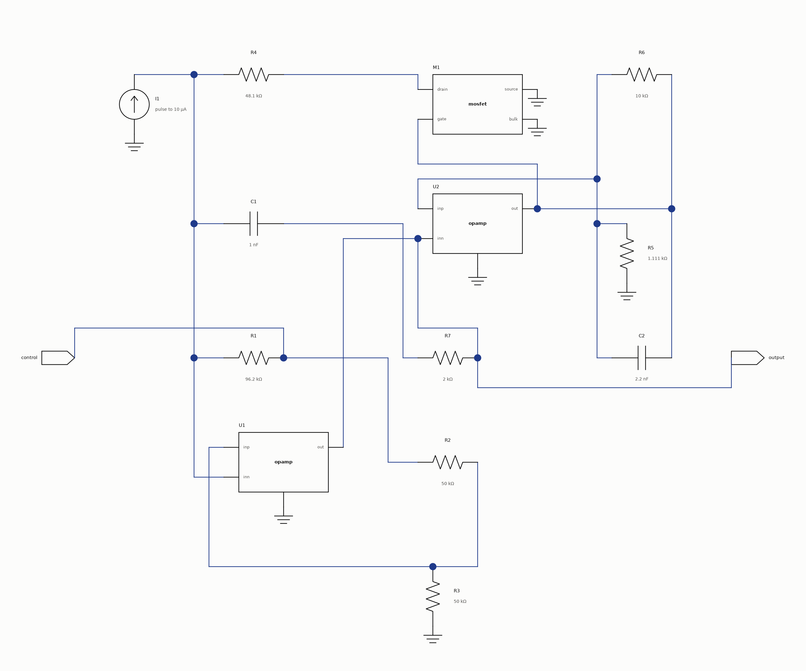
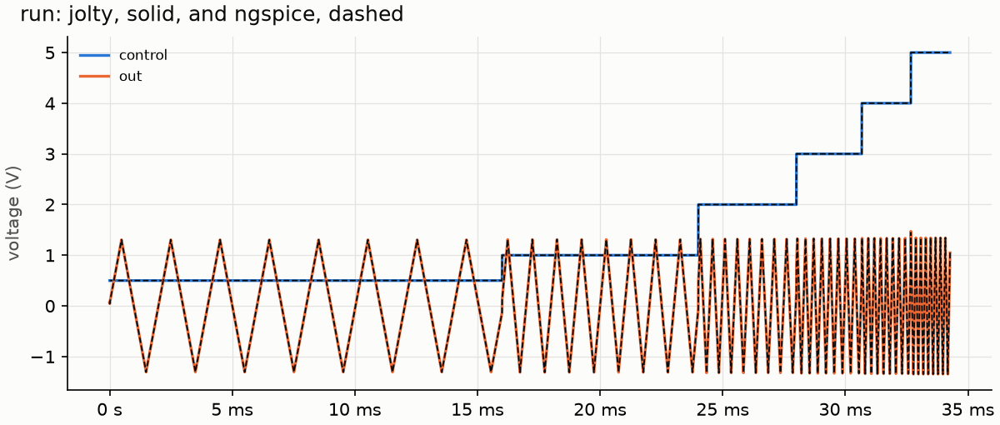

# A linear voltage-controlled oscillator

Delay-compensated MOSFET-switched integrator and Schmitt trigger VCO.

An n-channel MOSFET reverses integrator current with purely resistive channel drop rather than a bipolar saturation offset.
A 2.2 nF speed-up capacitor across the Schmitt trigger 10 kΩ feedback accelerates regeneration, cutting switching delay from 6 to 9 µs down to roughly 2 µs.
A 2 kΩ resistor in series with the 1 nF integrating capacitor steps the triangle at each reversal by 2 µs worth of ramp voltage, canceling delay across frequency.
Every frequency from 0.5 V to 5 V falls within 0.1% of 996 Hz/V.
Simulate via `jolty simulate docs/discovery/vco/design.py`.

[Open in 3D](vco.view.html#view=X1){ .md-button .md-button--primary } [Script](https://github.com/maxencefaldor/jolty/blob/main/docs/discovery/vco/design.py){ .md-button } [Every experiment](https://github.com/maxencefaldor/jolty/tree/main/docs/discovery/vco){ .md-button }

17 devices and 16 unknowns.

## The prompt

> Design an oscillator whose frequency is proportional to a control voltage: 1 kHz per volt from 0.5 V to 5 V.
>
> - Each frequency lies within 1 % of the straight line through the origin that fits them best: its linearity.
> - The slope is within 5 % of 1 kHz/V.
> - Use at most two op-amps of `examples/common.py`, its transistors, diodes, resistors and capacitors, as few as you can.
>
> Use jolty to find the best design you can, and report what limits its linearity.

The prompt requires 1 kHz/V from 0.5 V to 5 V with every frequency within 1% of the best-fit line through the origin, using at most two op-amps.
The textbook integrator plus Schmitt trigger missed linearity by 3×; jolty traced the error to Schmitt trigger regeneration delay, and two compensating parts brought linearity within 0.1% of 996 Hz/V.

## Method

`candidates.py` defines each VCO exposing `control`, `output`, and `ground`: an integrator biased at half `control` fed through `R`, paired with a switch sinking twice that current through `R/2` controlled by a ±10% inverting Schmitt trigger (±13 V rails).
A 10 µA startup pulse at 1 µs initiates oscillation.
`explore.py` simulates 16 periods per control voltage at 4,000 steps per period, extracts frequency from the final 12 rising edges, and fits a line through the origin.
The script also measures trigger delay from triangle threshold crossing to trigger output zero crossing.

## Results

| Design | Slope | Worst deviation from the line |
| --- | --- | --- |
| 2N3904 switch | 889.7 Hz/V | 3.08 % |
| MOSFET switch | 905.0 Hz/V | 8.05 % |
| MOSFET, 5.8 kΩ in series with 1 nF capacitor | | stalls from 2 V |
| MOSFET, 100 pF across trigger feedback | 935.3 Hz/V | 5.35 % |
| MOSFET, 1 nF across trigger feedback | 963.1 Hz/V | 2.93 % |
| MOSFET, 100 pF across feedback, 1 kΩ in series | | stalls from 4 V |
| MOSFET, 1 nF across feedback, 2 kΩ in series with capacitor | 994.1 Hz/V | 0.22 % |
| MOSFET, 2.2 nF across feedback, 1.5 kΩ in series | 988.5 Hz/V | 0.71 % |
| **MOSFET, 2.2 nF across feedback, 2 kΩ in series** | **996.1 Hz/V** | **0.096 %** |
| MOSFET, 2.2 nF across feedback, 2.5 kΩ in series | 1003.7 Hz/V | 0.72 % |

The first six rows sample six control voltages (0.5 V to 5 V), and the last four sample nineteen (every 0.25 V).

| Trigger | Delay at 0.5 V | Delay at 5 V |
| --- | --- | --- |
| 10 kΩ feedback alone | 9.06 µs | 5.82 µs |
| 1 nF across feedback | 2.21 µs | 1.96 µs |
| 2.2 nF across feedback | 2.27 µs | 1.93 µs |

## What the experiments showed

1. **Nonlinearity stems from switching delay rather than analog distortion.**
    Each half-period overshoots the threshold during trigger switching, yielding total period `4·Vth·C/I + 4·td`.
    A constant delay barely perturbs the 2 ms period at 0.5 V yet adds 12% at 5 V (200 µs period), bending high frequencies downward.
1. **Trigger delay is dominated by positive-feedback regeneration rather than slew rate.**
    Slew at 13 V/µs accounts for only 1 µs; the remainder is regeneration time from slow triangle overdrive through the 10% positive-feedback divider.
    Slower triangle slopes provide smaller overdrive and longer waits: 9.1 µs at 0.5 V versus 5.8 µs at 5 V.
1. **A BJT switch partially masks delay error with saturation voltage.**
    2N3904 `Vce(sat)` in series with `R/2` slows low-control discharge most, bending the low end opposite to delay error (3.1% net).
    A resistive MOSFET switch scales current cleanly without `Vce(sat)`, exposing the full 8.1% delay droop.
1. **A resistor in series with the integrating capacitor advances each reversal.**
    Reversing current steps the integrator output by `2·I·R`, subtracting fixed time `R·C` from every half-period regardless of frequency.
    Matching the 5 V delay over 1 nF predicted 5.8 kΩ.
1. **Large series resistance can stall oscillation.**
    Through the MOSFET channel and series resistor, trigger output feeds negative feedback into the inverting input exceeding the 10% positive feedback near threshold.
    The loop locks into a stable equilibrium (trigger at 0.76 V, triangle at 76 mV) above 2 V.
1. **A speed-up capacitor across trigger feedback solves both delay and stalling.**
    Transient edges feed full output swing back immediately, accelerating regeneration 3× to ~2 µs and overcoming negative feedback so zero controls stall at 1 nF or above.
    100 pF acts above op-amp bandwidth and still stalls at 4 V and 5 V with 1 kΩ series resistance, whereas 2.2 nF holds delay near 2 µs across all controls.
1. **Matching the series resistor to the 2 µs delay** (`2 kΩ × 1 nF = 2 µs`) reduces worst-case deviation to 0.096% (at the time-step resolution limit).
    1.5 kΩ leaves the low end high and 2.5 kΩ leaves the high end high (0.7% error either way).

## Conclusion

`design.py` steps control through 0.5, 1, 2, 3, 4, and 5 V in one transient using two op-amps, one MOSFET, seven resistors, and two capacitors.
Every stepped frequency lands within 0.09% of 996.1 Hz/V, achieving 10× spec margin with ngspice confirmation.
Residual limits are slope-dependent trigger delay (2.27 µs at 0.5 V vs 1.93 µs at 5 V) and numerical step size (800 steps/period reads 0.37% higher at 5 V than 8,000 steps/period).
Nominal slope (-0.4% from 1 kHz/V) depends on R, C, and trigger thresholds and would track component tolerances in hardware.

## Limits

The agent that wrote the prompt also designed the circuit using textbook knowledge and judged the output, making this a capability showcase rather than a blind benchmark.
Both techniques (Schmitt feedback speed-up capacitance and integrator series lead resistance) are standard design remedies.
The 2 µs delay reflects the op-amp macromodel, so real comparators require retuning; offsets, non-Meyer MOSFET charge injection, and capacitor tolerances are unmodeled, making 0.09% a simulated figure.

## Specs

| Requirement | jolty | ngspice | Difference |
| --- | --- | --- | --- |
| frequency of out from 4 ms to 16 ms in run ≥ 493.1 Hz and ≤ 503 Hz | 497.679 Hz, passed | 497.668 Hz, passed | 2.2e-05 |
| frequency of out from 18 ms to 24 ms in run ≥ 986.1 Hz and ≤ 1.006 kHz | 995.08 Hz, passed | 995.139 Hz, passed | 5.9e-05 |
| frequency of out from 25 ms to 28 ms in run ≥ 1.972 kHz and ≤ 2.012 kHz | 1.99065 kHz, passed | 1.99037 kHz, passed | 1.5e-04 |
| frequency of out from 28.67 ms to 30.67 ms in run ≥ 2.958 kHz and ≤ 3.018 kHz | 2.9864 kHz, passed | 2.98676 kHz, passed | 1.2e-04 |
| frequency of out from 31.17 ms to 32.67 ms in run ≥ 3.944 kHz and ≤ 4.024 kHz | 3.98548 kHz, passed | 3.98473 kHz, passed | 1.9e-04 |
| frequency of out from 33.07 ms to 34.27 ms in run ≥ 4.931 kHz and ≤ 5.03 kHz | 4.98699 kHz, passed | 4.98491 kHz, passed | 4.2e-04 |

## Replicated in ngspice

jolty writes the circuit as a SPICE netlist, ngspice runs every analysis of the plan, and each signal both report is compared, relative to its largest value.
A transient compares each of ngspice's points with jolty's waveform within one of jolty's steps.

A free-running oscillator's phase drifts with the least difference in two engines' numerics, so its waveforms compare through the specs' readings, its period and its swing, rather than point by point.

## Plots

