# Gallery

30 circuits, each built and simulated by one command from [`examples/`](https://github.com/maxencefaldor/jolty/tree/main/examples), its schematic and plots drawn by jolty.
Each example states its specs, from closed-form behavior: a cutoff, a period, a code, a truth table.
Every example without logic devices runs again in ngspice from the netlist jolty writes, and its page compares the two engines signal by signal.
Each opens in a 3D viewer, to orbit the circuit and scrub through its simulation, every device's state at every point.

## Filters

Passive and active filters, their responses in closed form.

-   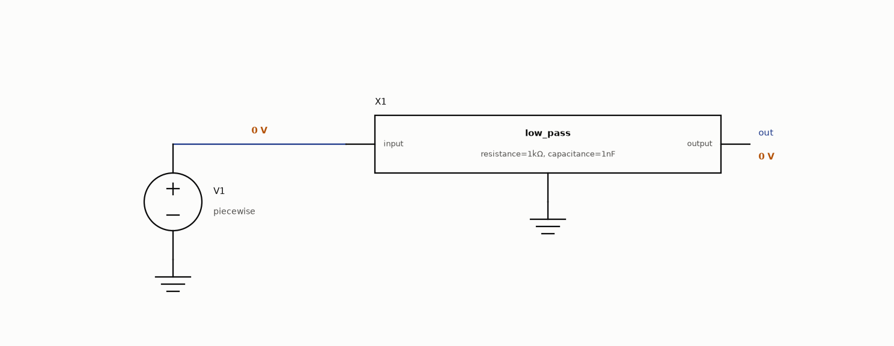

    **[RC low-pass filter](gallery/rc-filter.md)** · 4/4 specs · ngspice within 9.0e-16

    A first-order RC low-pass filter: its step response and its frequency response.

    [Open in 3D](gallery/rc-filter.html) · [Script](https://github.com/maxencefaldor/jolty/blob/main/examples/rc_filter.py)

-   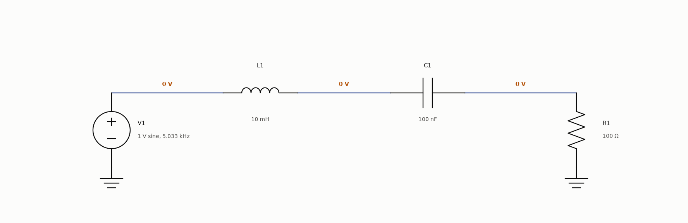

    **[Series RLC band-pass](gallery/rlc-bandpass.md)** · 3/3 specs · ngspice within 5.4e-04

    A series RLC band-pass filter, its output across the resistor.

    [Open in 3D](gallery/rlc-bandpass.html) · [Script](https://github.com/maxencefaldor/jolty/blob/main/examples/rlc_bandpass.py)

-   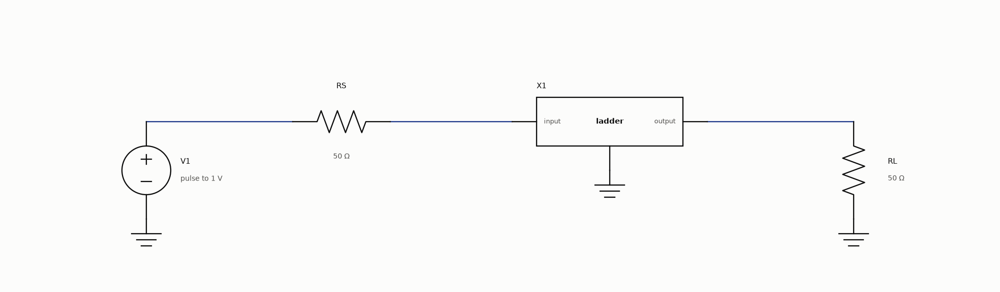

    **[Fifth-order Butterworth ladder](gallery/butterworth-ladder.md)** · 5/5 specs · ngspice within 2.2e-09

    A fifth-order Butterworth low-pass filter: an LC ladder between two 50 Ω ends.

    [Open in 3D](gallery/butterworth-ladder.html) · [Script](https://github.com/maxencefaldor/jolty/blob/main/examples/butterworth_ladder.py)

-   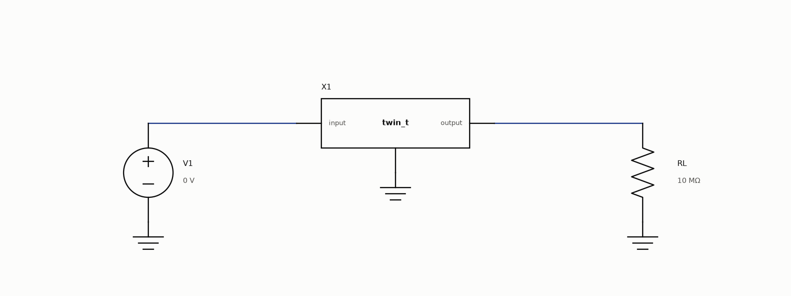

    **[Twin-T notch](gallery/twin-t-notch.md)** · 2/2 specs · ngspice within 5.3e-15

    A twin-T notch filter: two T networks in parallel that cancel at one frequency.

    [Open in 3D](gallery/twin-t-notch.html) · [Script](https://github.com/maxencefaldor/jolty/blob/main/examples/twin_t_notch.py)

-   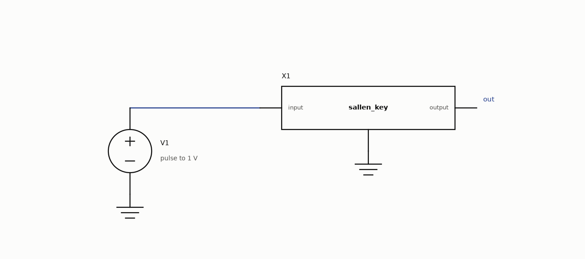

    **[Sallen-Key low-pass](gallery/sallen-key.md)** · 4/4 specs · ngspice within 2.3e-08

    A unity-gain Sallen-Key low-pass filter: the second-order Butterworth response.

    [Open in 3D](gallery/sallen-key.html) · [Script](https://github.com/maxencefaldor/jolty/blob/main/examples/sallen_key.py)

## Amplifiers and references

Transistors and op-amps, biased and amplifying.

-   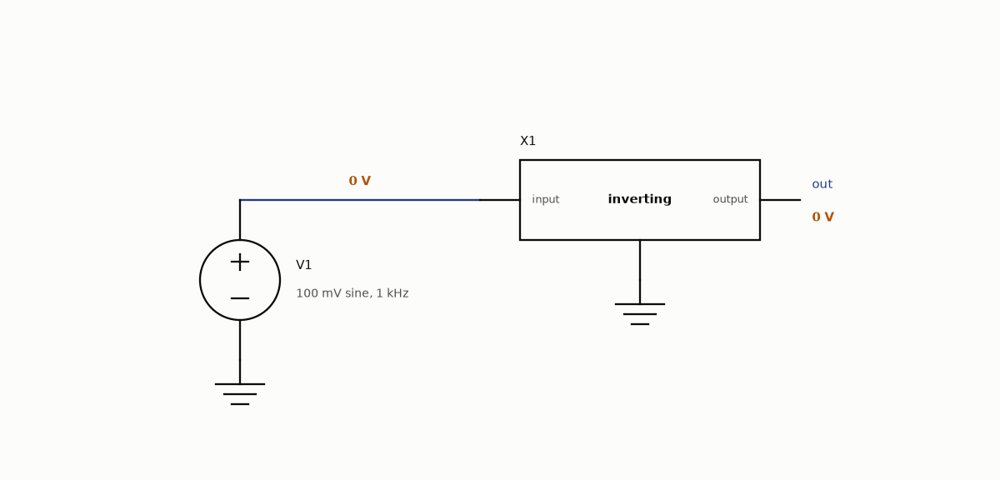

    **[Inverting amplifier](gallery/inverting-amplifier.md)** · 3/3 specs · ngspice within 1.2e-04

    An inverting amplifier: a gain of -10 set by two resistors around an op-amp.

    [Open in 3D](gallery/inverting-amplifier.html) · [Script](https://github.com/maxencefaldor/jolty/blob/main/examples/inverting_amplifier.py)

-   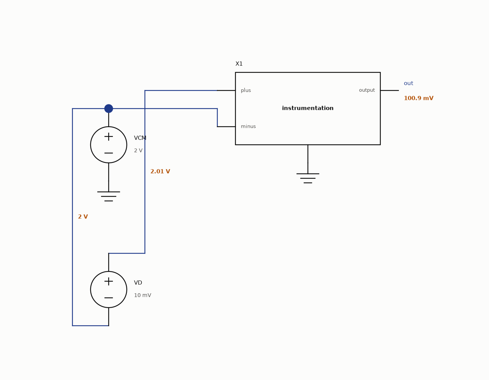

    **[Instrumentation amplifier](gallery/instrumentation-amplifier.md)** · 4/4 specs · ngspice within 2.5e-13

    A three-op-amp instrumentation amplifier: a gain of 10.09 that rejects common mode.

    [Open in 3D](gallery/instrumentation-amplifier.html) · [Script](https://github.com/maxencefaldor/jolty/blob/main/examples/instrumentation_amplifier.py)

-   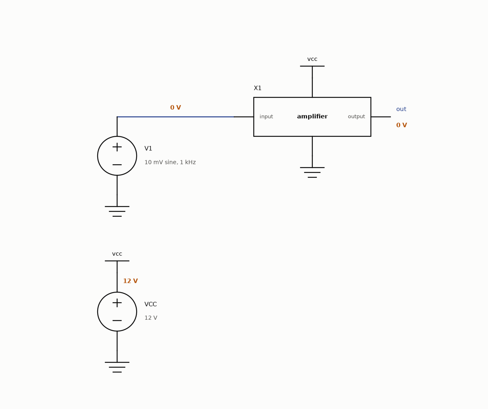

    **[Common-emitter amplifier](gallery/common-emitter.md)** · 2/2 specs · ngspice within 8.5e-05

    A common-emitter amplifier: a 2N3904 biased by a divider, its emitter degenerated.

    [Open in 3D](gallery/common-emitter.html) · [Script](https://github.com/maxencefaldor/jolty/blob/main/examples/common_emitter.py)

-   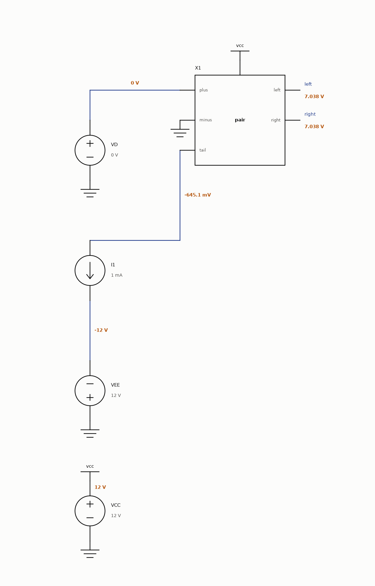

    **[Long-tailed pair](gallery/differential-pair.md)** · 3/3 specs · ngspice within 3.1e-07

    A long-tailed pair: two 2N3904s sharing a 1 mA tail, steering it between them.

    [Open in 3D](gallery/differential-pair.html) · [Script](https://github.com/maxencefaldor/jolty/blob/main/examples/differential_pair.py)

-   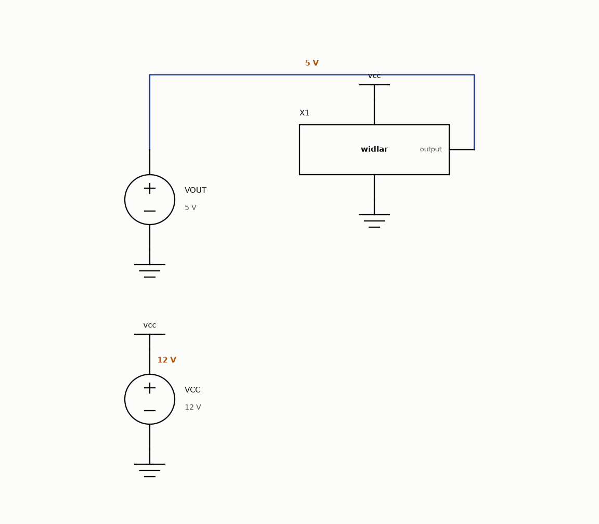

    **[Widlar current source](gallery/widlar-source.md)** · 3/3 specs · ngspice within 2.0e-07

    A Widlar current source: a small output current from a large reference.

    [Open in 3D](gallery/widlar-source.html) · [Script](https://github.com/maxencefaldor/jolty/blob/main/examples/widlar_source.py)

-   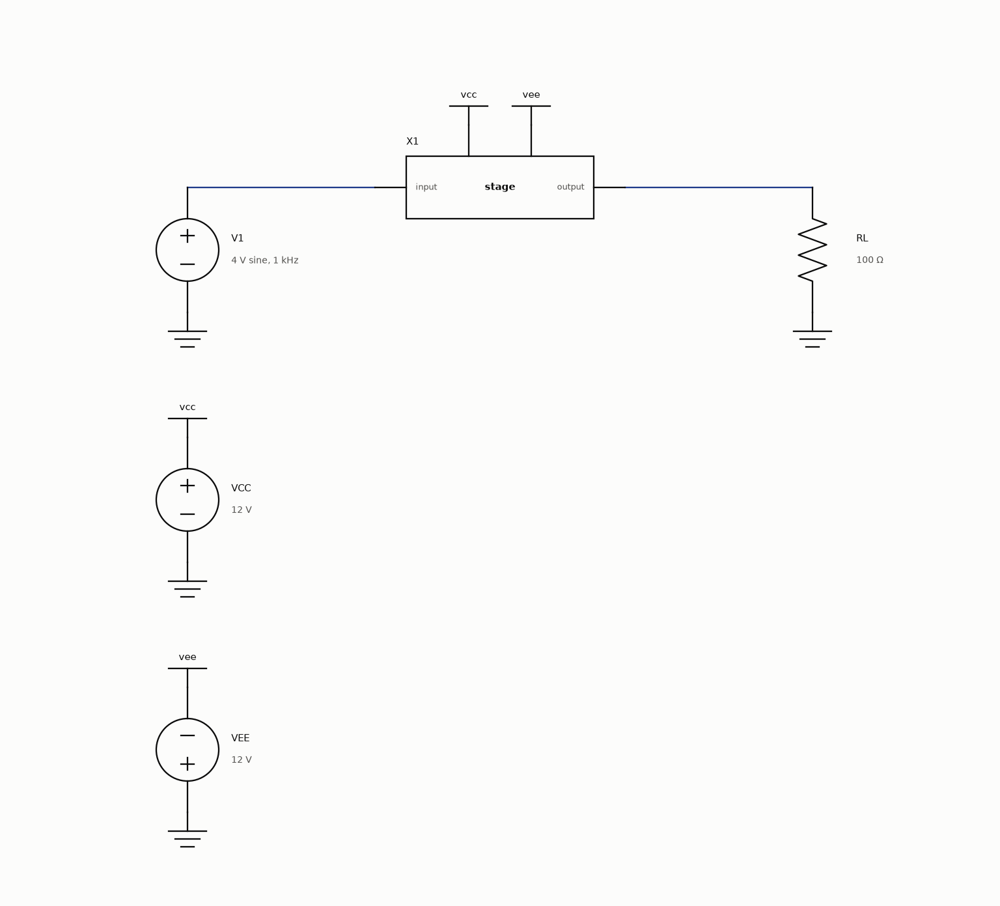

    **[Class AB push-pull stage](gallery/push-pull.md)** · 4/4 specs · ngspice within 1.8e-05

    A class AB push-pull output stage: complementary followers, biased past crossover.

    [Open in 3D](gallery/push-pull.html) · [Script](https://github.com/maxencefaldor/jolty/blob/main/examples/push_pull.py)

-   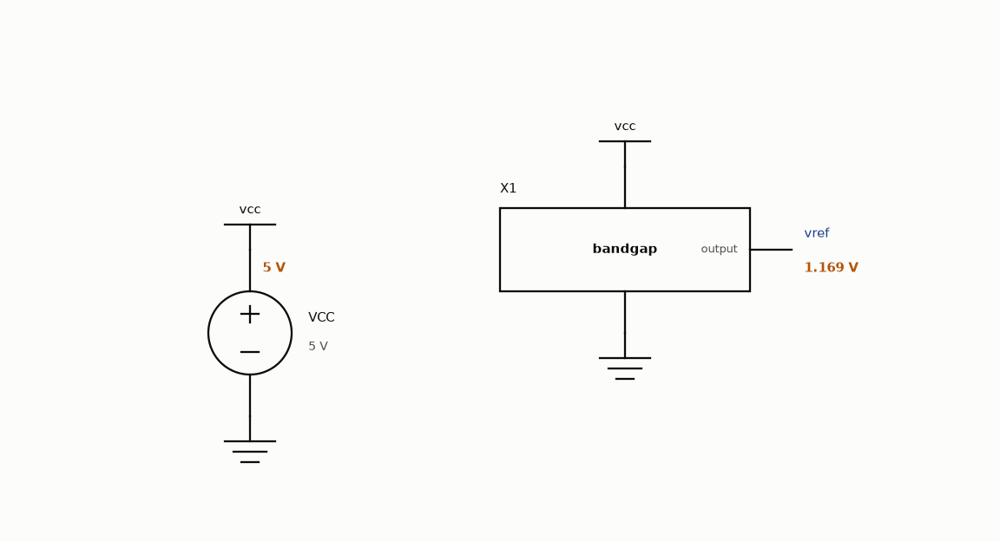

    **[Bandgap reference](gallery/bandgap-reference.md)** · 1/1 specs · ngspice within 1.7e-08

    A bandgap voltage reference: two transistors' base-emitter voltages cancelling drift.

    [Open in 3D](gallery/bandgap-reference.html) · [Script](https://github.com/maxencefaldor/jolty/blob/main/examples/bandgap_reference.py)

## Oscillators

Circuits with no stable state, running at the rate they set.

-   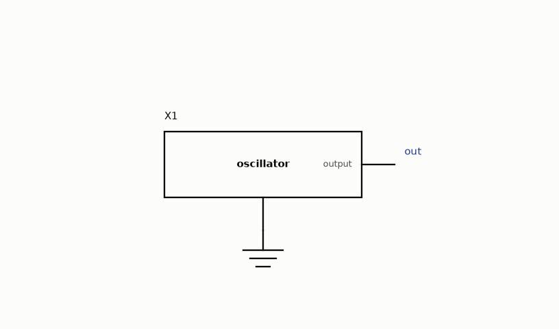

    **[Wien bridge oscillator](gallery/wien-bridge.md)** · 2/2 specs · ngspice agrees on its specs

    A Wien bridge oscillator, its amplitude held by two diodes.

    [Open in 3D](gallery/wien-bridge.html) · [Script](https://github.com/maxencefaldor/jolty/blob/main/examples/wien_bridge.py)

-   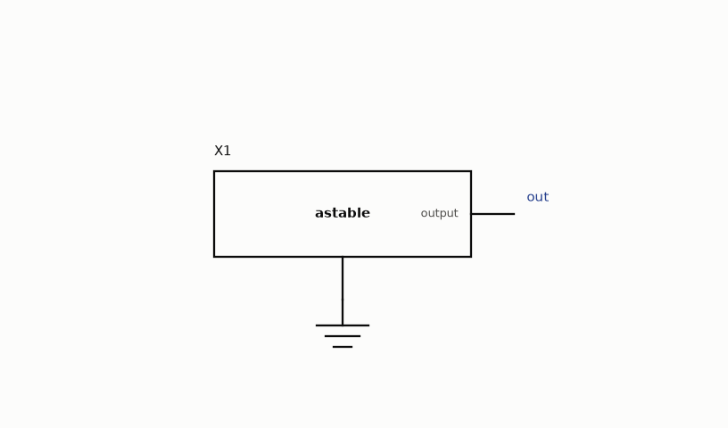

    **[Op-amp relaxation oscillator](gallery/relaxation-oscillator.md)** · 3/3 specs · ngspice agrees on its specs

    An op-amp relaxation oscillator: a Schmitt trigger timing itself through an RC.

    [Open in 3D](gallery/relaxation-oscillator.html) · [Script](https://github.com/maxencefaldor/jolty/blob/main/examples/relaxation_oscillator.py)

-   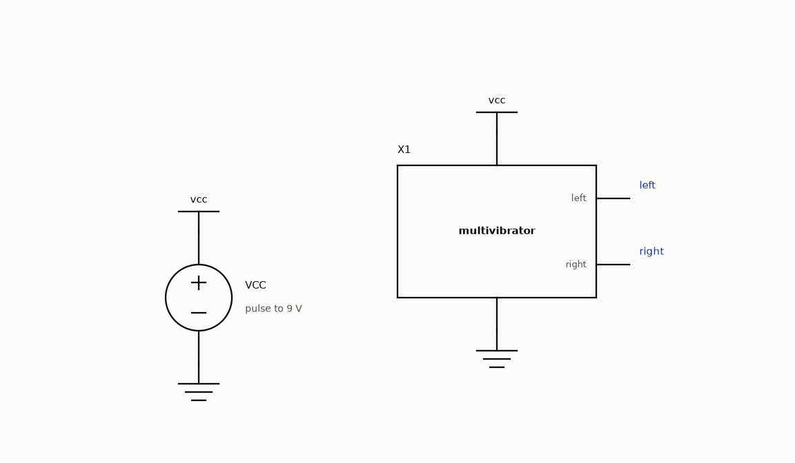

    **[Astable multivibrator](gallery/astable-multivibrator.md)** · 3/3 specs · ngspice agrees on its specs

    The astable multivibrator: two cross-coupled 2N3904s flipping each other in turn.

    [Open in 3D](gallery/astable-multivibrator.html) · [Script](https://github.com/maxencefaldor/jolty/blob/main/examples/astable_multivibrator.py)

-   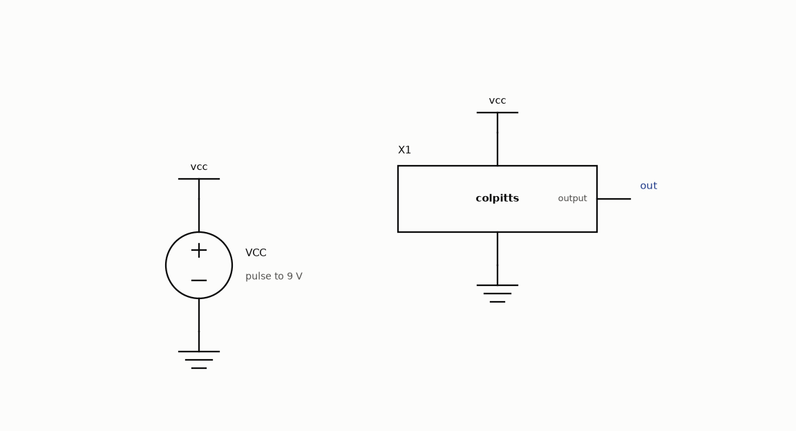

    **[Colpitts oscillator](gallery/colpitts-oscillator.md)** · 2/2 specs · ngspice agrees on its specs

    A Colpitts oscillator: a 2N3904 in common base, its tank a coil and two capacitors.

    [Open in 3D](gallery/colpitts-oscillator.html) · [Script](https://github.com/maxencefaldor/jolty/blob/main/examples/colpitts_oscillator.py)

-   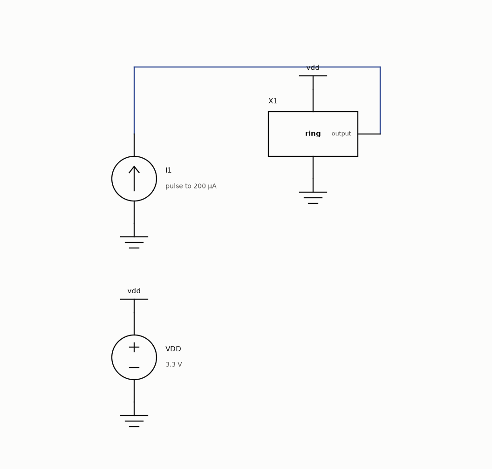

    **[CMOS ring oscillator](gallery/ring-oscillator.md)** · 2/2 specs · ngspice agrees on its specs

    A ring oscillator of five CMOS inverters, transistor by transistor.

    [Open in 3D](gallery/ring-oscillator.html) · [Script](https://github.com/maxencefaldor/jolty/blob/main/examples/ring_oscillator.py)

-   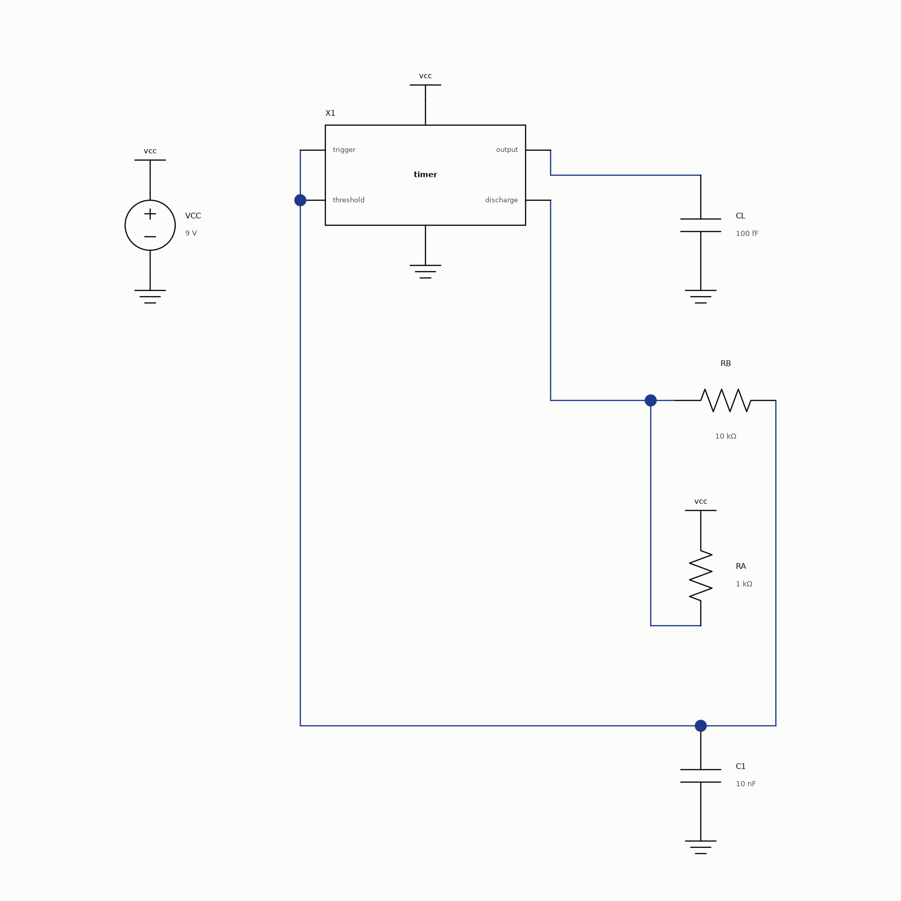

    **[555 timer, astable](gallery/timer-555.md)** · 2/2 specs

    The 555 timer, built from its block diagram, running astable.

    [Open in 3D](gallery/timer-555.html) · [Script](https://github.com/maxencefaldor/jolty/blob/main/examples/timer_555.py)

## Power

Rectifiers, regulators and switching converters.

-   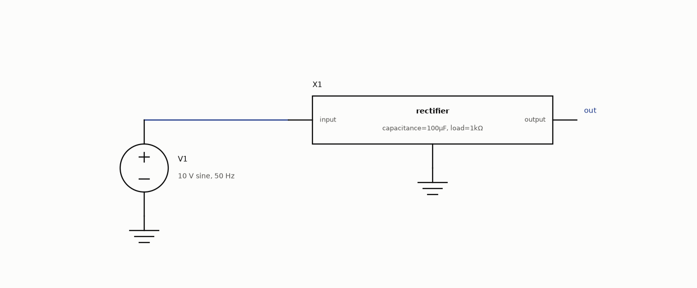

    **[Half-wave rectifier](gallery/rectifier.md)** · 0/0 specs · ngspice within 2.6e-05

    A half-wave rectifier: a diode charging a smoothing capacitor from a 50 Hz sine.

    [Open in 3D](gallery/rectifier.html) · [Script](https://github.com/maxencefaldor/jolty/blob/main/examples/rectifier.py)

-   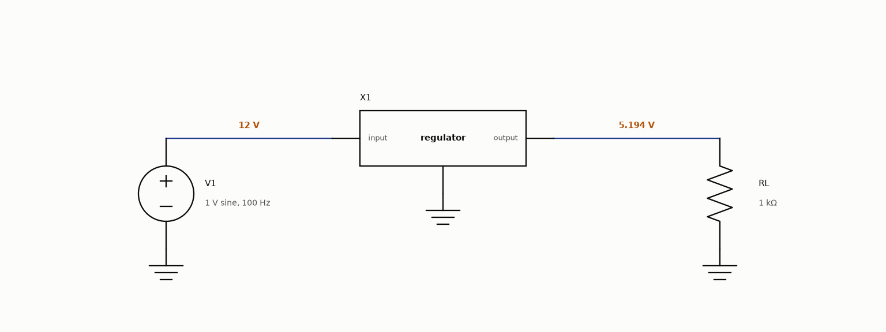

    **[Zener shunt regulator](gallery/zener-regulator.md)** · 4/4 specs · ngspice within 1.3e-06

    A zener shunt regulator: a 5.1 V zener holding a load's supply against its input.

    [Open in 3D](gallery/zener-regulator.html) · [Script](https://github.com/maxencefaldor/jolty/blob/main/examples/zener_regulator.py)

-   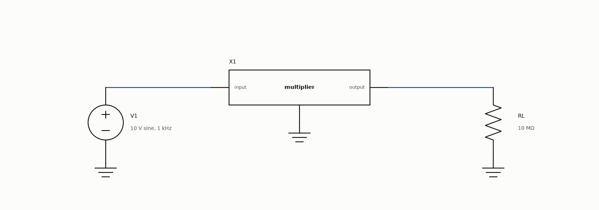

    **[Cockcroft-Walton multiplier](gallery/voltage-multiplier.md)** · 1/1 specs · ngspice within 6.5e-04

    A three-stage Cockcroft-Walton multiplier: six diodes and six capacitors.

    [Open in 3D](gallery/voltage-multiplier.html) · [Script](https://github.com/maxencefaldor/jolty/blob/main/examples/voltage_multiplier.py)

-   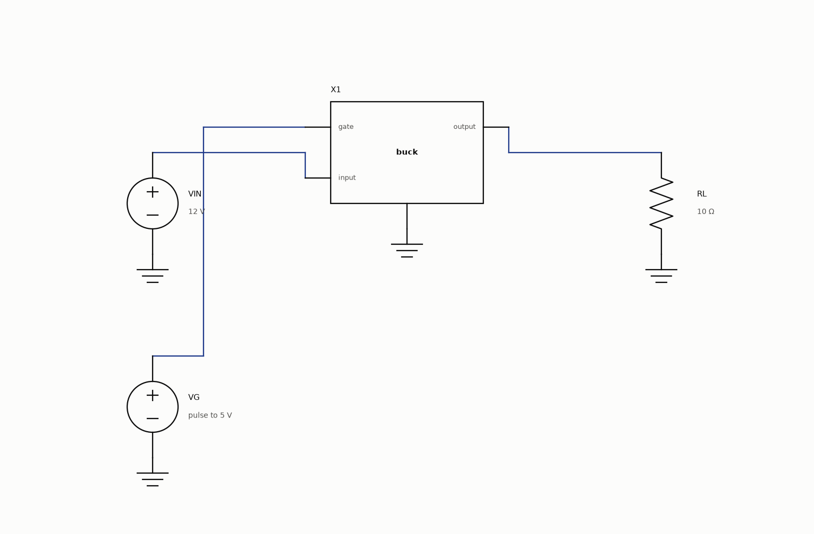

    **[Buck converter](gallery/buck-converter.md)** · 3/3 specs · ngspice within 5.0e-04

    A buck converter: a switch, a diode and an LC filter stepping 12 V down to 6 V.

    [Open in 3D](gallery/buck-converter.html) · [Script](https://github.com/maxencefaldor/jolty/blob/main/examples/buck_converter.py)

-   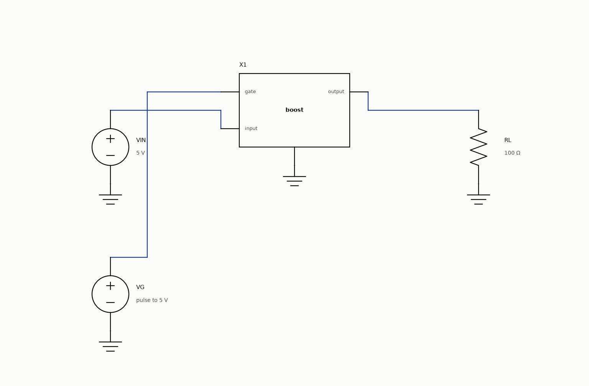

    **[Boost converter](gallery/boost-converter.md)** · 1/1 specs · ngspice within 5.9e-04

    A boost converter: an inductor charged by a switch and dumped through a diode.

    [Open in 3D](gallery/boost-converter.html) · [Script](https://github.com/maxencefaldor/jolty/blob/main/examples/boost_converter.py)

## Digital and mixed-signal

CMOS at transistor level, and logic at event speed beside analog circuits.

-   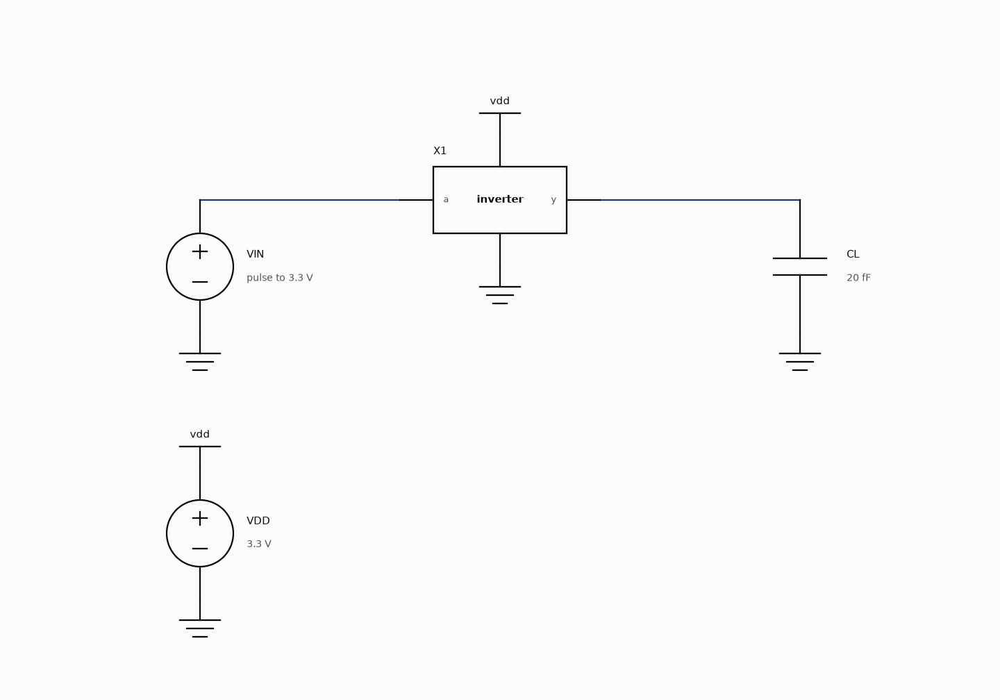

    **[CMOS inverter](gallery/cmos-inverter.md)** · 3/3 specs · ngspice within 4.5e-04

    The CMOS inverter: its transfer curve, its switching threshold, its edges.

    [Open in 3D](gallery/cmos-inverter.html) · [Script](https://github.com/maxencefaldor/jolty/blob/main/examples/cmos_inverter.py)

-   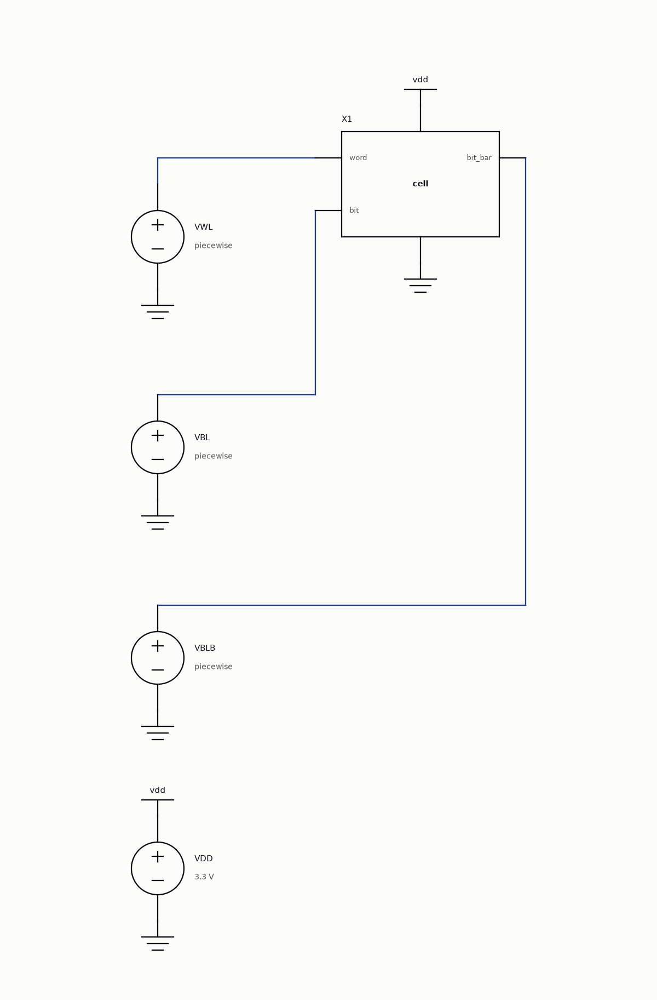

    **[Six-transistor SRAM cell](gallery/sram-cell.md)** · 4/4 specs · ngspice within 3.5e-04

    A six-transistor SRAM cell: two cross-coupled inverters and two access transistors.

    [Open in 3D](gallery/sram-cell.html) · [Script](https://github.com/maxencefaldor/jolty/blob/main/examples/sram_cell.py)

-   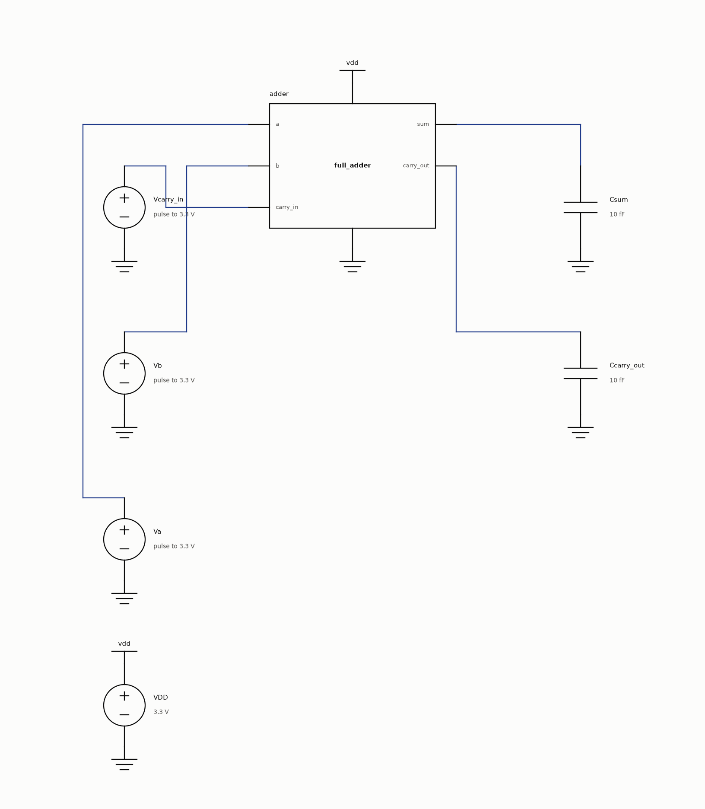

    **[Full adder of NAND gates](gallery/full-adder.md)** · 0/0 specs

    A full adder of nine CMOS NAND gates, each gate four transistors.

    [Open in 3D](gallery/full-adder.html) · [Script](https://github.com/maxencefaldor/jolty/blob/main/examples/full_adder.py)

-   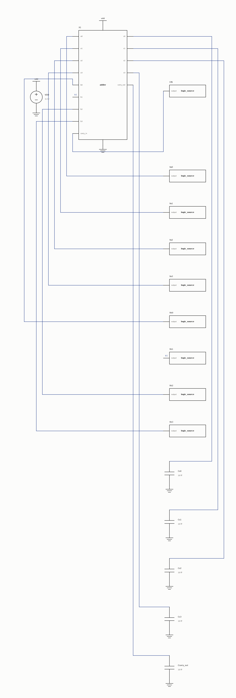

    **[Four-bit ripple-carry adder](gallery/ripple-adder.md)** · 20/20 specs

    A four-bit ripple-carry adder of logic gates, adding pairs of numbers in turn.

    [Open in 3D](gallery/ripple-adder.html) · [Script](https://github.com/maxencefaldor/jolty/blob/main/examples/ripple_adder.py)

-   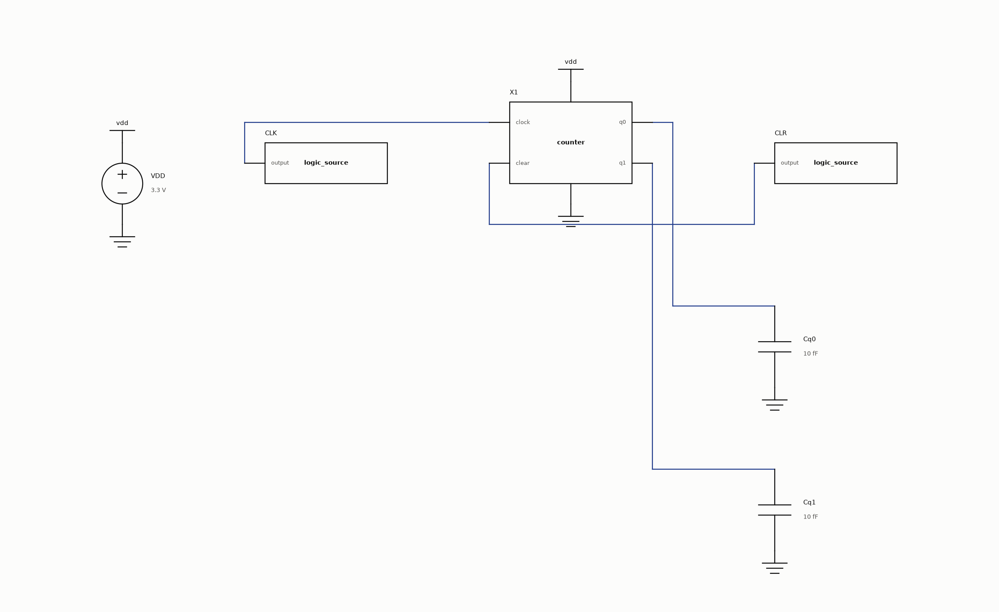

    **[Ripple counter of D flip-flops](gallery/ripple-counter.md)** · 15/15 specs

    A two-bit ripple counter of edge-triggered D flip-flops, each six NAND gates.

    [Open in 3D](gallery/ripple-counter.html) · [Script](https://github.com/maxencefaldor/jolty/blob/main/examples/ripple_counter.py)

-   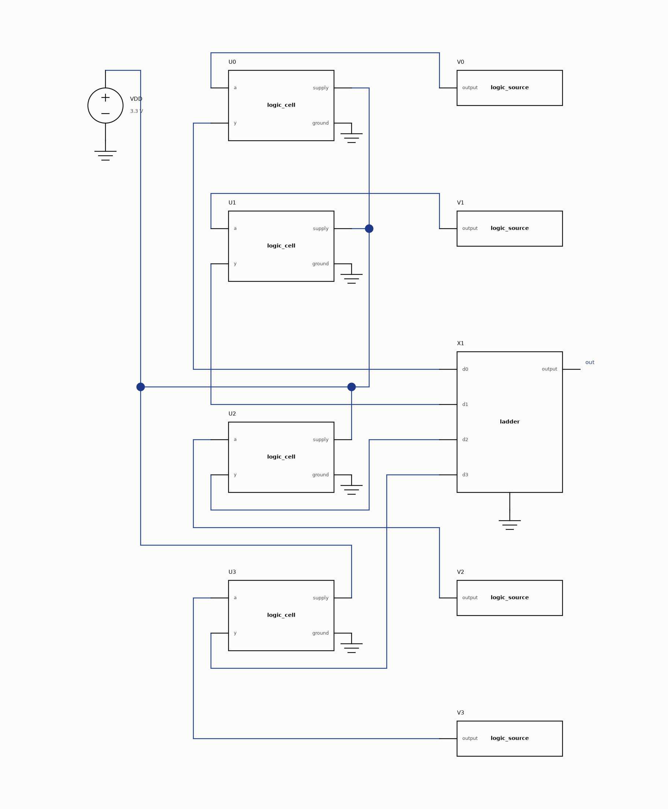

    **[R-2R ladder DAC](gallery/r2r-dac.md)** · 16/16 specs

    A four-bit R-2R ladder DAC, counting from 0 to 15.

    [Open in 3D](gallery/r2r-dac.html) · [Script](https://github.com/maxencefaldor/jolty/blob/main/examples/r2r_dac.py)

-   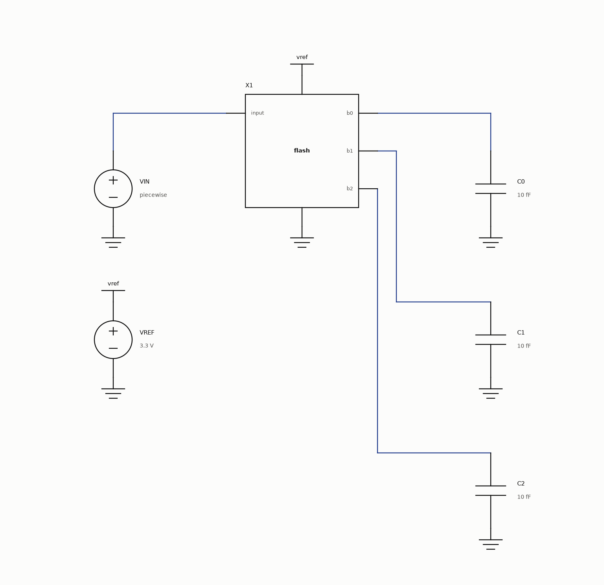

    **[Three-bit flash ADC](gallery/flash-adc.md)** · 24/24 specs

    A three-bit flash ADC: seven comparators on a resistor ladder, and an encoder.

    [Open in 3D](gallery/flash-adc.html) · [Script](https://github.com/maxencefaldor/jolty/blob/main/examples/flash_adc.py)

