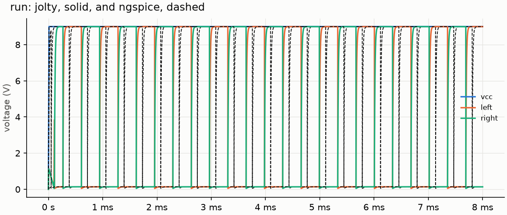
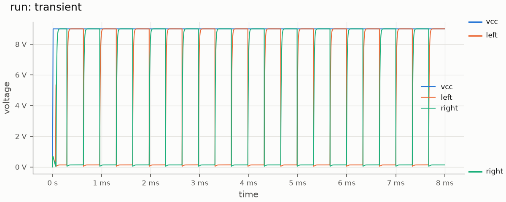

# Astable multivibrator

The astable multivibrator: two cross-coupled 2N3904s flipping each other in turn.

Each transistor's collector couples to the other's base through a capacitor and a 1N4148.
When one turns on, its collector falls by nearly the supply and drives the other's timing node that far below zero, which the diode keeps from the base: the 2N3904's emitter junction takes only 6 V in reverse.
The node recovers through its 47 kΩ toward the supply, turning its transistor on near half way.
Each half period is about RC·ln 2 = 0.326 ms with 10 nF: a period of 0.652 ms, 1.53 kHz.
Slightly unequal capacitors break the symmetry that would hold the circuit balanced.
Simulate it with `jolty simulate examples/astable_multivibrator.py`.

[Open in 3D](astable-multivibrator.view.html){ .md-button .md-button--primary } [Script](https://github.com/maxencefaldor/jolty/blob/main/examples/astable_multivibrator.py){ .md-button }

11 devices and 16 unknowns.

## Specs

| Requirement | jolty | ngspice | Difference |
| --- | --- | --- | --- |
| frequency of left from 2 ms in run ≥ 1.381 kHz and ≤ 1.688 kHz | 1.48171 kHz, passed | 1.48175 kHz, passed | 3.1e-05 |
| maximum of left from 2 ms in run ≥ 8.5 V and ≤ 9.1 V | 8.99693 V, passed | 8.99693 V, passed | 3.9e-08 |
| minimum of left from 2 ms in run ≤ 300 mV | 50.8599 mV, passed | 50.8833 mV, passed | 4.6e-04 |

## Replicated in ngspice

jolty writes the circuit as a SPICE netlist, ngspice runs every analysis of the plan, and each signal both report is compared, relative to its largest value.
A transient compares each of ngspice's points with jolty's waveform within one of jolty's steps.

A free-running oscillator's phase drifts with the least difference in two engines' numerics, so its waveforms compare through the specs' readings, its period and its swing, rather than point by point.

## Plots

