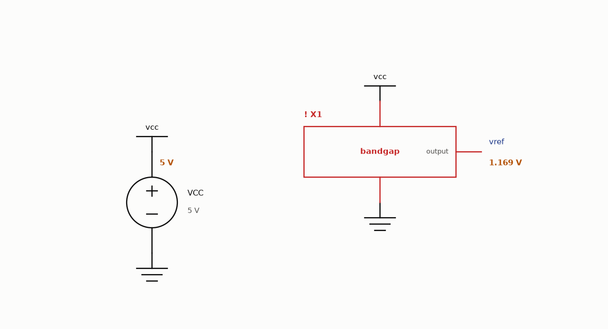

# Bandgap reference

A bandgap voltage reference: two transistors' base-emitter voltages cancelling drift.

An op-amp holds its two inputs equal, so equal resistors carry equal currents into a 2N3904 and into eight in parallel behind 1 kΩ.
The resistor then holds the difference of their base-emitter voltages, Vt·ln 8, proportional to absolute temperature, and the output adds R₁/R₃ times it to a base-emitter voltage, which falls with temperature.
With R₁/R₃ = 10.7 the two drifts cancel: the output stays within 2.2 mV of 1.168 V from -40 °C to 125 °C, some 13 ppm/K, near silicon's band gap less its curvature.
Ten megohms from a 5 V supply start it.
Simulate it with `jolty simulate examples/bandgap_reference.py`.

[Open in 3D](bandgap-reference.view.html){ .md-button .md-button--primary } [Script](https://github.com/maxencefaldor/jolty/blob/main/examples/bandgap_reference.py){ .md-button }

19 devices, 26 unknowns, simulated in 1.24 s.

## Specs

| Requirement | jolty | ngspice | Difference |
| --- | --- | --- | --- |
| vref in op ≥ 1.165 V and ≤ 1.171 V | 1.16692 V at cold, passed | 1.16692 V at cold, passed | 5.5e-12 |

## Replicated in ngspice

jolty writes the circuit as a SPICE netlist, ngspice runs every analysis of the plan, and each signal both report is compared, relative to its largest value.
A transient compares each of ngspice's points with jolty's waveform within one of jolty's steps.

| Analysis | Voltages | Largest deviation | Currents | Largest deviation |
| --- | --- | --- | --- | --- |
| `op` | 6 | 1.5e-11 | 2 | 2.9e-11 |
