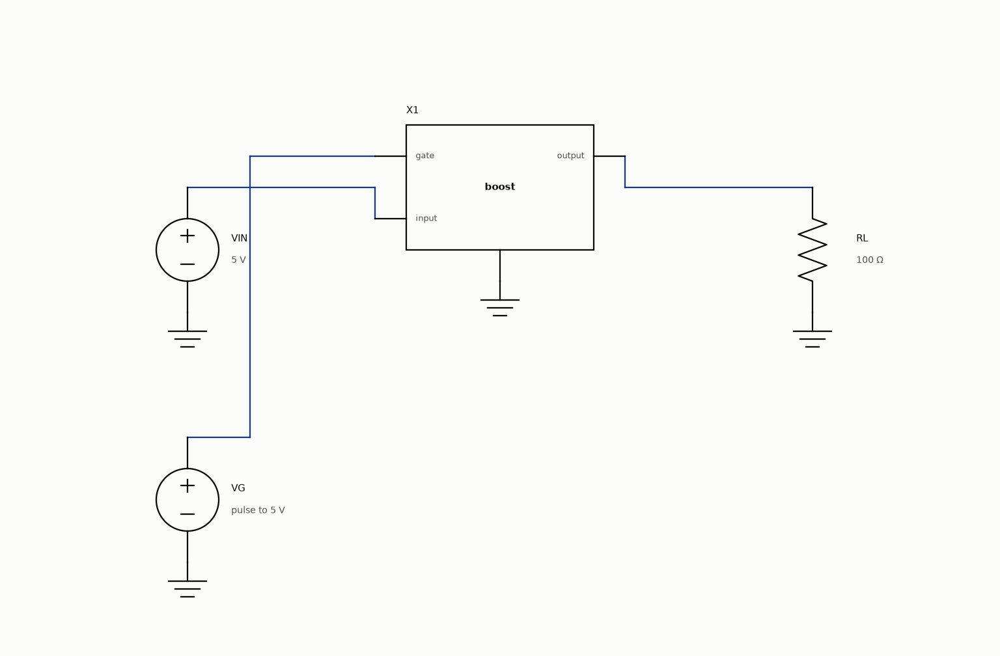
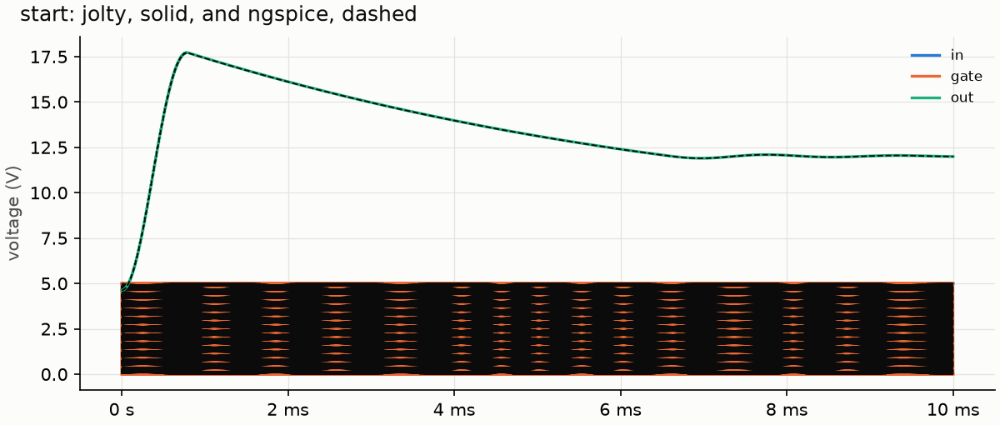
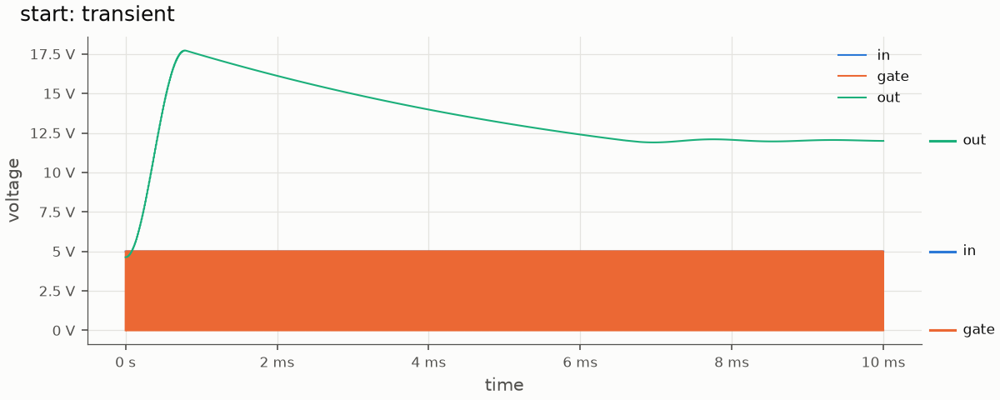

# Boost converter

A boost converter: an inductor charged by a switch and dumped through a diode.

The switch shorts the inductor to ground for 60 % of each 10 µs period, storing energy it then delivers through the diode on top of the input: the output settles near Vin/(1 - D) = 12.5 V from 5 V, less the losses.
Simulate it with `jolty simulate examples/boost_converter.py`.

[Open in 3D](boost-converter.view.html){ .md-button .md-button--primary } [Script](https://github.com/maxencefaldor/jolty/blob/main/examples/boost_converter.py){ .md-button }

7 devices and 9 unknowns.

## Specs

| Requirement | jolty | ngspice | Difference |
| --- | --- | --- | --- |
| average of out from 9 ms in start ≥ 11 V and ≤ 12.5 V | 12.0304 V, passed | 12.0262 V, passed | 3.5e-04 |

## Replicated in ngspice

jolty writes the circuit as a SPICE netlist, ngspice runs every analysis of the plan, and each signal both report is compared, relative to its largest value.
A transient compares each of ngspice's points with jolty's waveform within one of jolty's steps.

| Analysis | Voltages | Largest deviation | Currents | Largest deviation |
| --- | --- | --- | --- | --- |
| `start` | 4 | 5.9e-04 | 3 | 0.11 % |

## Plots

