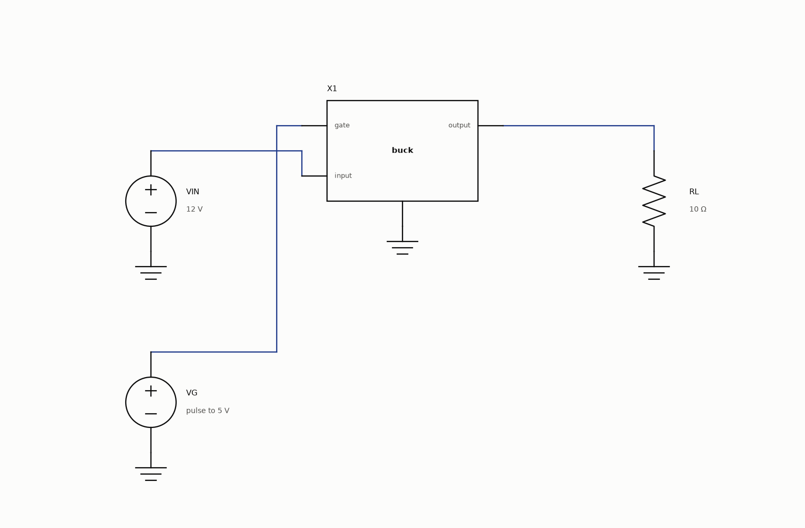
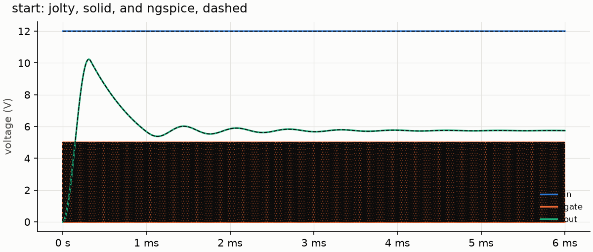
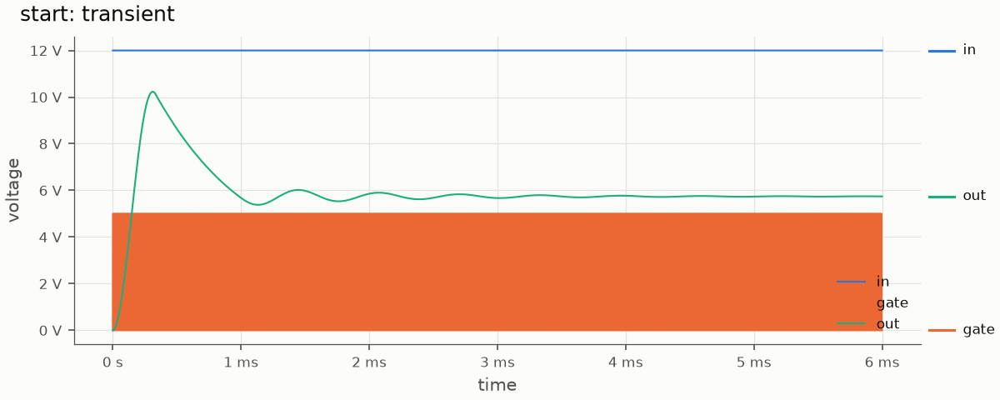

# Buck converter

A buck converter: a switch, a diode and an LC filter stepping 12 V down to 6 V.

A switch closes for half of each 10 µs period, and the inductor carries the current on through the diode while it is open, so the filter's output settles near the duty cycle times the input, less the diode's share.
With 100 µH and 100 µF, the LC filter rings at 1.6 kHz and its ripple is small.
Simulate it with `jolty simulate examples/buck_converter.py`.

[Open in 3D](buck-converter.view.html){ .md-button .md-button--primary } [Script](https://github.com/maxencefaldor/jolty/blob/main/examples/buck_converter.py){ .md-button }

7 devices and 9 unknowns.

## Specs

| Requirement | jolty | ngspice | Difference |
| --- | --- | --- | --- |
| average of out from 5 ms in start ≥ 5.5 V and ≤ 6 V | 5.74356 V, passed | 5.74152 V, passed | 3.6e-04 |
| peak-to-peak of out from 5.9 ms in start ≤ 20 mV | 7.87467 mV, passed | 7.44725 mV, passed | 5.4 % |
| average of X1/L1:current from 5 ms in start ≥ 550 mA and ≤ 600 mA | 575.216 mA, passed | 574.98 mA, passed | 4.1e-04 |

## Replicated in ngspice

jolty writes the circuit as a SPICE netlist, ngspice runs every analysis of the plan, and each signal both report is compared, relative to its largest value.
A transient compares each of ngspice's points with jolty's waveform within one of jolty's steps.

| Analysis | Voltages | Largest deviation | Currents | Largest deviation |
| --- | --- | --- | --- | --- |
| `start` | 4 | 5.0e-04 | 3 | 5.0e-04 |

## Plots

