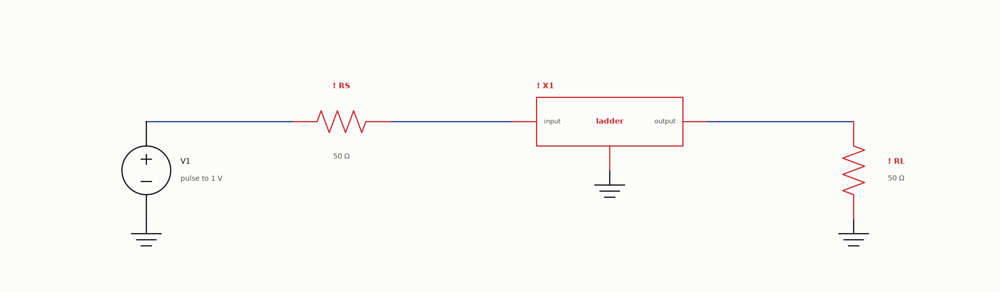
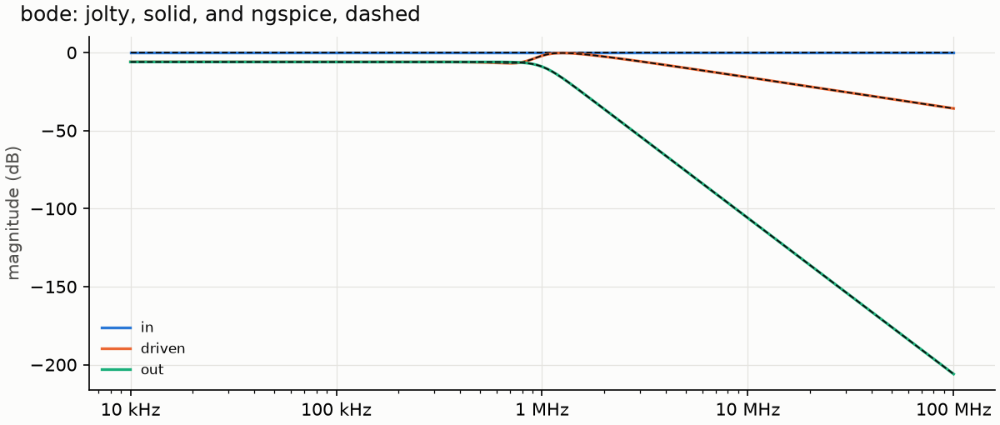
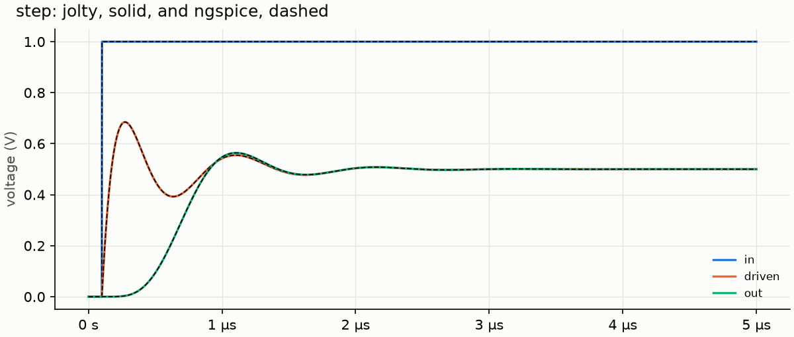
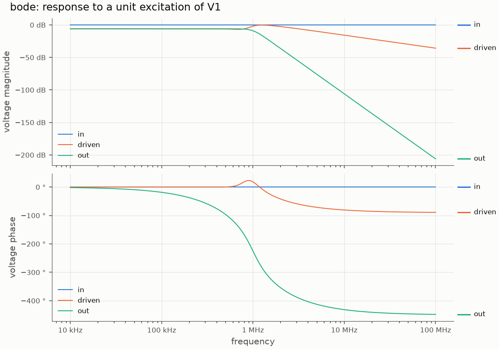
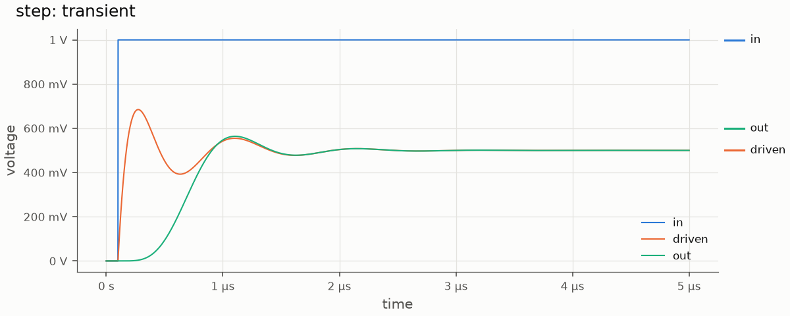

# Fifth-order Butterworth ladder

A fifth-order Butterworth low-pass filter: an LC ladder between two 50 Ω ends.

Its elements are the Butterworth prototype's, 0.618, 1.618, 2, 1.618 and 0.618, scaled to a 1 MHz cutoff and 50 Ω.
Between its terminations its gain is half, times 1/√(1 + (f/f_c)¹⁰): -6.02 dB in its passband, 3.01 dB less at the cutoff, and falling 100 dB a decade above it.
Simulate it with `jolty simulate examples/butterworth_ladder.py`.

[Open in 3D](butterworth-ladder.view.html){ .md-button .md-button--primary } [Script](https://github.com/maxencefaldor/jolty/blob/main/examples/butterworth_ladder.py){ .md-button }

8 devices, 7 unknowns, simulated in 1.58 s.

## Specs

| Requirement | jolty | ngspice | Difference |
| --- | --- | --- | --- |
| gain of out at 10 kHz in bode ≥ -6.022 dB and ≤ -6.02 dB | -6.0206 dB, passed | -6.0206 dB, passed | 0 |
| gain of out at 500 kHz in bode ≥ -6.026 dB and ≤ -6.024 dB | -6.02486 dB, passed | -6.02486 dB, passed | 5.9e-16 |
| gain of out at 1 MHz in bode ≥ -9.032 dB and ≤ -9.03 dB | -9.0309 dB, passed | -9.0309 dB, passed | 3.9e-16 |
| gain of out at 2 MHz in bode ≥ -36.13 dB and ≤ -36.13 dB | -36.1279 dB, passed | -36.1279 dB, passed | 2.0e-16 |
| gain of out at 10 MHz in bode ≥ -106 dB and ≤ -106 dB | -106.021 dB, passed | -106.021 dB, passed | 4.0e-16 |

## Replicated in ngspice

jolty writes the circuit as a SPICE netlist, ngspice runs every analysis of the plan, and each signal both report is compared, relative to its largest value.
A transient compares each of ngspice's points with jolty's waveform within one of jolty's steps.

| Analysis | Voltages | Largest deviation | Currents | Largest deviation |
| --- | --- | --- | --- | --- |
| `bode` | 4 | 4.6e-15 | 3 | 6.2e-15 |
| `step` | 4 | 2.2e-09 | 3 | 5.0e-05 |

## Plots

 
