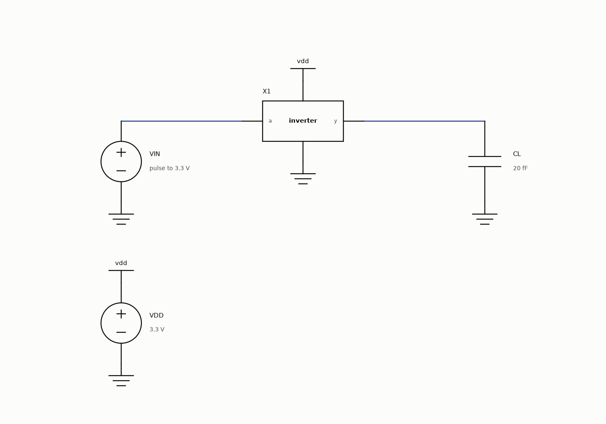
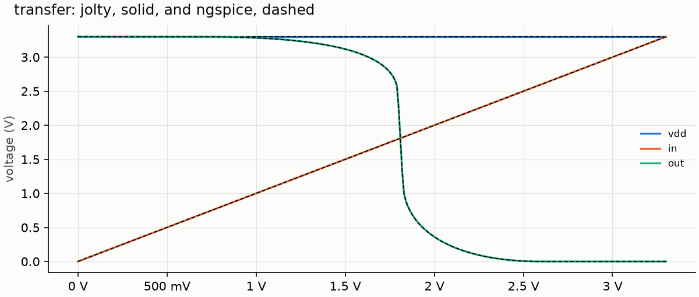
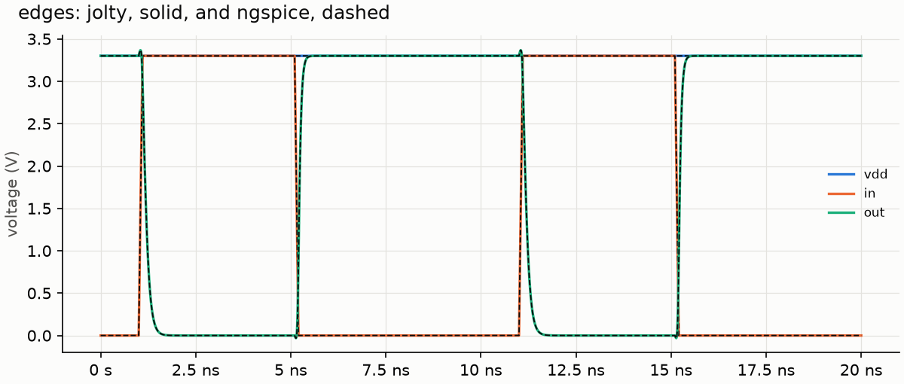
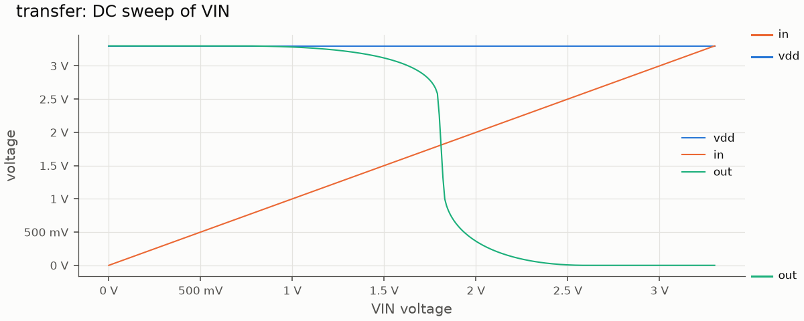
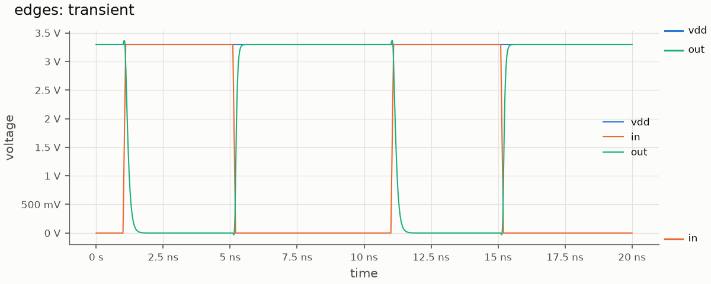

# CMOS inverter

The CMOS inverter: its transfer curve, its switching threshold, its edges.

A p-channel transistor twice as wide as its n-channel partner, which offsets the holes' lower mobility only partly here, as both share one transconductance parameter: the p-channel is the stronger, so the switching threshold, where both saturate,
Vm = (VDD - |Vtp| + Vtn·√(βn/βp))/(1 + √(βn/βp)), sits at 1.81 V of 3.3 V. Simulate it
with `jolty simulate examples/cmos_inverter.py`.

[Open in 3D](cmos-inverter.view.html){ .md-button .md-button--primary } [Script](https://github.com/maxencefaldor/jolty/blob/main/examples/cmos_inverter.py){ .md-button }

5 devices, 11 unknowns, simulated in 1.43 s.

## Specs

| Requirement | jolty | ngspice | Difference |
| --- | --- | --- | --- |
| out at 0 V in transfer ≥ 3.299 V and ≤ 3.301 V | 3.3 V, passed | 3.3 V, passed | 4.8e-12 |
| out at 3.3 V in transfer ≥ -1 mV and ≤ 1 mV | 12.2891 nV, passed | 12.2891 nV, passed | 2.0e-09 |
| out at 1.813 V in transfer ≥ 1.6 V and ≤ 1.7 V | 1.64982 V, passed | 1.64982 V, passed | 8.1e-15 |

## Replicated in ngspice

jolty writes the circuit as a SPICE netlist, ngspice runs every analysis of the plan, and each signal both report is compared, relative to its largest value.
A transient compares each of ngspice's points with jolty's waveform within one of jolty's steps.

| Analysis | Voltages | Largest deviation | Currents | Largest deviation |
| --- | --- | --- | --- | --- |
| `transfer` | 3 | 2.8e-06 | 2 | 3.8e-07 |
| `edges` | 3 | 4.5e-04 | 2 | 1.8 % |

## Plots

 
