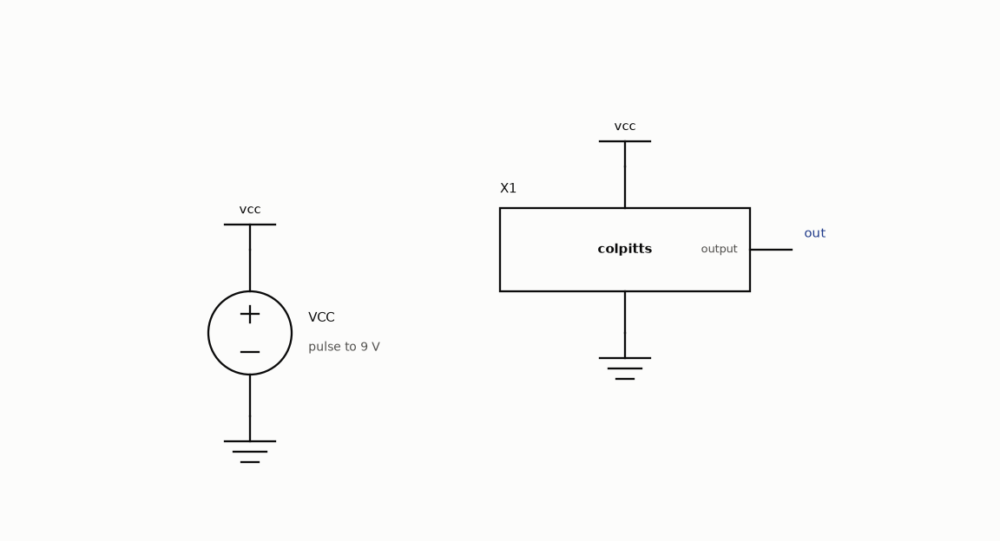
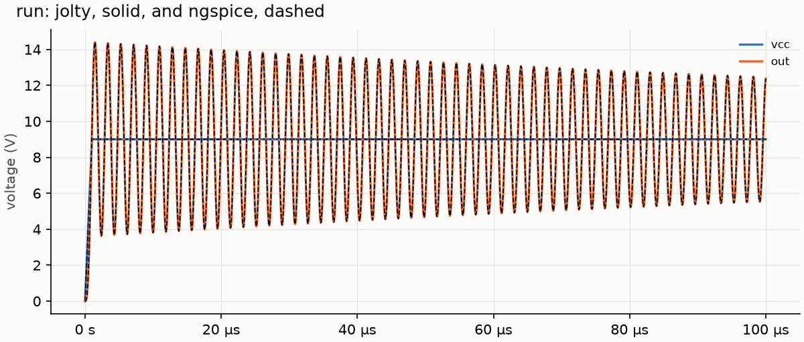
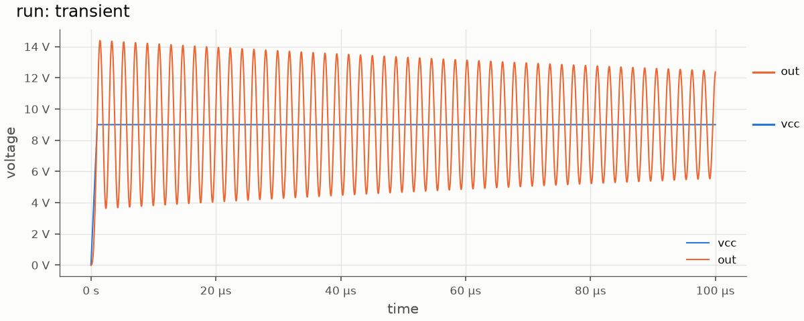

# Colpitts oscillator

A Colpitts oscillator: a common-base 2N3904 with an LC tank and capacitive divider.

The 100 µH inductor resonates with the 1 nF and 10 nF series capacitors (0.909 nF equivalent) at 1/(2π√(LC)) = 528 kHz.
The capacitive divider feeds one tenth of the collector swing back to the emitter in phase, and the supply ramp initiates oscillation.
Simulate with `jolty simulate examples/colpitts_oscillator.py`.

[Open in 3D](colpitts-oscillator.view.html){ .md-button .md-button--primary } [Script](https://github.com/maxencefaldor/jolty/blob/main/examples/colpitts_oscillator.py){ .md-button }

9 devices and 8 unknowns.

## Specs

| Requirement | jolty | ngspice | Difference |
| --- | --- | --- | --- |
| frequency of out from 80 µs in run ≥ 512 kHz and ≤ 543.7 kHz | 527.297 kHz, passed | 527.299 kHz, passed | 3.7e-06 |
| peak-to-peak of out from 80 µs in run ≥ 2 V | 7.5361 V, passed | 7.53669 V, passed | 7.8e-05 |

## Replicated in ngspice

jolty writes the circuit as a SPICE netlist, ngspice runs every analysis of the plan, and each signal both report is compared, relative to its largest value.
A transient compares each of ngspice's points with jolty's waveform within one of jolty's steps.

A free-running oscillator's phase drifts with the least difference in two engines' numerics, so its waveforms compare through the specs' readings, its period and its swing, rather than point by point.

## Plots

