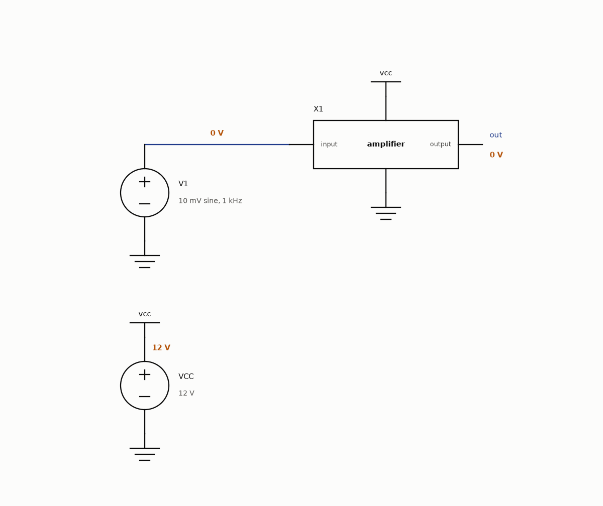
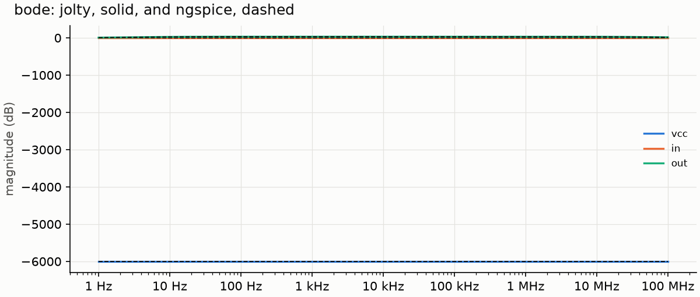
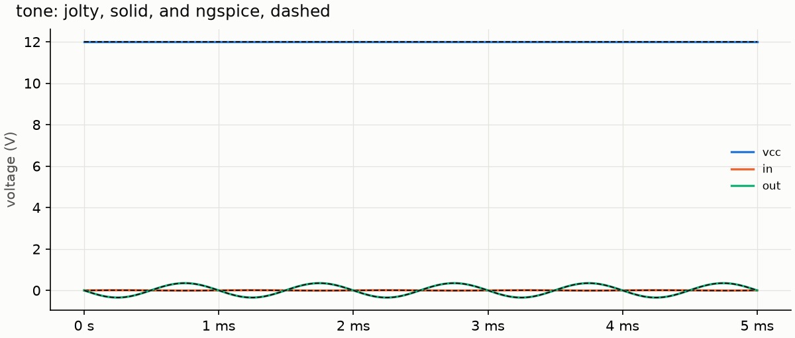
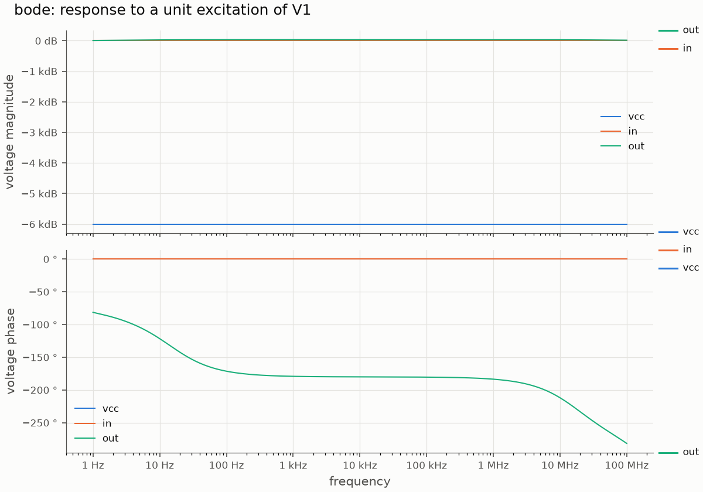
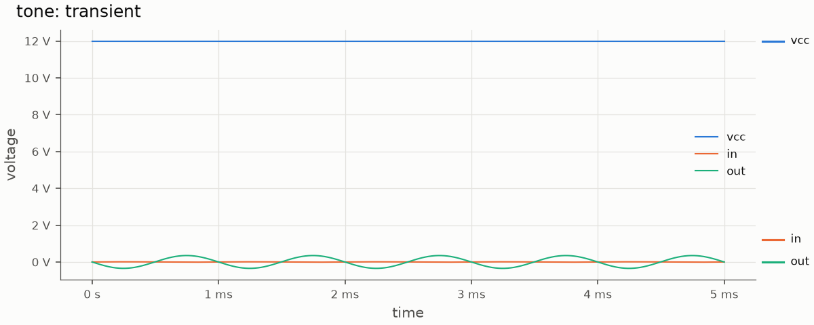

# Common-emitter amplifier

A common-emitter amplifier: a 2N3904 biased by a divider, its emitter degenerated.

The divider sets the base near 1.8 V, so about 1.1 mA flows through the emitter's 100 Ω and 1 kΩ; the 1 kΩ is bypassed above a few hertz.
The midband gain is the collector's 4.7 kΩ over the emitter's 100 Ω and the transistor's own 1/gm, some 32 dB, inverted.
Coupling capacitors pass the band from tens of hertz up.
Simulate it with `jolty simulate examples/common_emitter.py`.

[Open in 3D](common-emitter.view.html){ .md-button .md-button--primary } [Script](https://github.com/maxencefaldor/jolty/blob/main/examples/common_emitter.py){ .md-button }

12 devices, 11 unknowns, simulated in 2.33 s.

## Specs

| Requirement | jolty | ngspice | Difference |
| --- | --- | --- | --- |
| X1/collector in op ≥ 5 V and ≤ 8 V | 7.35325 V, passed | 7.35325 V, passed | 2.6e-07 |
| gain of out at 10 kHz in bode ≥ 30.5 dB and ≤ 32.5 dB | 30.8477 dB, passed | 30.8477 dB, passed | 8.1e-07 |

## Replicated in ngspice

jolty writes the circuit as a SPICE netlist, ngspice runs every analysis of the plan, and each signal both report is compared, relative to its largest value.
A transient compares each of ngspice's points with jolty's waveform within one of jolty's steps.

| Analysis | Voltages | Largest deviation | Currents | Largest deviation |
| --- | --- | --- | --- | --- |
| `op` | 7 | 3.9e-07 | 2 | 3.4e-07 |
| `bode` | 7 | 2.9e-06 | 2 | 2.9e-06 |
| `tone` | 7 | 8.5e-05 | 2 | 0 |

## Plots

 
