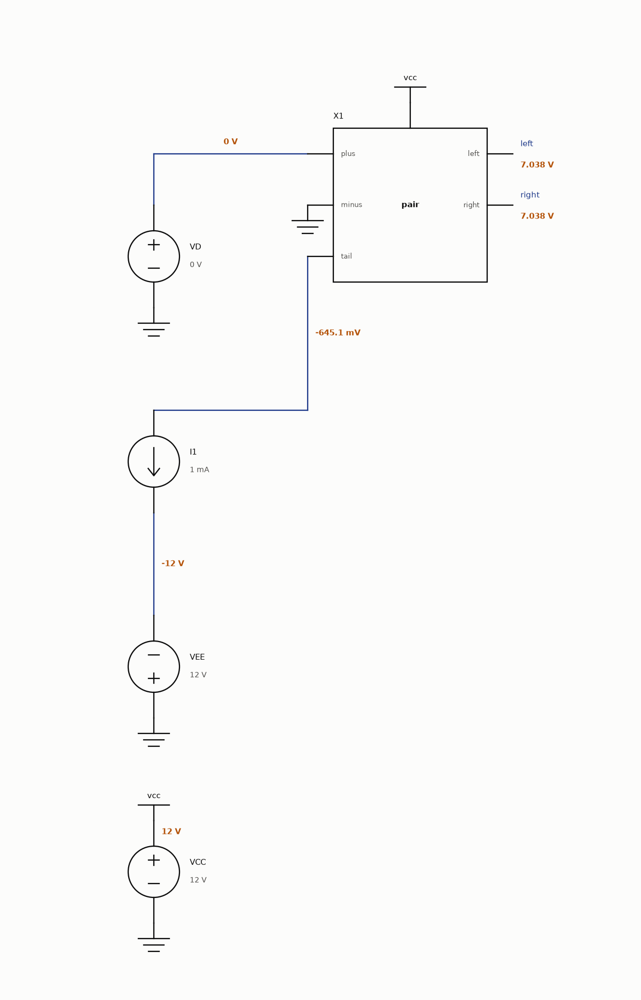
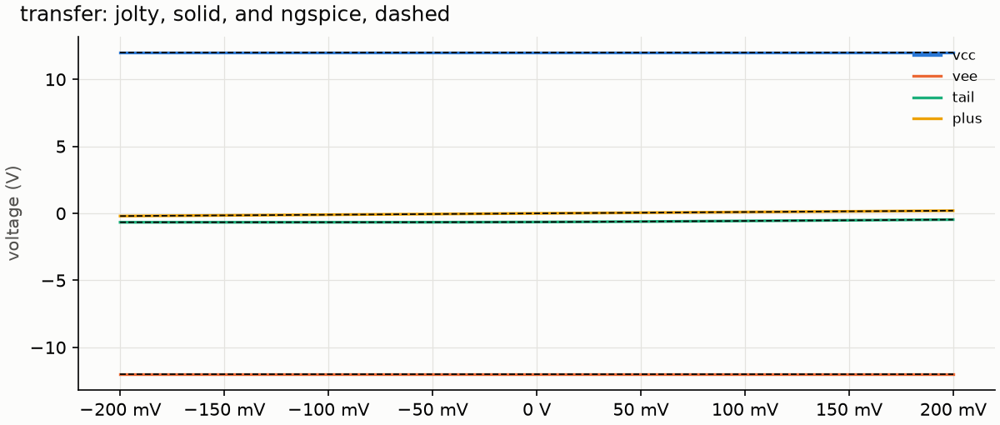
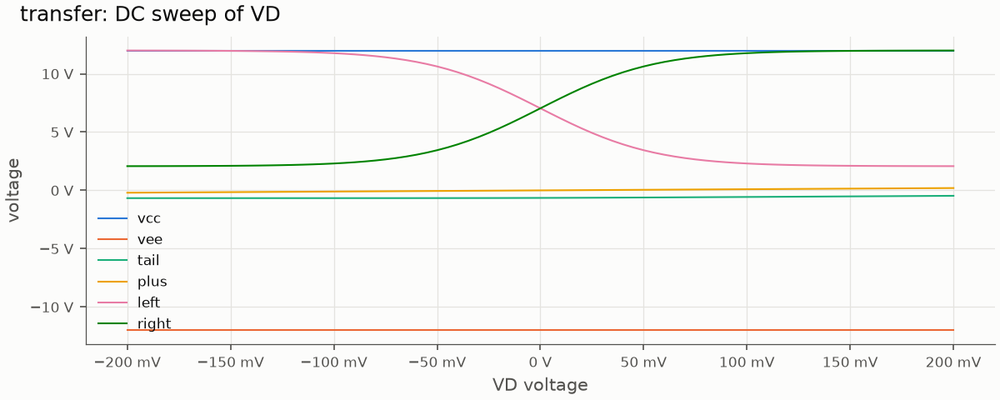

# Long-tailed pair

A long-tailed pair: two 2N3904s sharing a 1 mA tail, steering it between them.

The base voltage difference splits the tail current as I·tanh(Vd/2Vt).
The differential output swings ±I·Rc = ±10 V with a small-signal gain of gm·Rc = (I/2)/Vt·Rc (about 193).
Simulate with `jolty simulate examples/differential_pair.py`.

[Open in 3D](differential-pair.view.html){ .md-button .md-button--primary } [Script](https://github.com/maxencefaldor/jolty/blob/main/examples/differential_pair.py){ .md-button }

8 devices and 13 unknowns.

## Specs

| Requirement | jolty | ngspice | Difference |
| --- | --- | --- | --- |
| left relative to right in op ≥ -1 mV and ≤ 1 mV | 0 V, passed | 888.178 aV, passed | 1e+02 % |
| right relative to left at 200 mV in transfer ≥ 9.85 V and ≤ 10.05 V | 9.91669 V, passed | 9.91669 V, passed | 5.9e-12 |
| right relative to left at -200 mV in transfer ≥ -10.05 V and ≤ -9.85 V | -9.91686 V, passed | -9.91686 V, passed | 2.4e-11 |

## Replicated in ngspice

jolty writes the circuit as a SPICE netlist, ngspice runs every analysis of the plan, and each signal both report is compared, relative to its largest value.
A transient compares each of ngspice's points with jolty's waveform within one of jolty's steps.

| Analysis | Voltages | Largest deviation | Currents | Largest deviation |
| --- | --- | --- | --- | --- |
| `op` | 6 | 1.0e-08 | 3 | 2.6e-08 |
| `transfer` | 6 | 3.1e-07 | 3 | 4.8e-07 |

## Plots

