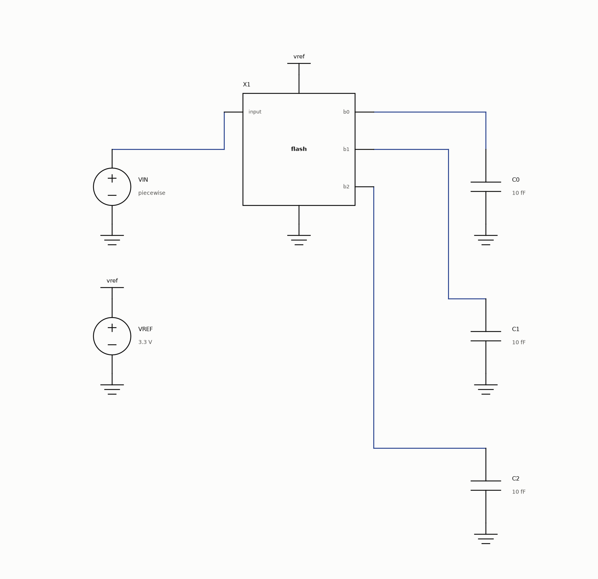
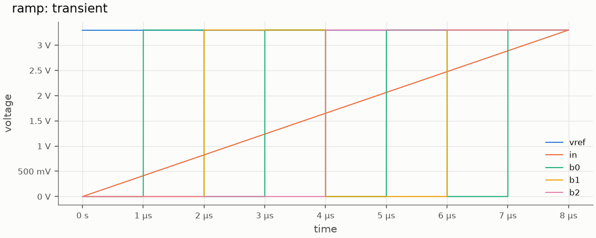

# Three-bit flash ADC

A three-bit flash ADC: seven comparators on a resistor ladder, and an encoder.

Eight equal resistors divide the 3.3 V reference into seven taps, an eighth of it apart.
Each comparator compares the input to one tap; together they read the input as a thermometer code, as many ones as taps below it, and a logic encoder counts the ones into three bits.
A ramp from 0 to 3.3 V walks the code from 0 to 7.
Simulate it with `jolty simulate examples/flash_adc.py`.

[Open in 3D](flash-adc.view.html){ .md-button .md-button--primary } [Script](https://github.com/maxencefaldor/jolty/blob/main/examples/flash_adc.py){ .md-button }

21 devices, 31 unknowns, simulated in 1.24 s.

## Specs

| Requirement | jolty |
| --- | --- |
| b0 at 500 ns in ramp ≥ -10 mV and ≤ 10 mV | 0 V, passed |
| b1 at 500 ns in ramp ≥ -10 mV and ≤ 10 mV | 0 V, passed |
| b2 at 500 ns in ramp ≥ -10 mV and ≤ 10 mV | 0 V, passed |
| b0 at 1.5 µs in ramp ≥ 3.29 V and ≤ 3.31 V | 3.3 V, passed |
| b1 at 1.5 µs in ramp ≥ -10 mV and ≤ 10 mV | 0 V, passed |
| b2 at 1.5 µs in ramp ≥ -10 mV and ≤ 10 mV | 0 V, passed |
| b0 at 2.5 µs in ramp ≥ -10 mV and ≤ 10 mV | 0 V, passed |
| b1 at 2.5 µs in ramp ≥ 3.29 V and ≤ 3.31 V | 3.3 V, passed |
| b2 at 2.5 µs in ramp ≥ -10 mV and ≤ 10 mV | 0 V, passed |
| b0 at 3.5 µs in ramp ≥ 3.29 V and ≤ 3.31 V | 3.3 V, passed |
| b1 at 3.5 µs in ramp ≥ 3.29 V and ≤ 3.31 V | 3.3 V, passed |
| b2 at 3.5 µs in ramp ≥ -10 mV and ≤ 10 mV | 0 V, passed |
| b0 at 4.5 µs in ramp ≥ -10 mV and ≤ 10 mV | 0 V, passed |
| b1 at 4.5 µs in ramp ≥ -10 mV and ≤ 10 mV | 0 V, passed |
| b2 at 4.5 µs in ramp ≥ 3.29 V and ≤ 3.31 V | 3.3 V, passed |
| b0 at 5.5 µs in ramp ≥ 3.29 V and ≤ 3.31 V | 3.3 V, passed |
| b1 at 5.5 µs in ramp ≥ -10 mV and ≤ 10 mV | 0 V, passed |
| b2 at 5.5 µs in ramp ≥ 3.29 V and ≤ 3.31 V | 3.3 V, passed |
| b0 at 6.5 µs in ramp ≥ -10 mV and ≤ 10 mV | 0 V, passed |
| b1 at 6.5 µs in ramp ≥ 3.29 V and ≤ 3.31 V | 3.3 V, passed |
| b2 at 6.5 µs in ramp ≥ 3.29 V and ≤ 3.31 V | 3.3 V, passed |
| b0 at 7.5 µs in ramp ≥ 3.29 V and ≤ 3.31 V | 3.3 V, passed |
| b1 at 7.5 µs in ramp ≥ 3.29 V and ≤ 3.31 V | 3.3 V, passed |
| b2 at 7.5 µs in ramp ≥ 3.29 V and ≤ 3.31 V | 3.3 V, passed |

## Checked in closed form

The example holds logic devices, which SPICE has no element for, so its specs check it against its closed-form behavior: truth tables, codes and periods.

## Plots

