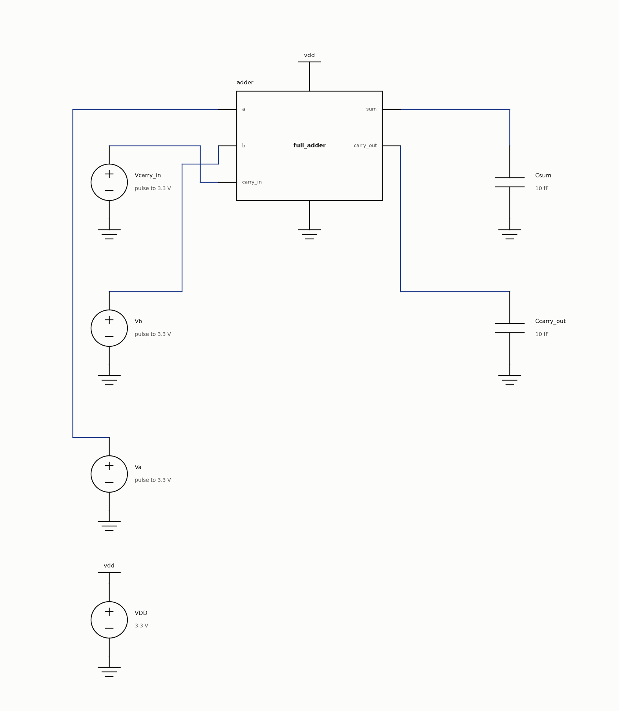
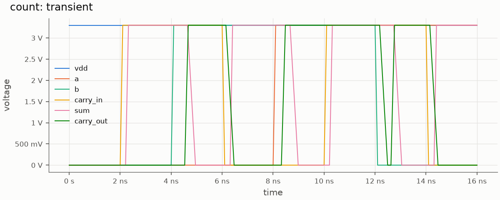

# Full adder of NAND gates

A full adder of nine CMOS NAND gates, each gate four transistors.

The plan characterizes the transistor-level NAND gate into an event-driven logic cell.
Nine characterized cells simulate the full adder at event speed, while spot checks re-simulate individual gates at transistor level against the contract.
Simulate with `jolty simulate examples/full_adder.py`.

[Open in 3D](full-adder.view.html){ .md-button .md-button--primary } [Script](https://github.com/maxencefaldor/jolty/blob/main/examples/full_adder.py){ .md-button }

10 devices and 12 unknowns.

## Specs

The example states no specs.

## Checked in closed form

The example holds logic devices, which SPICE has no element for, so its specs check it against its closed-form behavior: truth tables, codes and periods.

## Plots

