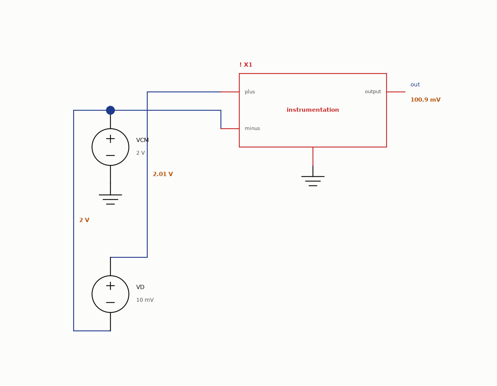
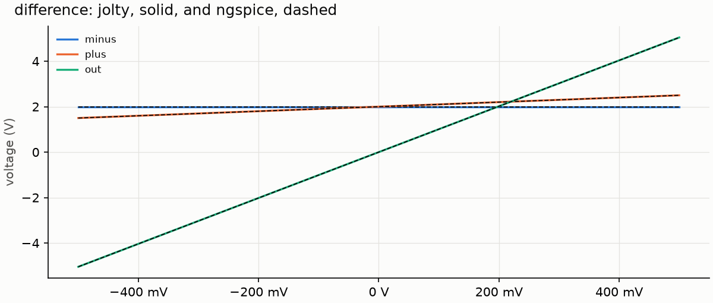
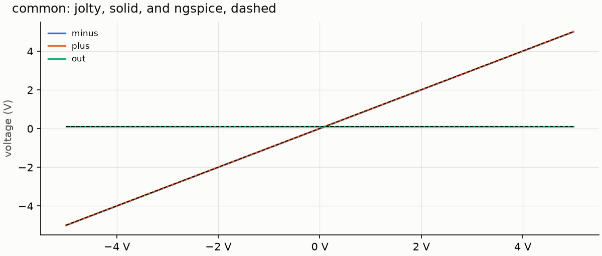
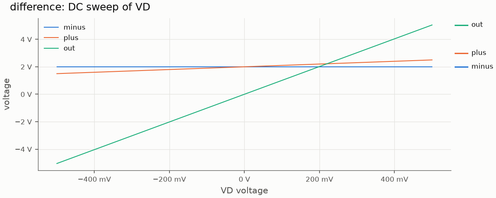
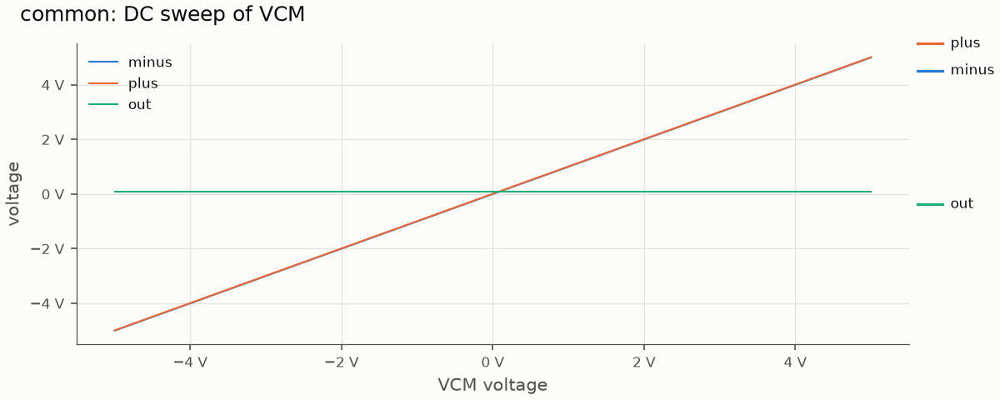

# Instrumentation amplifier

A three-op-amp instrumentation amplifier: a gain of 10.09 that rejects common mode.

Two followers with 10 kΩ feedback resistors share a 2.2 kΩ gain resistor, a gain of 1 + 2·10/2.2 = 10.09 to the difference of their inputs and of one to what the inputs share; a difference amplifier of four matched 10 kΩ resistors then keeps the difference alone.
A 10 mV difference riding on 2 V comes out as 100.9 mV.
Simulate it with `jolty simulate examples/instrumentation_amplifier.py`.

[Open in 3D](instrumentation-amplifier.view.html){ .md-button .md-button--primary } [Script](https://github.com/maxencefaldor/jolty/blob/main/examples/instrumentation_amplifier.py){ .md-button }

14 devices, 17 unknowns, simulated in 1.69 s.

## Specs

| Requirement | jolty | ngspice | Difference |
| --- | --- | --- | --- |
| out in op ≥ 100.9 mV and ≤ 101 mV | 100.897 mV, passed | 100.897 mV, passed | 5.5e-14 |
| out at 500 mV in difference ≥ 5.04 V and ≤ 5.05 V | 5.04484 V, passed | 5.04484 V, passed | 1.0e-14 |
| out at -5 V in common ≥ 100.9 mV and ≤ 101 mV | 100.897 mV, passed | 100.897 mV, passed | 1.2e-13 |
| out at 5 V in common ≥ 100.9 mV and ≤ 101 mV | 100.897 mV, passed | 100.897 mV, passed | 1.9e-14 |

## Replicated in ngspice

jolty writes the circuit as a SPICE netlist, ngspice runs every analysis of the plan, and each signal both report is compared, relative to its largest value.
A transient compares each of ngspice's points with jolty's waveform within one of jolty's steps.

| Analysis | Voltages | Largest deviation | Currents | Largest deviation |
| --- | --- | --- | --- | --- |
| `op` | 12 | 5.5e-14 | 5 | 8.9e-15 |
| `difference` | 12 | 1.4e-14 | 5 | 1.3e-14 |
| `common` | 12 | 2.6e-13 | 5 | 1.2e-14 |

## Plots

 
