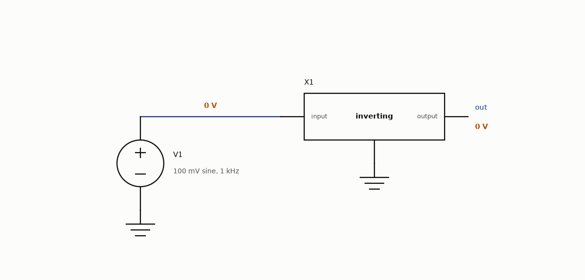
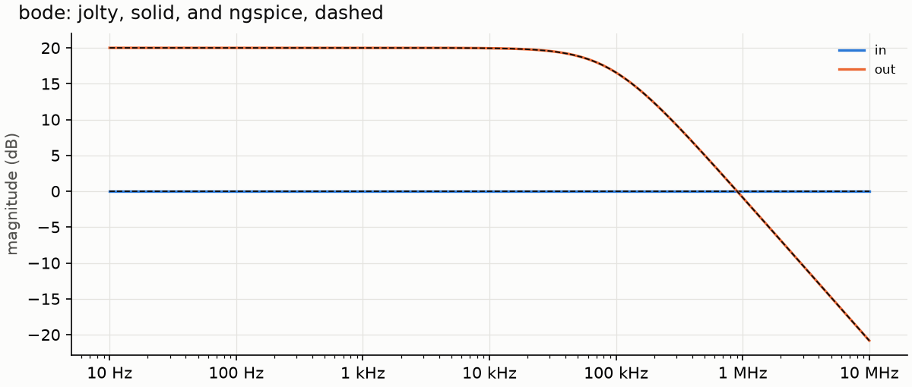
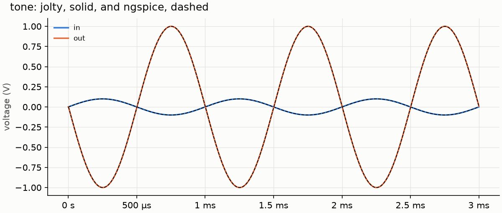
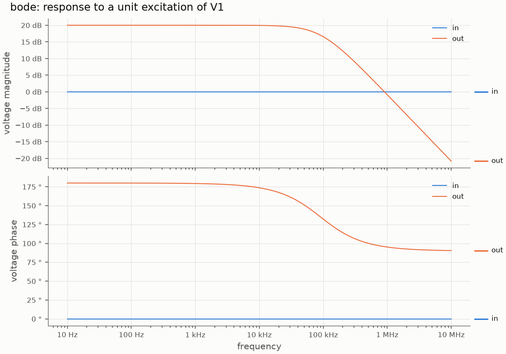
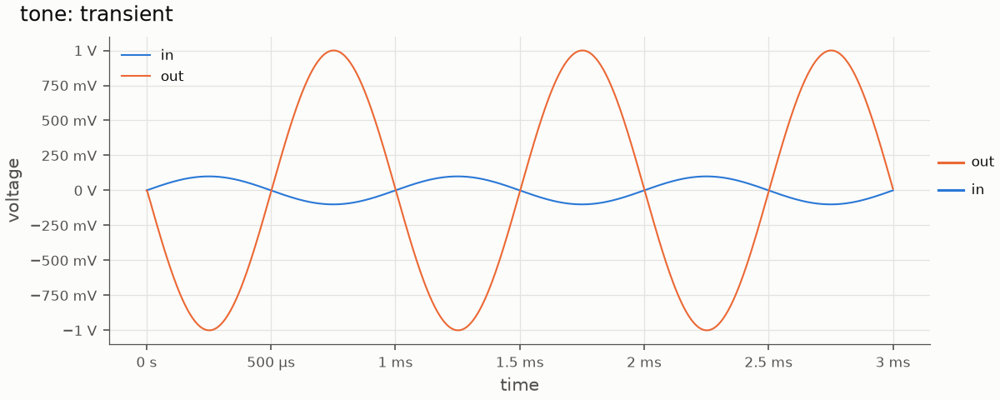

# Inverting amplifier

An inverting amplifier: a gain of -10 set by two resistors around an op-amp.

The op-amp's finite gain A = 10⁵ takes the closed-loop gain to -10/(1 + 11/A), and its 1 MHz gain-bandwidth product sets the bandwidth at 1 MHz/11 = 90.9 kHz, where the gain is 3 dB down.
Simulate it with `jolty simulate examples/inverting_amplifier.py`.

[Open in 3D](inverting-amplifier.view.html){ .md-button .md-button--primary } [Script](https://github.com/maxencefaldor/jolty/blob/main/examples/inverting_amplifier.py){ .md-button }

8 devices, 6 unknowns, simulated in 1.59 s.

## Specs

| Requirement | jolty | ngspice | Difference |
| --- | --- | --- | --- |
| gain of out at 100 Hz in bode ≥ 20 dB and ≤ 20 dB | 19.999 dB, passed | 19.999 dB, passed | 0 |
| 3 dB bandwidth of out in bode ≥ 90.4 kHz and ≤ 91.4 kHz | 90.6292 kHz, passed | 90.6292 kHz, passed | 1.8e-15 |
| peak-to-peak of out from 1 ms in tone ≥ 1.998 V and ≤ 2.002 V | 1.99964 V, passed | 1.99965 V, passed | 4.9e-06 |

## Replicated in ngspice

jolty writes the circuit as a SPICE netlist, ngspice runs every analysis of the plan, and each signal both report is compared, relative to its largest value.
A transient compares each of ngspice's points with jolty's waveform within one of jolty's steps.

| Analysis | Voltages | Largest deviation | Currents | Largest deviation |
| --- | --- | --- | --- | --- |
| `op` | 4 | 0 | 2 | 0 |
| `bode` | 4 | 1.2e-15 | 2 | 1.2e-15 |
| `tone` | 4 | 1.2e-04 | 2 | 1.5e-05 |

## Plots

 
