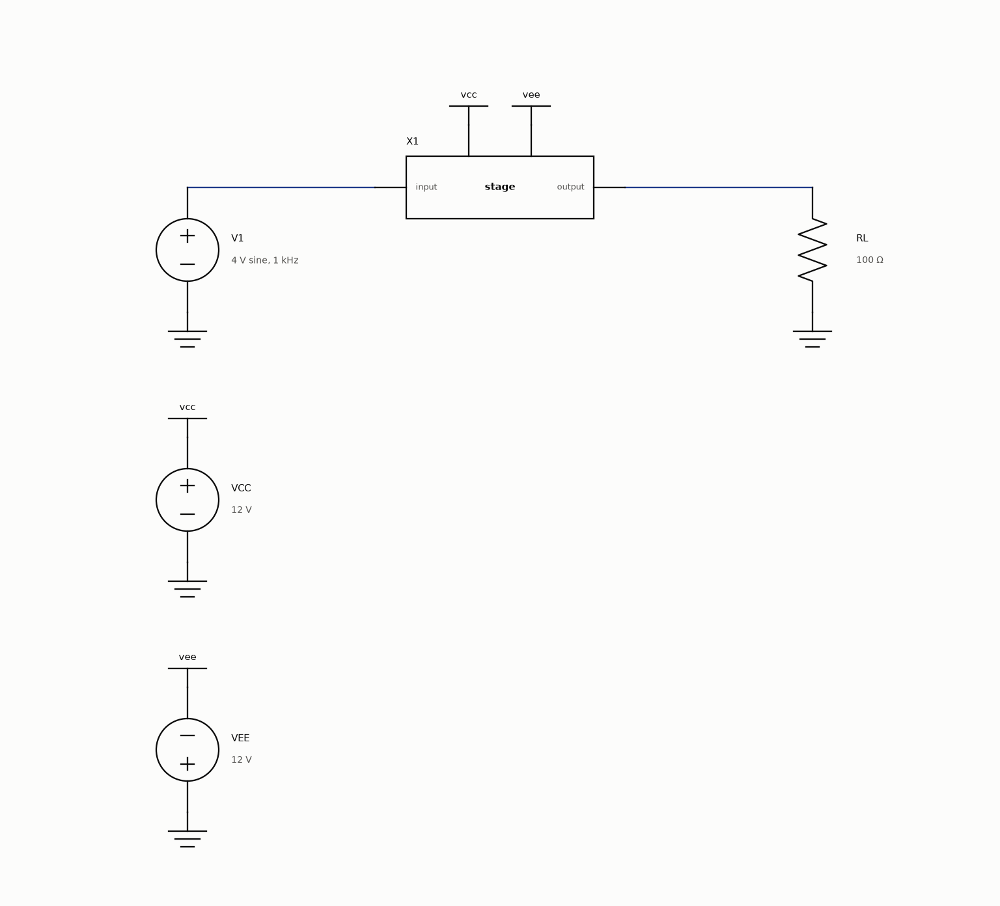
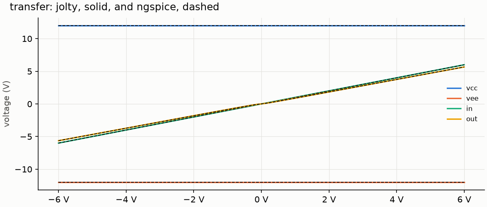
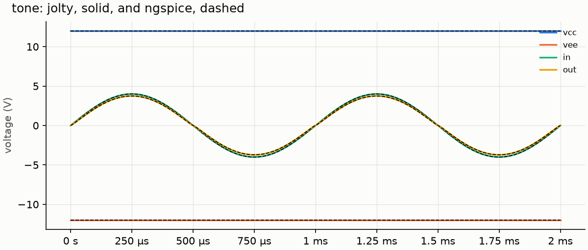
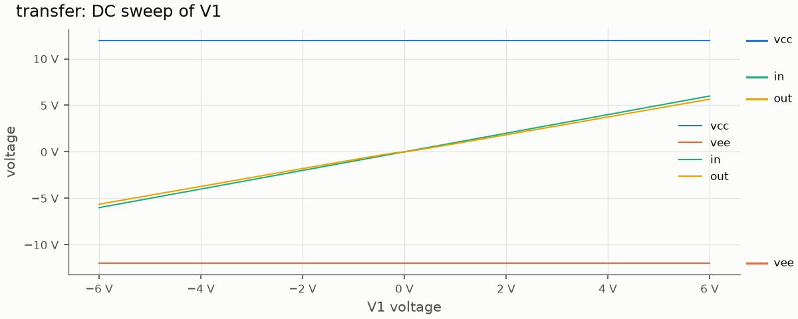
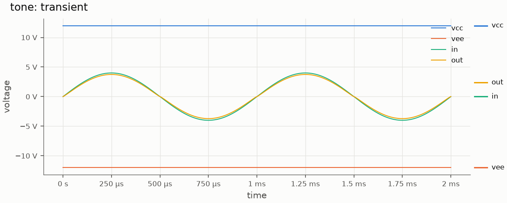

# Class AB push-pull stage

A class AB push-pull output stage: complementary followers, biased past crossover.

A 2N3904 sources the load's current and a 2N3906 sinks it, each an emitter follower.
Two 1N4148 diodes between their bases hold both just on, so neither lets go as the signal crosses zero, and the output follows the input without the dead band of a class B stage.
Simulate it with `jolty simulate examples/push_pull.py`.

[Open in 3D](push-pull.view.html){ .md-button .md-button--primary } [Script](https://github.com/maxencefaldor/jolty/blob/main/examples/push_pull.py){ .md-button }

12 devices, 19 unknowns, simulated in 1.97 s.

## Specs

| Requirement | jolty | ngspice | Difference |
| --- | --- | --- | --- |
| out at 0 V in transfer ≥ -100 mV and ≤ 100 mV | 8.09978 mV, passed | 8.09978 mV, passed | 3.1e-10 |
| out at 100 mV in transfer ≥ 0 V and ≤ 200 mV | 70.0639 mV, passed | 70.0639 mV, passed | 2.5e-07 |
| out at 4 V in transfer ≥ 3.6 V and ≤ 4 V | 3.74629 V, passed | 3.74629 V, passed | 3.5e-10 |
| out at -4 V in transfer ≥ -4 V and ≤ -3.6 V | -3.71769 V, passed | -3.71769 V, passed | 7.7e-10 |

## Replicated in ngspice

jolty writes the circuit as a SPICE netlist, ngspice runs every analysis of the plan, and each signal both report is compared, relative to its largest value.
A transient compares each of ngspice's points with jolty's waveform within one of jolty's steps.

| Analysis | Voltages | Largest deviation | Currents | Largest deviation |
| --- | --- | --- | --- | --- |
| `transfer` | 8 | 7.6e-07 | 3 | 7.6e-07 |
| `tone` | 8 | 1.8e-05 | 3 | 1.7e-05 |

## Plots

 
