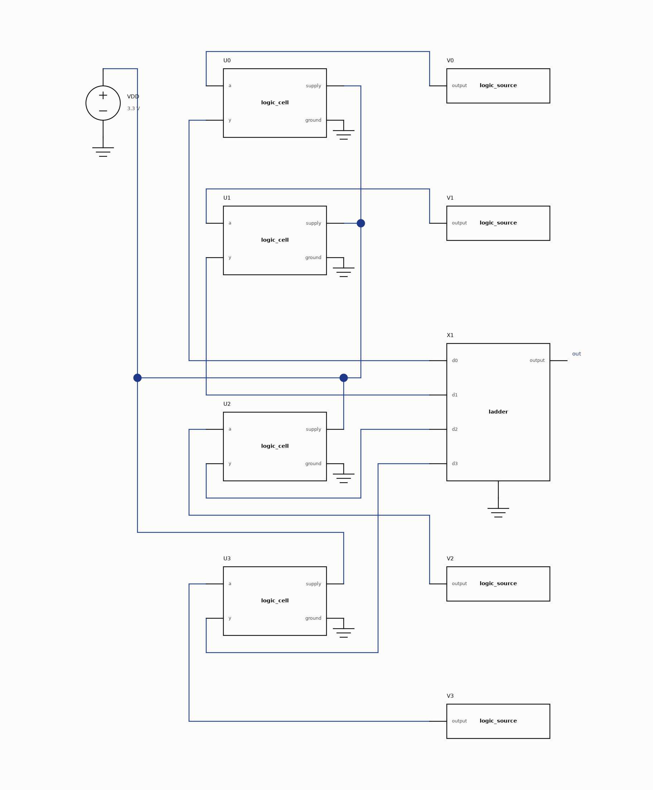
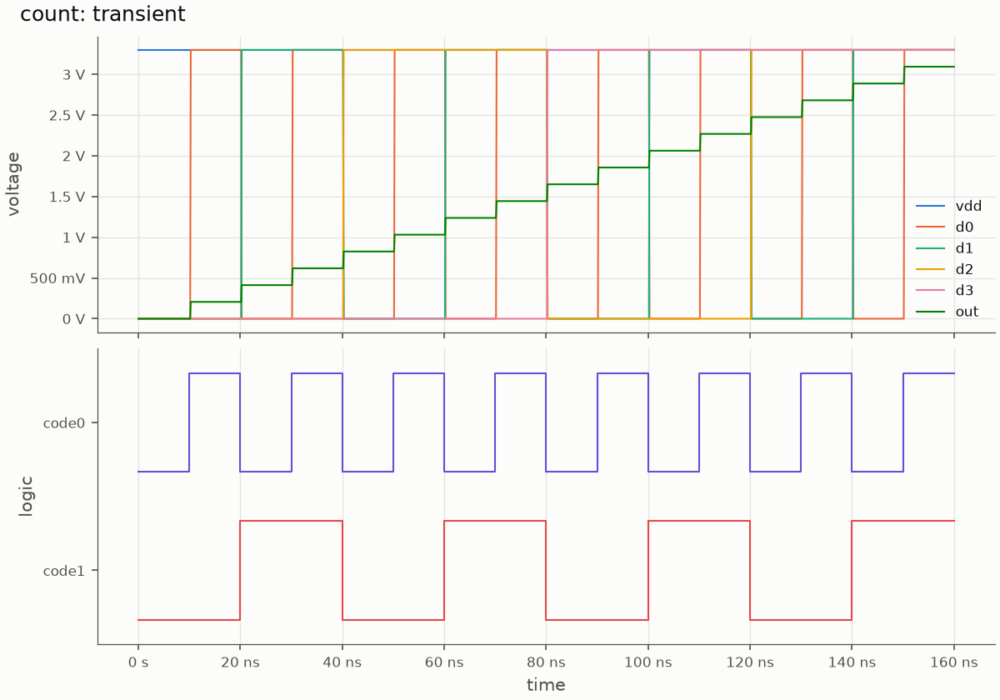

# R-2R ladder DAC

A four-bit R-2R ladder DAC, counting from 0 to 15.

Each bit's logic level drives a 20 kΩ leg of a ladder of 10 kΩ rungs, terminated by 20 kΩ to ground.
Every node of the ladder looks into 20 kΩ either way, so each bit adds its weight, half the previous bit's, and the output is the supply times the code over 16, exactly.
A counter of logic sources steps the code every 10 ns, through buffers on 3.3 V. Simulate it with `jolty simulate examples/r2r_dac.py`.

[Open in 3D](r2r-dac.html){ .md-button .md-button--primary } [Script](https://github.com/maxencefaldor/jolty/blob/main/examples/r2r_dac.py){ .md-button }

17 devices, 14 unknowns, simulated in 1.55 s.

## Specs

| Requirement | jolty |
| --- | --- |
| out at 5 ns in count ≥ -1 µV and ≤ 1 µV | 0 V, passed |
| out at 15 ns in count ≥ 206.2 mV and ≤ 206.3 mV | 206.25 mV, passed |
| out at 25 ns in count ≥ 412.5 mV and ≤ 412.5 mV | 412.5 mV, passed |
| out at 35 ns in count ≥ 618.7 mV and ≤ 618.8 mV | 618.75 mV, passed |
| out at 45 ns in count ≥ 825 mV and ≤ 825 mV | 825 mV, passed |
| out at 55 ns in count ≥ 1.031 V and ≤ 1.031 V | 1.03125 V, passed |
| out at 65 ns in count ≥ 1.237 V and ≤ 1.238 V | 1.2375 V, passed |
| out at 75 ns in count ≥ 1.444 V and ≤ 1.444 V | 1.44375 V, passed |
| out at 85 ns in count ≥ 1.65 V and ≤ 1.65 V | 1.65 V, passed |
| out at 95 ns in count ≥ 1.856 V and ≤ 1.856 V | 1.85625 V, passed |
| out at 105 ns in count ≥ 2.062 V and ≤ 2.063 V | 2.0625 V, passed |
| out at 115 ns in count ≥ 2.269 V and ≤ 2.269 V | 2.26875 V, passed |
| out at 125 ns in count ≥ 2.475 V and ≤ 2.475 V | 2.475 V, passed |
| out at 135 ns in count ≥ 2.681 V and ≤ 2.681 V | 2.68125 V, passed |
| out at 145 ns in count ≥ 2.887 V and ≤ 2.888 V | 2.8875 V, passed |
| out at 155 ns in count ≥ 3.094 V and ≤ 3.094 V | 3.09375 V, passed |

## Checked in closed form

The example holds logic devices, which SPICE has no element for, so its specs check it against its closed-form behavior: truth tables, codes and periods.

## Plots

