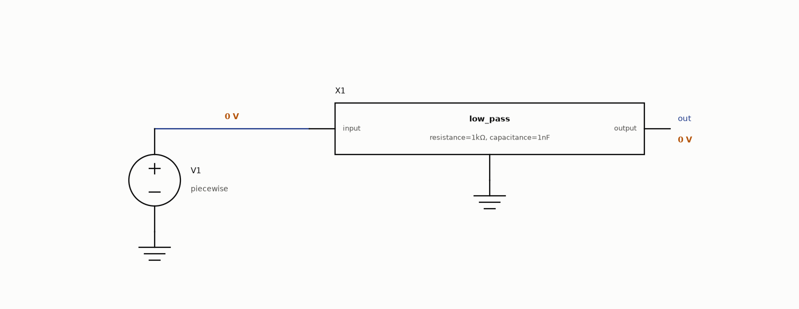
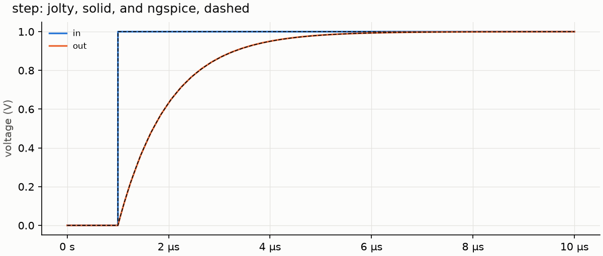
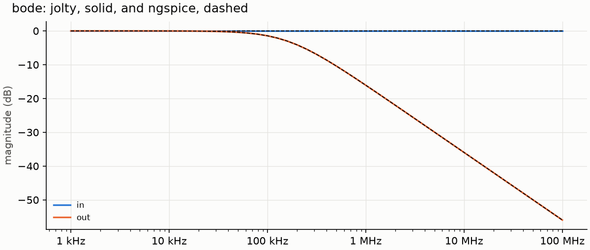
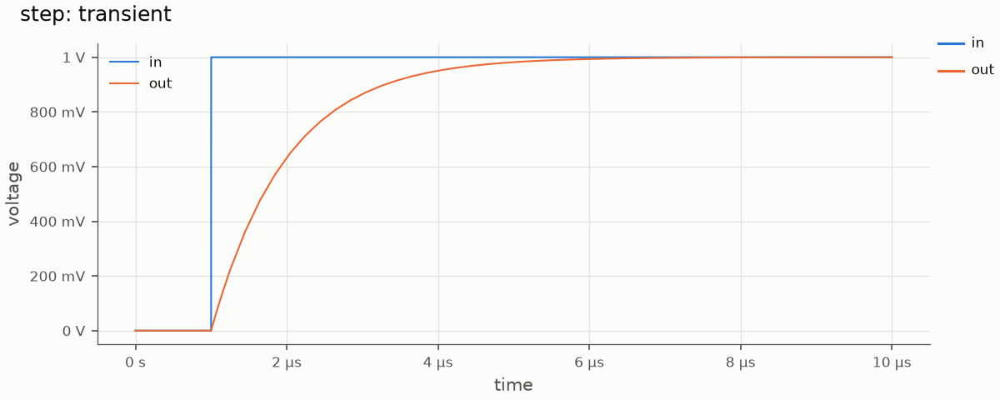
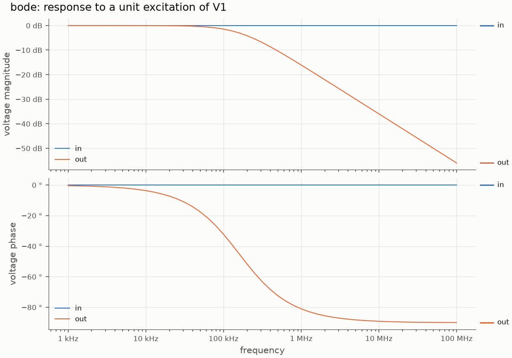

# RC low-pass filter

A first-order RC low-pass filter: its step response and its frequency response.

The filter's time constant is 1 µs and its cutoff frequency 159 kHz.
Simulate it with `jolty simulate examples/rc_filter.py`, which checks its specs too.

[Open in 3D](rc-filter.html){ .md-button .md-button--primary } [Script](https://github.com/maxencefaldor/jolty/blob/main/examples/rc_filter.py){ .md-button }

3 devices, 3 unknowns, simulated in 1.88 s.

## Specs

| Requirement | jolty | ngspice | Difference |
| --- | --- | --- | --- |
| gain of out at 1 kHz in bode ≥ -0.1 dB and ≤ 0.1 dB | -0.000171449 dB, passed | -0.000171449 dB, passed | 0 |
| 3 dB bandwidth of out in bode ≥ 150 kHz and ≤ 170 kHz | 158.754 kHz, passed | 158.754 kHz, passed | 1.6e-15 |
| rise time of out in step ≤ 2.5 µs with a margin of 100 ns | 2.19248 µs, passed | 2.1961 µs, passed | 0.17 % |
| overshoot of out in step ≤ 1 % | 0 %, passed | 0 %, passed | 0 |

## Replicated in ngspice

jolty writes the circuit as a SPICE netlist, ngspice runs every analysis of the plan, and each signal both report is compared, relative to its largest value.
A transient compares each of ngspice's points with jolty's waveform within one of jolty's steps.

| Analysis | Voltages | Largest deviation | Currents | Largest deviation |
| --- | --- | --- | --- | --- |
| `op` | 2 | 0 | 1 | 0 |
| `step` | 2 | 0 | 1 | 5.0e-06 |
| `bode` | 2 | 9.0e-16 | 1 | 9.4e-16 |

## Plots

 
