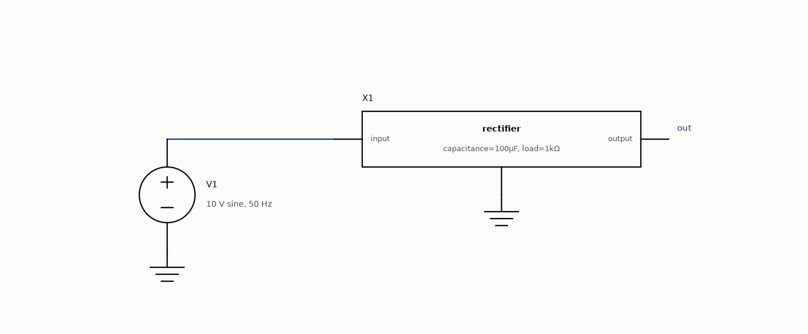
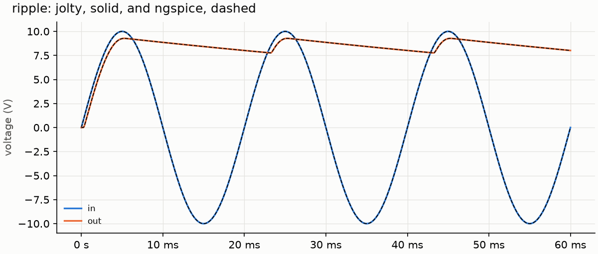
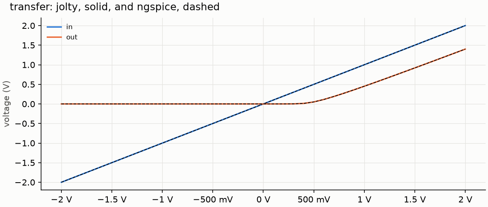
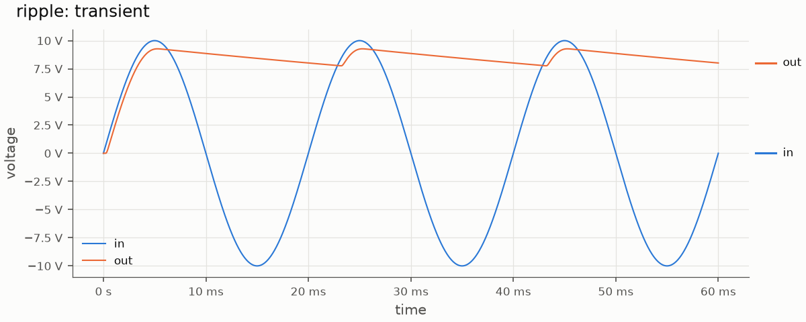
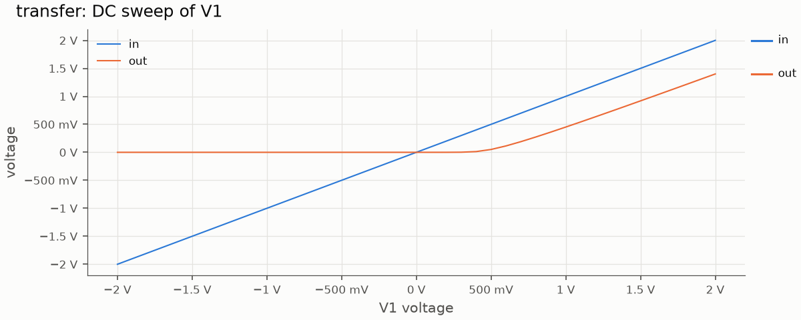

# Half-wave rectifier

A half-wave rectifier: a diode charging a smoothing capacitor from a 50 Hz sine.

The diode's parameters are those of a small-signal silicon diode such as the 1N4148.
Simulate it with `jolty simulate examples/rectifier.py`.

[Open in 3D](rectifier.view.html){ .md-button .md-button--primary } [Script](https://github.com/maxencefaldor/jolty/blob/main/examples/rectifier.py){ .md-button }

4 devices and 5 unknowns.

## Specs

The example states no specs.

## Replicated in ngspice

jolty writes the circuit as a SPICE netlist, ngspice runs every analysis of the plan, and each signal both report is compared, relative to its largest value.
A transient compares each of ngspice's points with jolty's waveform within one of jolty's steps.

| Analysis | Voltages | Largest deviation | Currents | Largest deviation |
| --- | --- | --- | --- | --- |
| `ripple` | 2 | 9.9e-05 | 1 | 2.5e-08 |
| `transfer` | 2 | 2.2e-06 | 1 | 2.2e-06 |

## Plots

 
