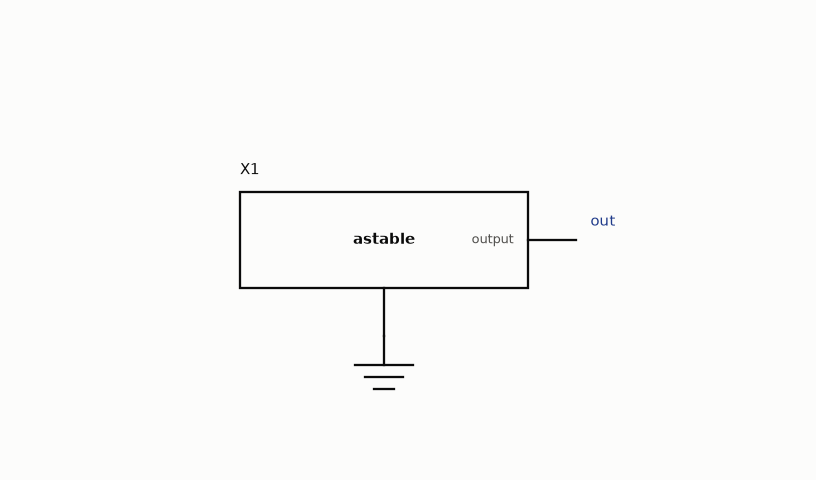
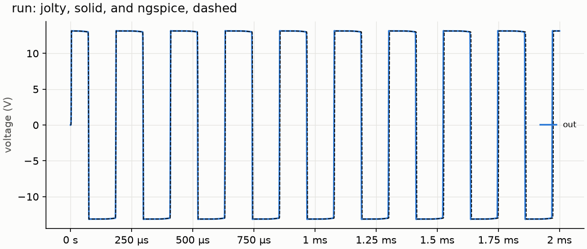
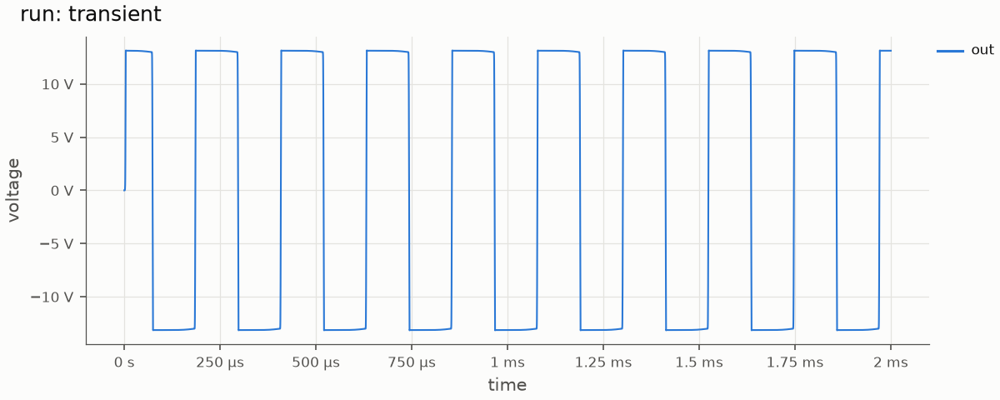

# Op-amp relaxation oscillator

An op-amp relaxation oscillator: a Schmitt trigger timing itself through an RC.

Two equal resistors feed half the output back to the non-inverting input, so the op-amp's output flips whenever the capacitor, charging through R toward the rail, crosses half of it.
Each half period lasts RC·ln((1 + β)/(1 - β)) with β = 1/2: with 10 kΩ and 10 nF, a period of 2RC·ln 3 = 219.7 µs, 4.551 kHz, a square wave between the op-amp's ±13 V rails.
The op-amp's 13 V/µs slew rate stretches each edge by 2 µs, and the period by some 1.5 %.
Simulate it with `jolty simulate examples/relaxation_oscillator.py`.

[Open in 3D](relaxation-oscillator.html){ .md-button .md-button--primary } [Script](https://github.com/maxencefaldor/jolty/blob/main/examples/relaxation_oscillator.py){ .md-button }

10 devices, 5 unknowns, simulated in 0.78 s.

## Specs

| Requirement | jolty | ngspice | Difference |
| --- | --- | --- | --- |
| frequency of out from 500 µs in run ≥ 4.46 kHz and ≤ 4.642 kHz | 4.48214 kHz, passed | 4.47234 kHz, passed | 0.22 % |
| maximum of out from 500 µs in run ≥ 12.7 V and ≤ 13.3 V | 13.1534 V, passed | 13.1301 V, passed | 0.18 % |
| minimum of out from 500 µs in run ≥ -13.3 V and ≤ -12.7 V | -13.1534 V, passed | -13.1301 V, passed | 0.18 % |

## Replicated in ngspice

jolty writes the circuit as a SPICE netlist, ngspice runs every analysis of the plan, and each signal both report is compared, relative to its largest value.
A transient compares each of ngspice's points with jolty's waveform within one of jolty's steps.

A free-running oscillator's phase drifts with the least difference in two engines' numerics, so its waveforms compare through the specs' readings, its period and its swing, rather than point by point.

## Plots

