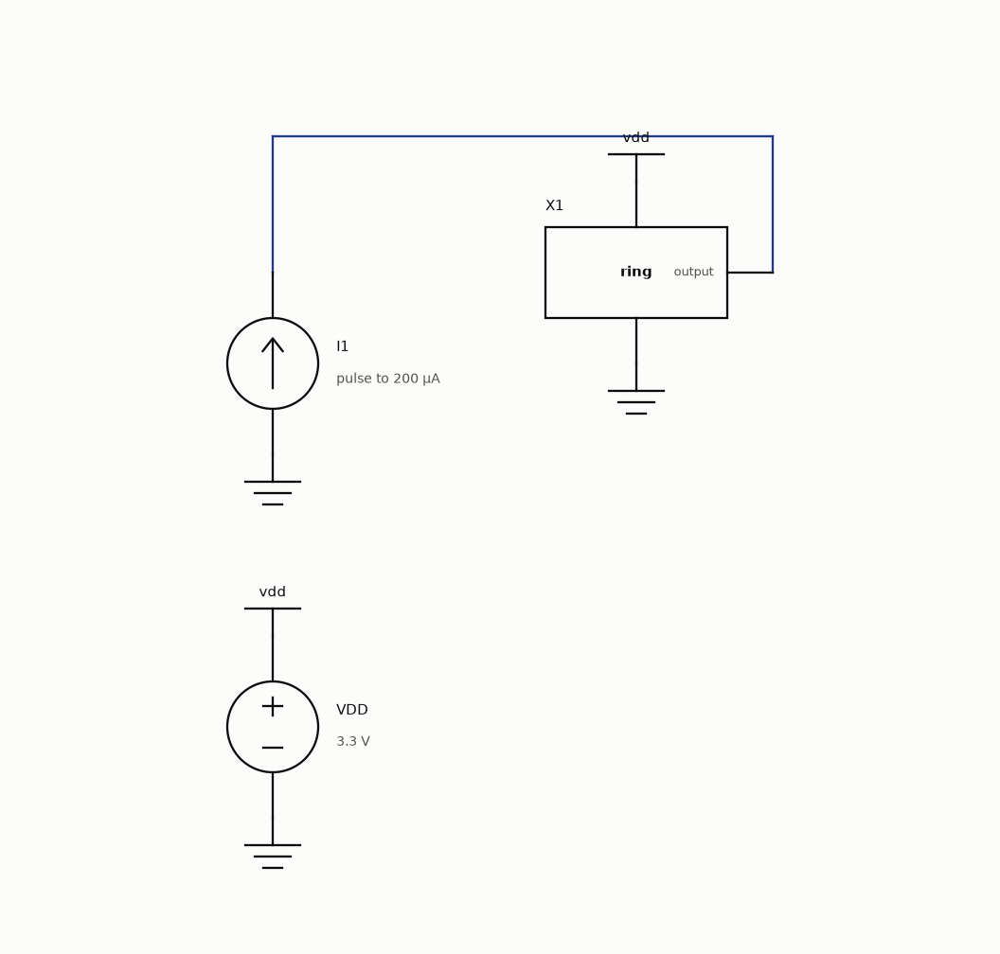
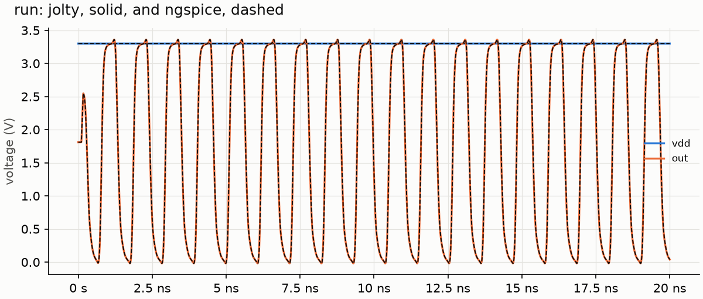
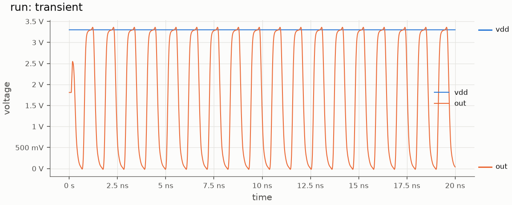

# CMOS ring oscillator

A ring oscillator of five CMOS inverters, transistor by transistor.

An odd ring of inverters has no stable state: each edge runs round the ring and comes back inverted, so the ring oscillates with a period of twice the five stages' delays.
Here each stage drives the next one's gate and 10 fF, and the ring runs near 930 MHz.
A pulse on the first stage's input sets it going.
Simulate it with `jolty simulate examples/ring_oscillator.py`.

[Open in 3D](ring-oscillator.view.html){ .md-button .md-button--primary } [Script](https://github.com/maxencefaldor/jolty/blob/main/examples/ring_oscillator.py){ .md-button }

9 devices and 37 unknowns.

## Specs

| Requirement | jolty | ngspice | Difference |
| --- | --- | --- | --- |
| frequency of out from 5 ns in run ≥ 400 MHz and ≤ 1 GHz | 926.649 MHz, passed | 926.486 MHz, passed | 1.8e-04 |
| peak-to-peak of out from 5 ns in run ≥ 3 V | 3.37904 V, passed | 3.37965 V, passed | 1.8e-04 |

## Replicated in ngspice

jolty writes the circuit as a SPICE netlist, ngspice runs every analysis of the plan, and each signal both report is compared, relative to its largest value.
A transient compares each of ngspice's points with jolty's waveform within one of jolty's steps.

A free-running oscillator's phase drifts with the least difference in two engines' numerics, so its waveforms compare through the specs' readings, its period and its swing, rather than point by point.

## Plots

