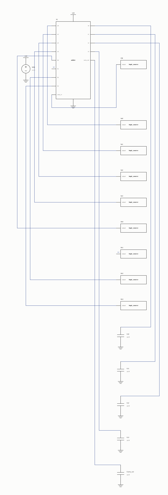
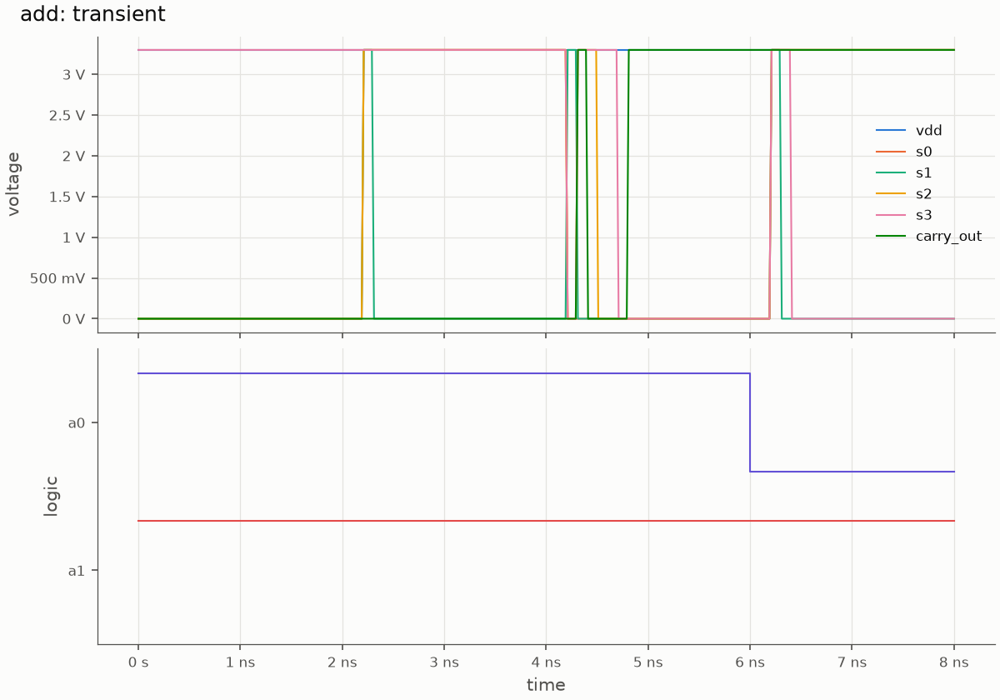

# Four-bit ripple-carry adder

A four-bit ripple-carry adder of logic gates, adding pairs of numbers in turn.

Each bit is a full adder of two XOR gates, two AND gates and an OR gate, its carry rippling into the next bit's.
Every gate takes 100 ps, so a carry that ripples through all four bits settles the sum within a nanosecond.
The gates between the bits trade logic levels at event speed; the outputs drive 10 fF on 3.3 V, read as voltages.
The bench adds 3 + 5, 7 + 6, 15 + 1 and 10 + 11, one pair every 2 ns.
Simulate it with `jolty simulate examples/ripple_adder.py`.

[Open in 3D](ripple-adder.html){ .md-button .md-button--primary } [Script](https://github.com/maxencefaldor/jolty/blob/main/examples/ripple_adder.py){ .md-button }

20 devices, 12 unknowns, simulated in 2.43 s.

## Specs

| Requirement | jolty |
| --- | --- |
| s0 at 1.5 ns in add ≥ -10 mV and ≤ 10 mV | 0 V, passed |
| s1 at 1.5 ns in add ≥ -10 mV and ≤ 10 mV | 0 V, passed |
| s2 at 1.5 ns in add ≥ -10 mV and ≤ 10 mV | 0 V, passed |
| s3 at 1.5 ns in add ≥ 3.29 V and ≤ 3.31 V | 3.3 V, passed |
| carry_out at 1.5 ns in add ≥ -10 mV and ≤ 10 mV | 0 V, passed |
| s0 at 3.5 ns in add ≥ 3.29 V and ≤ 3.31 V | 3.3 V, passed |
| s1 at 3.5 ns in add ≥ -10 mV and ≤ 10 mV | 0 V, passed |
| s2 at 3.5 ns in add ≥ 3.29 V and ≤ 3.31 V | 3.3 V, passed |
| s3 at 3.5 ns in add ≥ 3.29 V and ≤ 3.31 V | 3.3 V, passed |
| carry_out at 3.5 ns in add ≥ -10 mV and ≤ 10 mV | 0 V, passed |
| s0 at 5.5 ns in add ≥ -10 mV and ≤ 10 mV | 0 V, passed |
| s1 at 5.5 ns in add ≥ -10 mV and ≤ 10 mV | 0 V, passed |
| s2 at 5.5 ns in add ≥ -10 mV and ≤ 10 mV | 0 V, passed |
| s3 at 5.5 ns in add ≥ -10 mV and ≤ 10 mV | 0 V, passed |
| carry_out at 5.5 ns in add ≥ 3.29 V and ≤ 3.31 V | 3.3 V, passed |
| s0 at 7.5 ns in add ≥ 3.29 V and ≤ 3.31 V | 3.3 V, passed |
| s1 at 7.5 ns in add ≥ -10 mV and ≤ 10 mV | 0 V, passed |
| s2 at 7.5 ns in add ≥ 3.29 V and ≤ 3.31 V | 3.3 V, passed |
| s3 at 7.5 ns in add ≥ -10 mV and ≤ 10 mV | 0 V, passed |
| carry_out at 7.5 ns in add ≥ 3.29 V and ≤ 3.31 V | 3.3 V, passed |

## Checked in closed form

The example holds logic devices, which SPICE has no element for, so its specs check it against its closed-form behavior: truth tables, codes and periods.

## Plots

