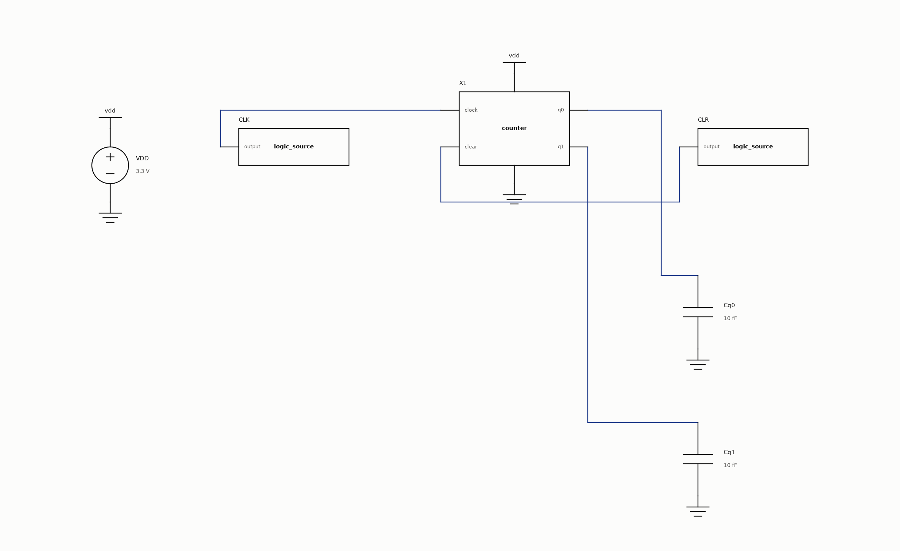
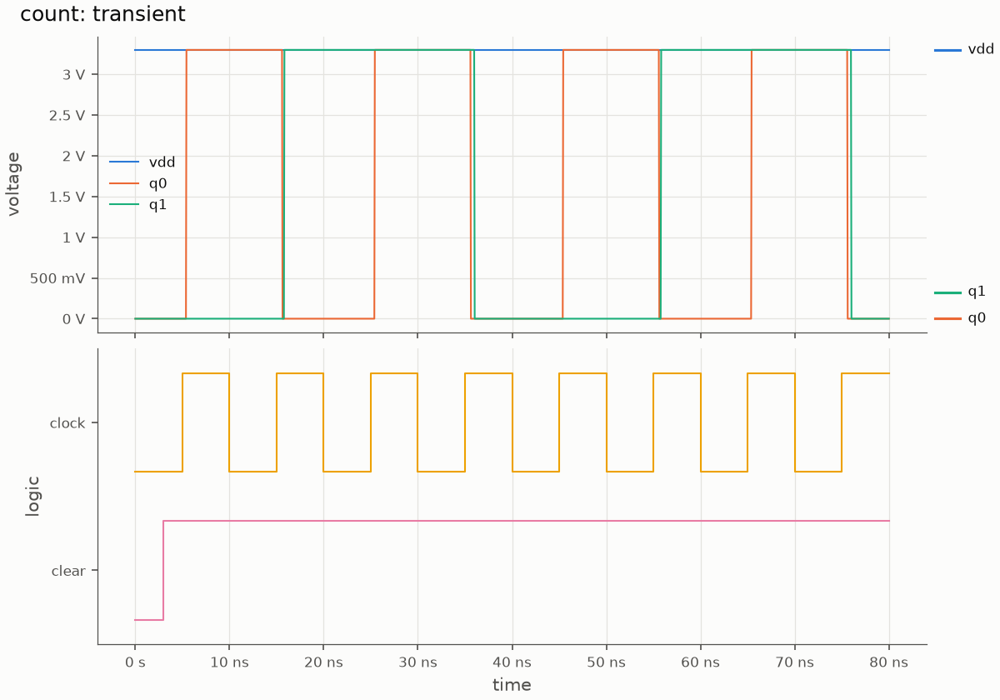

# Ripple counter of D flip-flops

A two-bit ripple counter of edge-triggered D flip-flops, each six NAND gates.

Each flip-flop follows the 7474 topology: two latches of three-input NAND gates pass data on the rising clock edge, with preset and clear.
Driven by its complemented output, a flip-flop toggles on every rising edge to halve the clock frequency.
A second stage clocked by the first complement halves the rate again, counting 0, 1, 2, 3 in binary while clear holds both outputs at zero initially.
Simulate with `jolty simulate examples/ripple_counter.py`.

[Open in 3D](ripple-counter.view.html){ .md-button .md-button--primary } [Script](https://github.com/maxencefaldor/jolty/blob/main/examples/ripple_counter.py){ .md-button }

11 devices and 6 unknowns.

## Specs

| Requirement | jolty |
| --- | --- |
| q0 at 15 ns in count ≥ 3.29 V and ≤ 3.31 V | 3.3 V, passed |
| q1 at 15 ns in count ≥ -10 mV and ≤ 10 mV | 0 V, passed |
| q0 at 25 ns in count ≥ -10 mV and ≤ 10 mV | 0 V, passed |
| q1 at 25 ns in count ≥ 3.29 V and ≤ 3.31 V | 3.3 V, passed |
| q0 at 35 ns in count ≥ 3.29 V and ≤ 3.31 V | 3.3 V, passed |
| q1 at 35 ns in count ≥ 3.29 V and ≤ 3.31 V | 3.3 V, passed |
| q0 at 45 ns in count ≥ -10 mV and ≤ 10 mV | 0 V, passed |
| q1 at 45 ns in count ≥ -10 mV and ≤ 10 mV | 0 V, passed |
| q0 at 55 ns in count ≥ 3.29 V and ≤ 3.31 V | 3.3 V, passed |
| q1 at 55 ns in count ≥ -10 mV and ≤ 10 mV | 0 V, passed |
| q0 at 65 ns in count ≥ -10 mV and ≤ 10 mV | 0 V, passed |
| q1 at 65 ns in count ≥ 3.29 V and ≤ 3.31 V | 3.3 V, passed |
| q0 at 75 ns in count ≥ 3.29 V and ≤ 3.31 V | 3.3 V, passed |
| q1 at 75 ns in count ≥ 3.29 V and ≤ 3.31 V | 3.3 V, passed |
| frequency of q0 in count ≥ 49.5 MHz and ≤ 50.5 MHz | 50 MHz, passed |

## Checked in closed form

The example holds logic devices, which SPICE has no element for, so its specs check it against its closed-form behavior: truth tables, codes and periods.

## Plots

