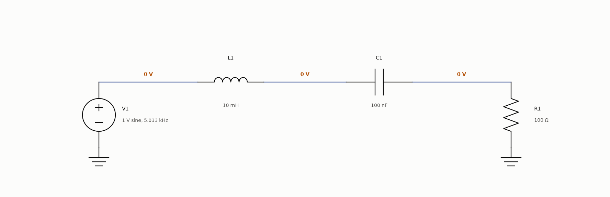
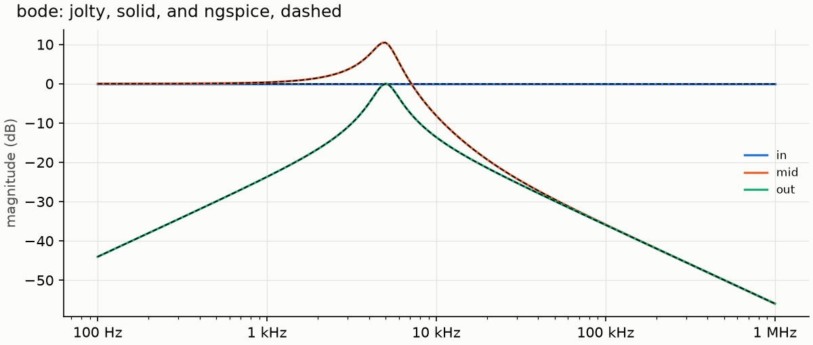
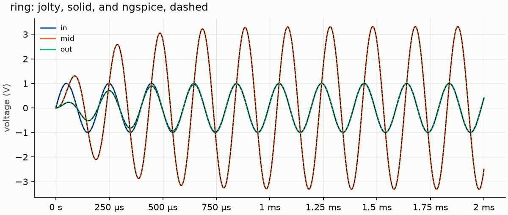
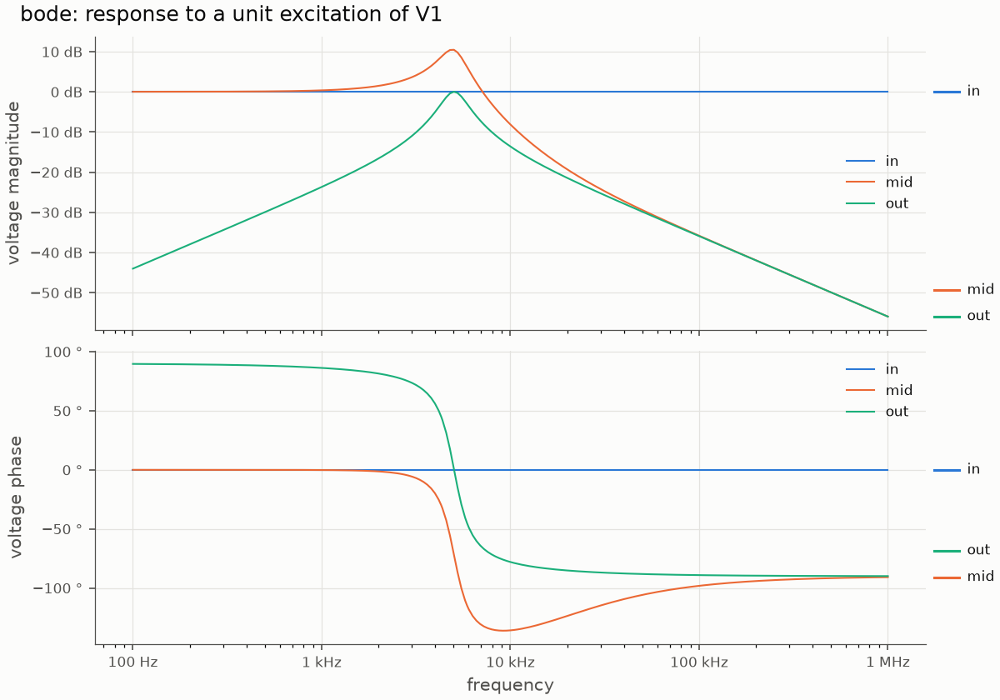
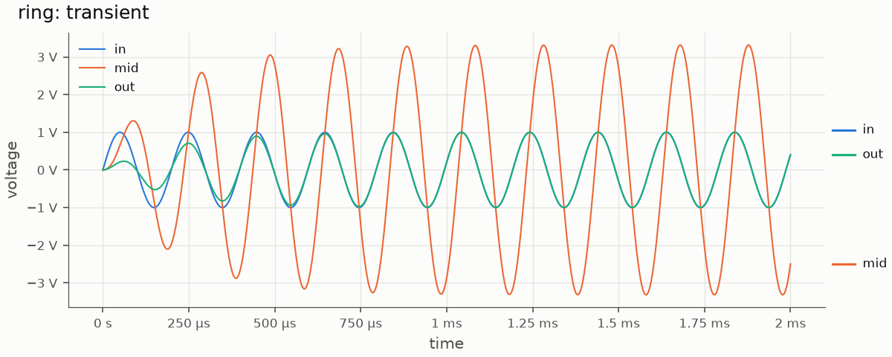

# Series RLC band-pass

A series RLC band-pass filter, its output across the resistor.

With 10 mH, 100 nF and 100 Ω, it resonates at f₀ = 1/(2π√(LC)) = 5.033 kHz with a quality factor Q = √(L/C)/R = 3.162, so its half-power band spans f₀/Q = 1.592 kHz, between f₀(√(1 + 1/4Q²) ∓ 1/2Q).
Simulate it with `jolty simulate examples/rlc_bandpass.py`.

[Open in 3D](rlc-bandpass.view.html){ .md-button .md-button--primary } [Script](https://github.com/maxencefaldor/jolty/blob/main/examples/rlc_bandpass.py){ .md-button }

4 devices, 5 unknowns, simulated in 1.38 s.

## Specs

| Requirement | jolty | ngspice | Difference |
| --- | --- | --- | --- |
| gain of out at 5.033 kHz in bode ≥ -1e-09 dB and ≤ 1e-09 dB | -9.64327e-16 dB, passed | 0 dB, passed | 1e+02 % |
| gain of out at 4.3 kHz in bode ≥ -3.01 dB and ≤ -3.01 dB | -3.0103 dB, passed | -3.0103 dB, passed | 1.5e-15 |
| gain of out at 5.891 kHz in bode ≥ -3.01 dB and ≤ -3.01 dB | -3.0103 dB, passed | -3.0103 dB, passed | 0 |

## Replicated in ngspice

jolty writes the circuit as a SPICE netlist, ngspice runs every analysis of the plan, and each signal both report is compared, relative to its largest value.
A transient compares each of ngspice's points with jolty's waveform within one of jolty's steps.

| Analysis | Voltages | Largest deviation | Currents | Largest deviation |
| --- | --- | --- | --- | --- |
| `op` | 3 | 0 | 2 | 0 |
| `bode` | 3 | 4.3e-14 | 2 | 4.3e-14 |
| `ring` | 3 | 5.4e-04 | 2 | 5.1e-04 |

## Plots

 
