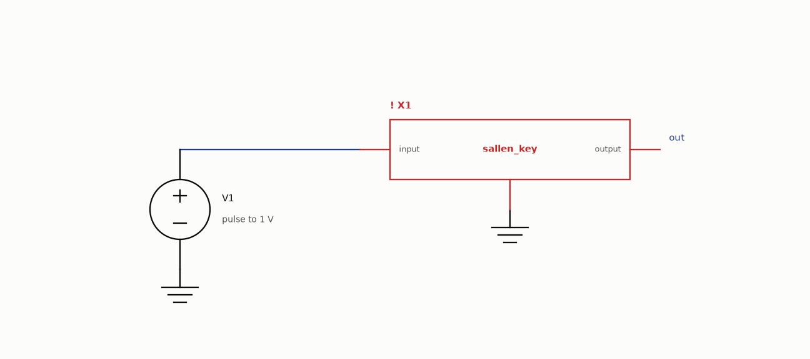
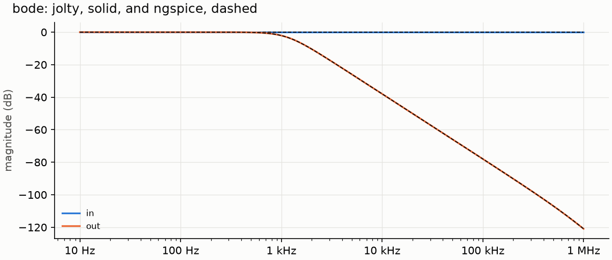
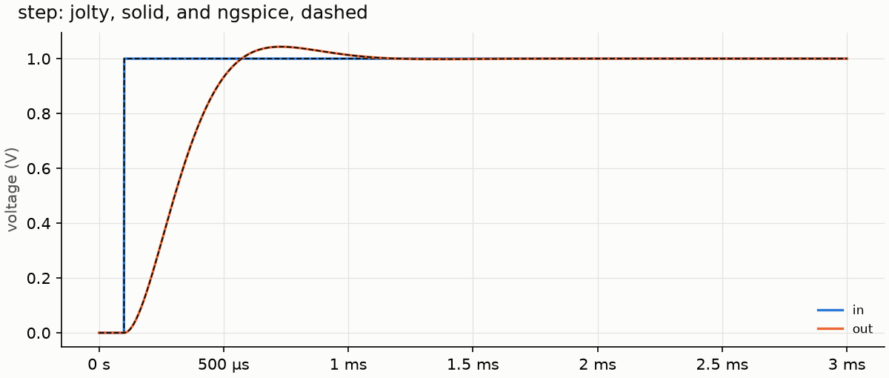
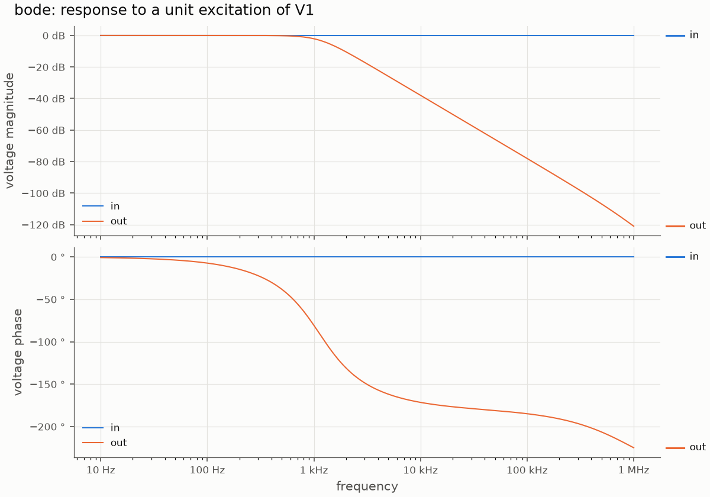
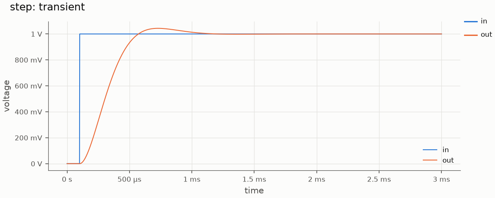

# Sallen-Key low-pass

A unity-gain Sallen-Key low-pass filter: the second-order Butterworth response.

Two 10 kΩ resistors, 20 nF from their junction back to the output and 10 nF to ground make ω₀ = 1/√(R₁R₂C₁C₂) and Q = √(R₁R₂C₁C₂)/((R₁ + R₂)C₂) = 1/√2: a cutoff of 1.125 kHz with no peaking, -3.01 dB there and -40 dB a decade beyond.
A follower drives the output: the op-amp of the shared parts, 100 dB of gain and 1 MHz of bandwidth.
Simulate it with `jolty simulate examples/sallen_key.py`.

[Open in 3D](sallen-key.view.html){ .md-button .md-button--primary } [Script](https://github.com/maxencefaldor/jolty/blob/main/examples/sallen_key.py){ .md-button }

10 devices and 7 unknowns.

## Specs

| Requirement | jolty | ngspice | Difference |
| --- | --- | --- | --- |
| gain of out at 10 Hz in bode ≥ -0.001 dB and ≤ 0.001 dB | -8.59339e-05 dB, passed | -8.59339e-05 dB, passed | 2.2e-11 |
| gain of out at 1.125 kHz in bode ≥ -3.02 dB and ≤ -3 dB | -3.01192 dB, passed | -3.01192 dB, passed | 1.6e-15 |
| gain of out at 11.25 kHz in bode ≥ -40.05 dB and ≤ -39.95 dB | -40.0148 dB, passed | -40.0148 dB, passed | 3.6e-16 |
| overshoot of out in step ≥ 4.27 % and ≤ 4.37 % | 4.34556 %, passed | 4.34523 %, passed | 7.5e-05 |

## Replicated in ngspice

jolty writes the circuit as a SPICE netlist, ngspice runs every analysis of the plan, and each signal both report is compared, relative to its largest value.
A transient compares each of ngspice's points with jolty's waveform within one of jolty's steps.

| Analysis | Voltages | Largest deviation | Currents | Largest deviation |
| --- | --- | --- | --- | --- |
| `bode` | 5 | 1.4e-15 | 2 | 1.1e-15 |
| `step` | 5 | 2.3e-08 | 2 | 5.0e-05 |

## Plots

 
