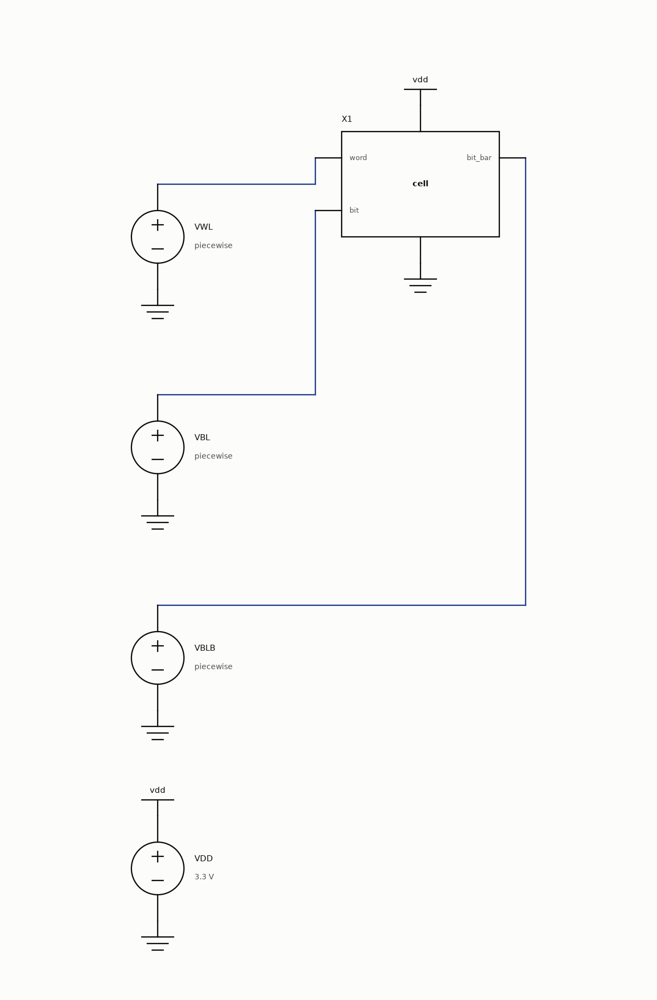
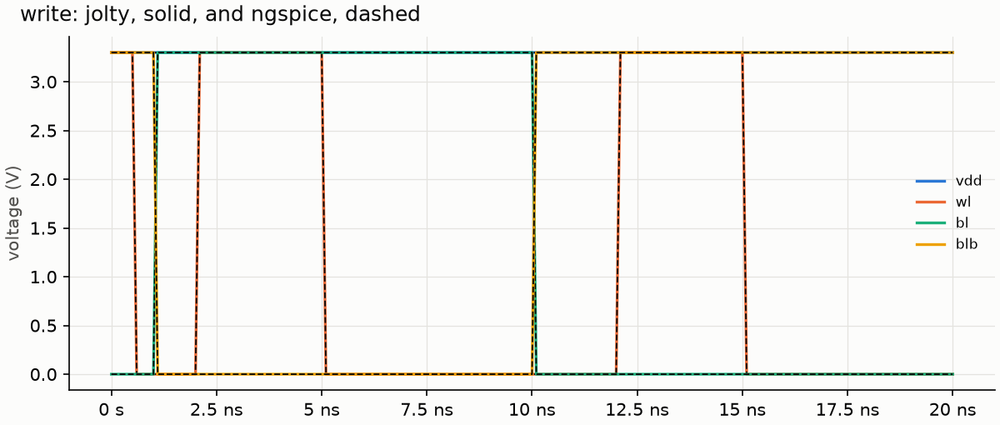
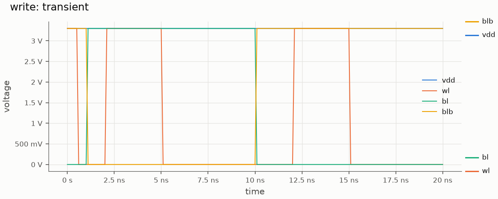

# Six-transistor SRAM cell

A six-transistor SRAM cell: two cross-coupled inverters and two access transistors.

The inverters hold a bit, each the other's complement.
Raising the word line opens the access transistors onto the bit lines: driven apart, the bit lines overpower the cell's weaker pull-ups and write it, and once the word line falls the cell keeps what was written.
The bench starts writing a 0, so the operating point holds one state of the two the cell could, then writes a 1, holds it, writes a 0 and holds it.
Simulate it with `jolty simulate examples/sram_cell.py`.

[Open in 3D](sram-cell.view.html){ .md-button .md-button--primary } [Script](https://github.com/maxencefaldor/jolty/blob/main/examples/sram_cell.py){ .md-button }

8 devices and 28 unknowns.

## Specs

| Requirement | jolty | ngspice | Difference |
| --- | --- | --- | --- |
| X1/q at 9 ns in write ≥ 3.29 V and ≤ 3.31 V | 3.3 V, passed | 3.3 V, passed | 4.6e-15 |
| X1/q_bar at 9 ns in write ≥ -10 mV and ≤ 10 mV | 12.2891 nV, passed | 12.2891 nV, passed | 1.3e-07 |
| X1/q at 19 ns in write ≥ -10 mV and ≤ 10 mV | 12.2891 nV, passed | 12.2891 nV, passed | 5.2e-08 |
| X1/q_bar at 19 ns in write ≥ 3.29 V and ≤ 3.31 V | 3.3 V, passed | 3.3 V, passed | 1.3e-16 |

## Replicated in ngspice

jolty writes the circuit as a SPICE netlist, ngspice runs every analysis of the plan, and each signal both report is compared, relative to its largest value.
A transient compares each of ngspice's points with jolty's waveform within one of jolty's steps.

| Analysis | Voltages | Largest deviation | Currents | Largest deviation |
| --- | --- | --- | --- | --- |
| `write` | 6 | 0.22 % | 4 | 4.5 % |

## Plots

