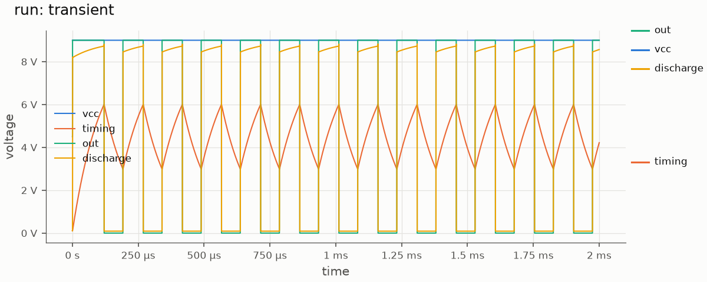

# 555 timer, astable

The 555 timer, built from its block diagram, running astable.

Inside the timer, three 5 kΩ resistors divide the supply into thirds, and two comparators monitor threshold against two thirds and trigger against one third.
A NOR SR latch tracks the last crossing, and a 2N3904 discharges the timing capacitor while the output is low.
Outside, 1 kΩ and 10 kΩ charge 10 nF from 9 V to two thirds, and the 10 kΩ resistor discharges the capacitor to one third.
The output stays high for 0.693(Ra + Rb)C = 76.2 µs and low for 0.693·Rb·C = 69.3 µs, yielding a 145.5 µs period (6.87 kHz).
Simulate with `jolty simulate examples/timer_555.py`.

[Open in 3D](timer-555.view.html){ .md-button .md-button--primary } [Script](https://github.com/maxencefaldor/jolty/blob/main/examples/timer_555.py){ .md-button }

16 devices and 17 unknowns.

## Specs

| Requirement | jolty |
| --- | --- |
| frequency of out from 500 µs in run ≥ 6.664 kHz and ≤ 7.076 kHz | 6.7325 kHz, passed |
| maximum of timing from 500 µs in run ≥ 5.9 V and ≤ 6.1 V | 6.0084 V, passed |

## Checked in closed form

The example holds logic devices, which SPICE has no element for, so its specs check it against its closed-form behavior: truth tables, codes and periods.

## Plots

