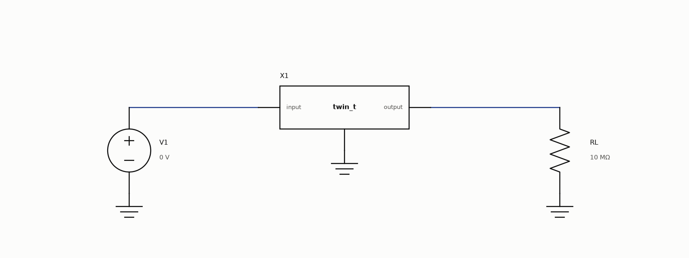
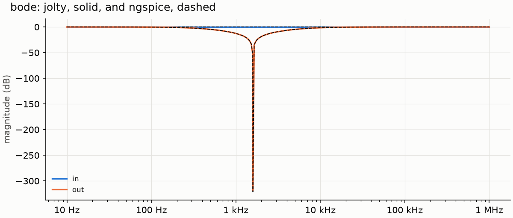
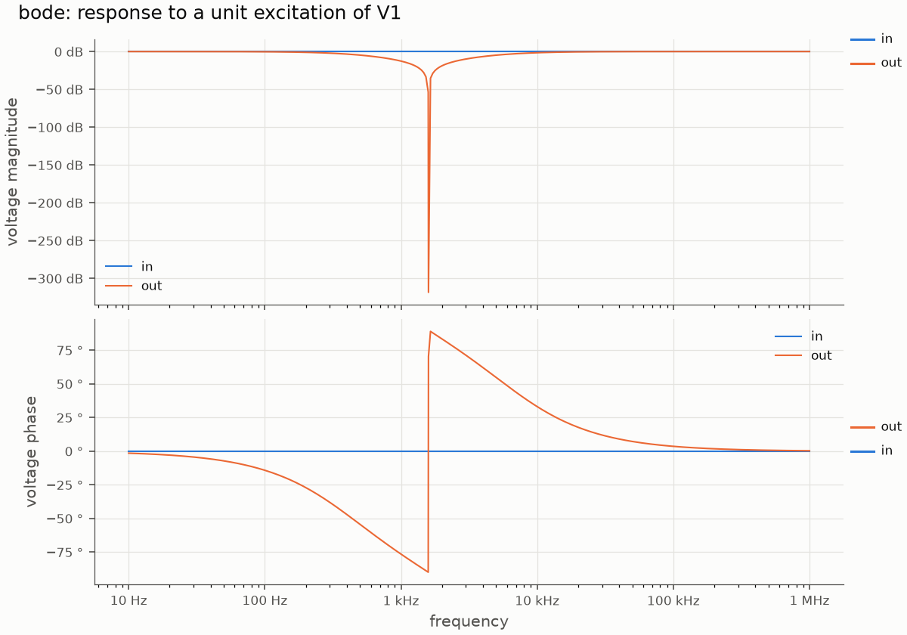

# Twin-T notch

A twin-T notch filter: two T networks in parallel that cancel at one frequency.

One T is two resistors R with a capacitor 2C to ground; the other two capacitors C with a resistor R/2 to ground.
With R = 10 kΩ and C = 10 nF, their outputs cancel exactly at f₀ = 1/(2πRC) = 1.592 kHz, and the filter passes the frequencies far from it.
Simulate it with `jolty simulate examples/twin_t_notch.py`.

[Open in 3D](twin-t-notch.html){ .md-button .md-button--primary } [Script](https://github.com/maxencefaldor/jolty/blob/main/examples/twin_t_notch.py){ .md-button }

8 devices, 5 unknowns, simulated in 1.65 s.

## Specs

| Requirement | jolty | ngspice | Difference |
| --- | --- | --- | --- |
| gain of out at 10 Hz in bode ≥ -0.03 dB and ≤ 0 dB | -0.0200895 dB, passed | -0.0200895 dB, passed | 9.6e-14 |
| gain of out at 1.592 kHz in bode ≤ -100 dB | -318.53 dB, passed | -321.276 dB, passed | 0.85 % |

## Replicated in ngspice

jolty writes the circuit as a SPICE netlist, ngspice runs every analysis of the plan, and each signal both report is compared, relative to its largest value.
A transient compares each of ngspice's points with jolty's waveform within one of jolty's steps.

| Analysis | Voltages | Largest deviation | Currents | Largest deviation |
| --- | --- | --- | --- | --- |
| `bode` | 4 | 5.3e-15 | 1 | 8.1e-14 |

## Plots

