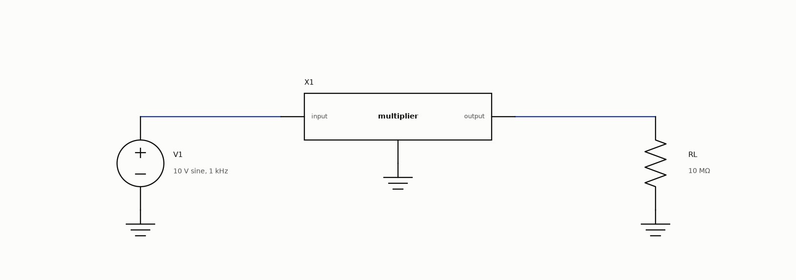
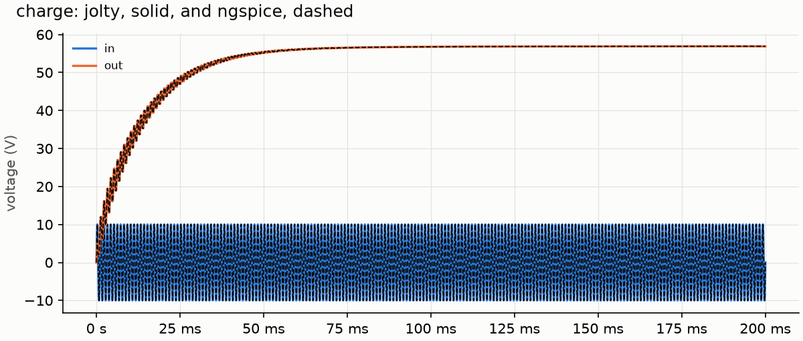
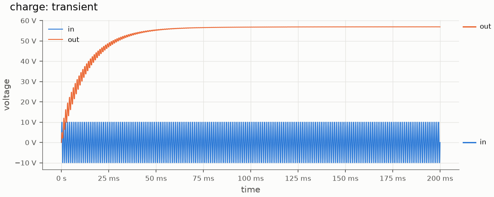

# Cockcroft-Walton multiplier

A three-stage Cockcroft-Walton multiplier: six diodes and six capacitors.

Each stage adds twice the input's peak: from a 10 V sine, an unloaded ladder of three stages charges toward 60 V, less two diode drops a stage.
The capacitors charge a little each cycle, so the output climbs over tens of cycles.
Simulate it with `jolty simulate examples/voltage_multiplier.py`.

[Open in 3D](voltage-multiplier.view.html){ .md-button .md-button--primary } [Script](https://github.com/maxencefaldor/jolty/blob/main/examples/voltage_multiplier.py){ .md-button }

14 devices, 14 unknowns, simulated in 3.60 s.

## Specs

| Requirement | jolty | ngspice | Difference |
| --- | --- | --- | --- |
| out at 200 ms in charge ≥ 50 V and ≤ 60 V | 56.8871 V, passed | 56.8849 V, passed | 3.8e-05 |

## Replicated in ngspice

jolty writes the circuit as a SPICE netlist, ngspice runs every analysis of the plan, and each signal both report is compared, relative to its largest value.
A transient compares each of ngspice's points with jolty's waveform within one of jolty's steps.

| Analysis | Voltages | Largest deviation | Currents | Largest deviation |
| --- | --- | --- | --- | --- |
| `charge` | 7 | 1.6e-04 | 1 | 0.34 % |

## Plots

