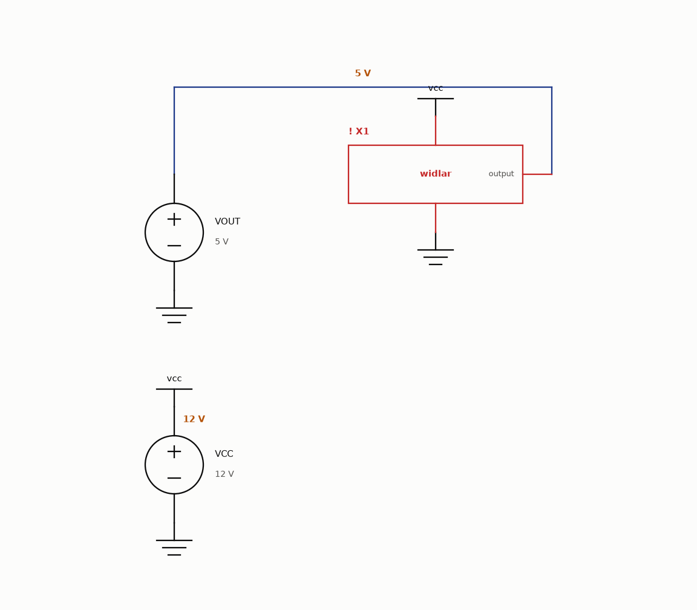
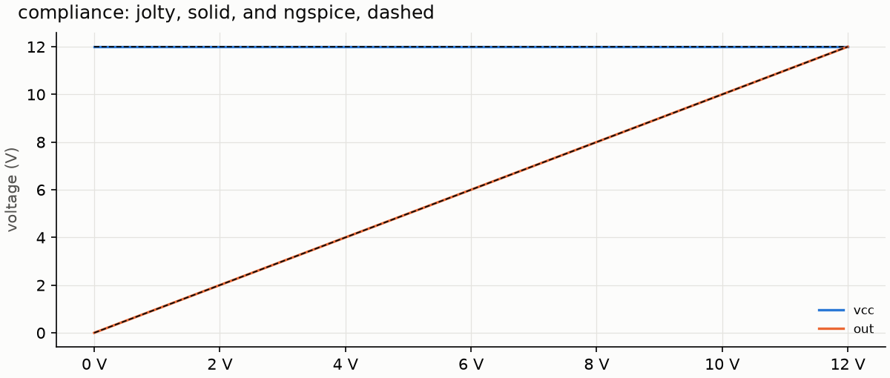
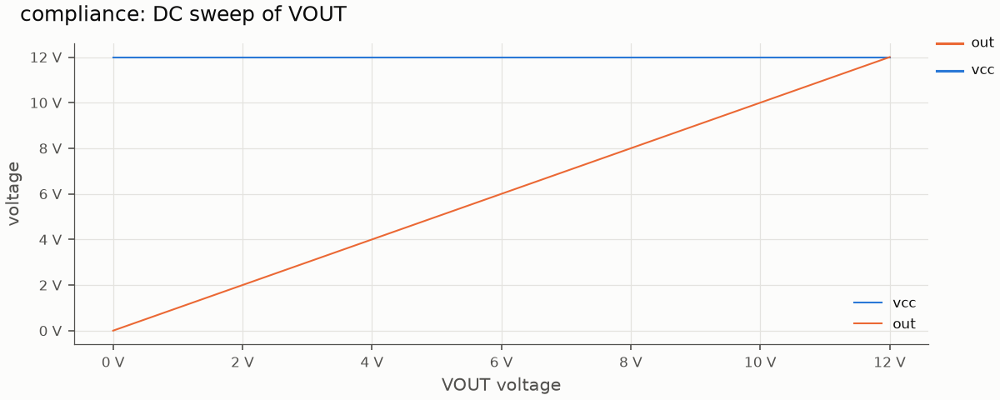

# Widlar current source

A Widlar current source: a small output current from a large reference.

The reference transistor carries about 1 mA, set by 11.3 kΩ from 12 V; an emitter resistor of 1.55 kΩ under the output transistor takes the difference of their base-emitter voltages, Vt·ln(Iref/Iout) = Iout·Re, so the output settles near 50 µA and stays there as its collector's voltage moves.
Simulate it with `jolty simulate examples/widlar_source.py`.

[Open in 3D](widlar-source.view.html){ .md-button .md-button--primary } [Script](https://github.com/maxencefaldor/jolty/blob/main/examples/widlar_source.py){ .md-button }

6 devices, 10 unknowns, simulated in 1.01 s.

## Specs

| Requirement | jolty | ngspice | Difference |
| --- | --- | --- | --- |
| VOUT:current in op ≥ -55 µA and ≤ -45 µA | -50.4293 µA, passed | -50.4294 µA, passed | 1.1e-07 |
| VOUT:current at 1 V in compliance ≥ -55 µA and ≤ -45 µA | -49.7588 µA, passed | -49.7588 µA, passed | 2.0e-08 |
| VOUT:current at 12 V in compliance ≥ -55 µA and ≤ -45 µA | -51.5282 µA, passed | -51.5282 µA, passed | 2.3e-07 |

## Replicated in ngspice

jolty writes the circuit as a SPICE netlist, ngspice runs every analysis of the plan, and each signal both report is compared, relative to its largest value.
A transient compares each of ngspice's points with jolty's waveform within one of jolty's steps.

| Analysis | Voltages | Largest deviation | Currents | Largest deviation |
| --- | --- | --- | --- | --- |
| `op` | 4 | 1.2e-08 | 2 | 1.1e-07 |
| `compliance` | 4 | 2.0e-07 | 2 | 2.3e-08 |

## Plots

