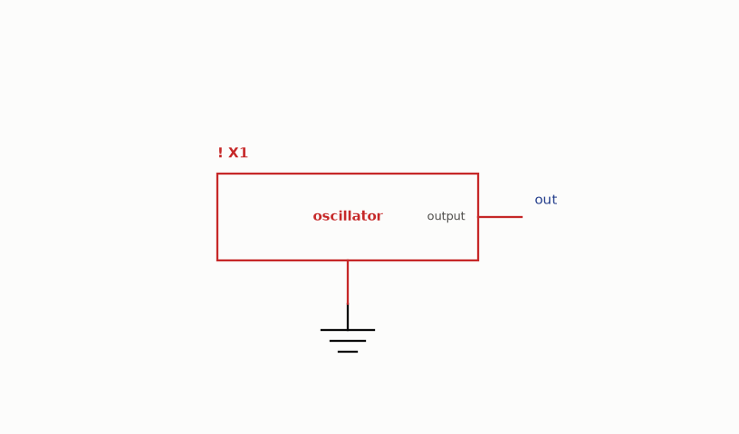
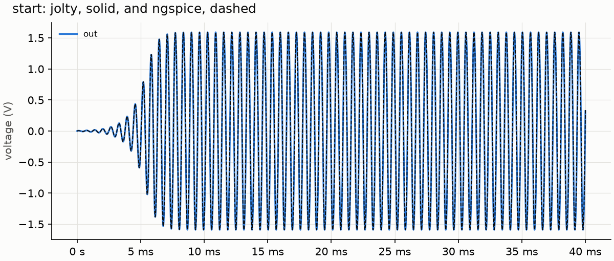
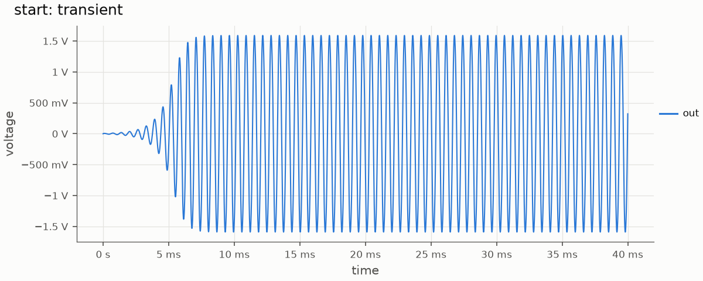

# Wien bridge oscillator

A Wien bridge oscillator, its amplitude held by two diodes.

The bridge's series and parallel RC arms, 10 kΩ and 10 nF each, pass a third of the output with no phase shift at f₀ = 1/(2πRC) = 1.592 kHz, so the loop oscillates there when the op-amp's non-inverting gain is three.
Its gain is 1 + 22 kΩ/10 kΩ = 3.2, enough to start; as the swing grows, two 1N4148 diodes across part of the feedback resistor conduct and bring the gain to three, holding the amplitude.
A 1 µA pulse at the start sets it going.
Simulate it with `jolty simulate examples/wien_bridge.py`.

[Open in 3D](wien-bridge.view.html){ .md-button .md-button--primary } [Script](https://github.com/maxencefaldor/jolty/blob/main/examples/wien_bridge.py){ .md-button }

15 devices and 11 unknowns.

## Specs

| Requirement | jolty | ngspice | Difference |
| --- | --- | --- | --- |
| frequency of out from 30 ms in start ≥ 1.56 kHz and ≤ 1.623 kHz | 1.57384 kHz, passed | 1.57392 kHz, passed | 5.5e-05 |
| peak-to-peak of out from 30 ms in start ≥ 2 V and ≤ 20 V | 3.1809 V, passed | 3.18105 V, passed | 4.6e-05 |

## Replicated in ngspice

jolty writes the circuit as a SPICE netlist, ngspice runs every analysis of the plan, and each signal both report is compared, relative to its largest value.
A transient compares each of ngspice's points with jolty's waveform within one of jolty's steps.

A free-running oscillator's phase drifts with the least difference in two engines' numerics, so its waveforms compare through the specs' readings, its period and its swing, rather than point by point.

## Plots

