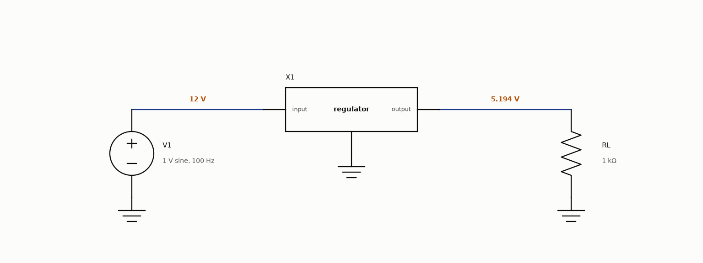
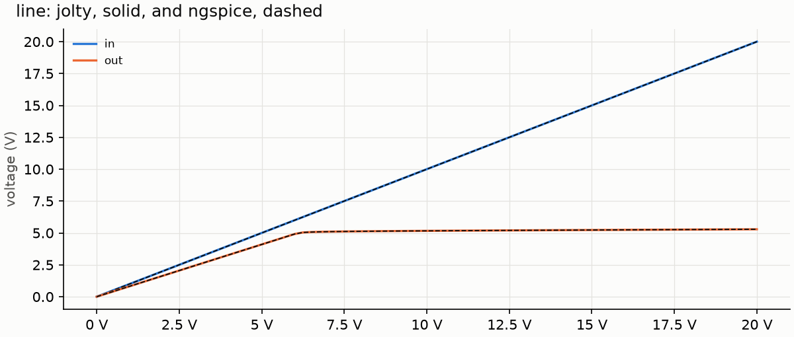
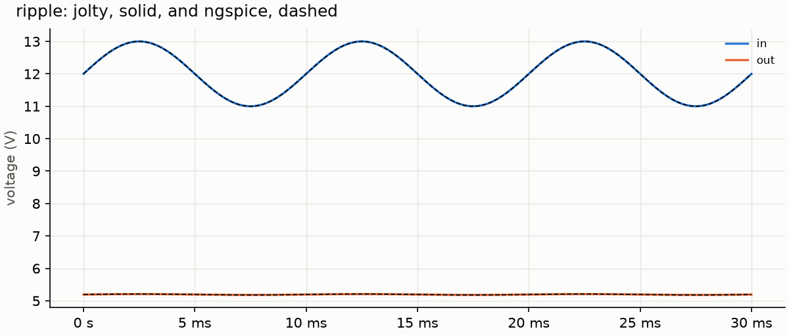
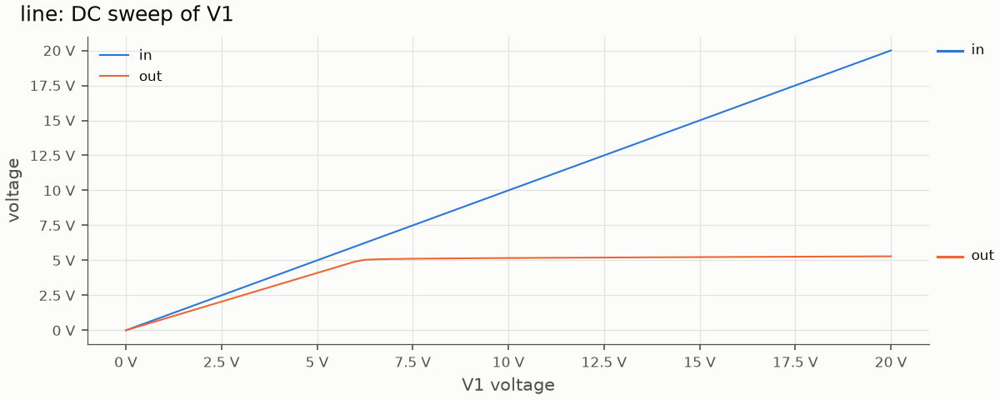
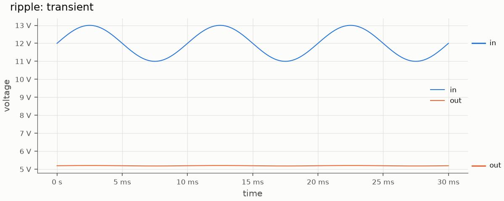

# Zener shunt regulator

A zener shunt regulator: a 5.1 V zener holding a load's supply against its input.

A 220 Ω resistor feeds the zener and a 1 kΩ load from a 12 V input.
Above the zener's knee, the input's changes fall across the resistor, and the output moves by the zener's small resistance over the resistor's: a line regulation of some 1 %.
Simulate it with `jolty simulate examples/zener_regulator.py`.

[Open in 3D](zener-regulator.view.html){ .md-button .md-button--primary } [Script](https://github.com/maxencefaldor/jolty/blob/main/examples/zener_regulator.py){ .md-button }

4 devices, 4 unknowns, simulated in 1.17 s.

## Specs

| Requirement | jolty | ngspice | Difference |
| --- | --- | --- | --- |
| out at 9 V in line ≥ 4.9 V and ≤ 5.3 V | 5.14813 V, passed | 5.14813 V, passed | 1.8e-07 |
| out at 12 V in line ≥ 4.9 V and ≤ 5.3 V | 5.19387 V, passed | 5.19387 V, passed | 7.9e-09 |
| out at 15 V in line ≥ 4.9 V and ≤ 5.3 V | 5.23158 V, passed | 5.23158 V, passed | 1.4e-09 |
| out at 20 V in line ≥ 4.9 V and ≤ 5.3 V | 5.28811 V, passed | 5.28811 V, passed | 2.1e-10 |

## Replicated in ngspice

jolty writes the circuit as a SPICE netlist, ngspice runs every analysis of the plan, and each signal both report is compared, relative to its largest value.
A transient compares each of ngspice's points with jolty's waveform within one of jolty's steps.

| Analysis | Voltages | Largest deviation | Currents | Largest deviation |
| --- | --- | --- | --- | --- |
| `op` | 2 | 5.6e-10 | 1 | 4.3e-10 |
| `line` | 2 | 1.3e-06 | 1 | 4.6e-07 |
| `ripple` | 2 | 1.0e-06 | 1 | 1.7e-06 |

## Plots

 
