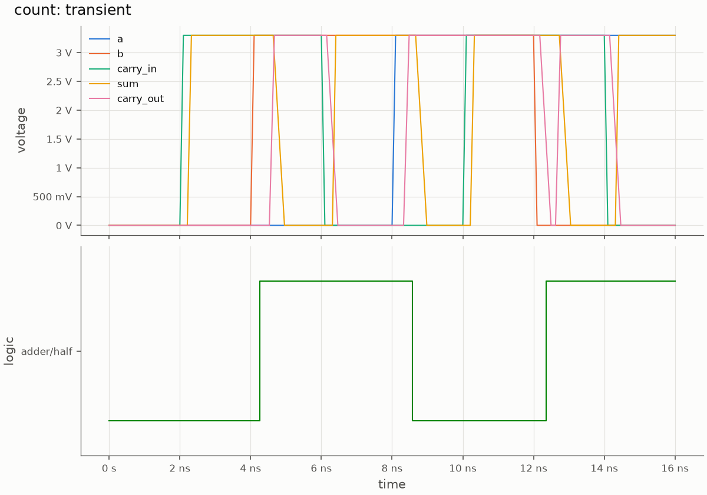

# Fidelity

A transistor-level component is exact by definition, and as expensive to simulate as its full circuit.
Plan fidelity replaces selected component instances with faster models: logic cells characterized from the underlying component circuits and simulated by the [event scheduler](logic.md).
The circuit itself remains unchanged; only the plan controls model selection.

## Choosing models

A plan's `fidelity` maps scopes, patterns of instance paths, to `jolty.Characterized` settings:

```python
def plan() -> Plan:
    return Plan(
        {"count": Transient(stop=16 * ns)},
        fidelity={"adder/*": Characterized(3.3 * V, spot_checks=2)},
    )
```

In a scope, `*` matches within a level of the hierarchy and `**` across levels.
An instance within another that a scope matches takes the outer one's model, and a scope that matches no component instance is an error.
Characterized models apply under nominal plan conditions, at every corner, and across Monte Carlo samples (representing nominal internal parts).

## Characterization

A component characterized as a logic cell exposes input ports (`Role.INPUT`), output ports (`Role.OUTPUT`), one supply port, and one ground port.
Characterization holds the supply at the configured `supply` voltage and devices at the run temperature, measuring standard cell properties:

- truth tables from an operating point at every input combination, requiring each output within 10% of a rail;
- input capacitance as the mean small-signal capacitance across input combinations;
- timing arcs (delay and transition time) from transients over a grid of input slews and output loads for every single-input transition affecting an output.

Delay spans from the input crossing half-supply to the output crossing half-supply, and transition time measures the full rail-to-rail swing at the crossing slope.
Grid scales adapt to each cell: loads equal `fanouts` times mean input capacitance (default `(0, 1, 2, 4)`), and input slews equal `slews` times mean fanout-1 output transition (default `(0.5, 1, 2, 4)`).
Transients at grid midpoints quantify interpolation error, which appears in the simulation report.

Characterization requires transistor capacitances: zero input capacitance leaves load scaling undefined, and nodes coupled only by Meyer gate capacitances stall transients in both ngspice and jolty.

During event simulation, each output switches after the delay interpolated linearly from the input slew and output load (clamped at table boundaries).
Logic-net loads sum downstream input capacitances, while electrical-net loads equal total operating-point small-signal capacitance including transistor gates.
An output reversing before reaching a rail swings less voltage and crosses half-supply sooner.

## Spot checks

On each run, `spot_checks` matched instances (chosen deterministically using `seed`) re-run the plan at full transistor fidelity while neighbors stay characterized.
Every output transition must match the model's level sequence within the model's interpolation error plus `tolerance` (default 0.1) times mean delay; operating points and DC sweeps must match logic levels identically.
Any mismatch violates the fidelity contract and reports the divergence:

<!-- output of: jolty simulate full_adder.py --plan contract.py --no-schematic --no-plot -->

```text
fidelity:
  nand: a logic cell of 4 arcs for adder/U1, ..., adder/U9, over transitions from 67.53 ps to 540.2 ps and loads from 0 F to 19.86 fF; interpolated within 4.125 ps of its delays and 10.84 ps of its transitions
  error[contract-violated]: adder/U6's model diverges
    count: output y changes to 1 at 4.543 ns in its circuit and at 4.59 ns in its model
```

A violated contract fails the simulation, as a failed spec does.

## Validity and dependence

A characterized cell's timing holds where it was measured: between its least and its most input transition and load, at its supply.
The engine monitors every analysis for out-of-range cell inputs, loads, or supply deviations beyond relative tolerance, warning under `outside-validity`:

<!-- output of: jolty simulate validity.py --no-schematic --no-plot -->

```text
fidelity:
  ...
  warn[outside-validity]: X1's load reads 470 fF in step, outside the 0 F to 20.72 fF its model was characterized over; first at 1.05 ns, once
```

Outside its domain, a cell holds its tables' edge, and its timing is a guess.

When the plan defines specs, each spot check measures them again, with its instance at its circuit's fidelity.
A requirement whose verdict changes there depends on the model, and the report states it at the rule `fidelity-dependence`, a warning:

<!-- output of: jolty simulate validity.py --no-schematic --no-plot -->

```text
fidelity:
  ...
  warn[fidelity-dependence]: first falling crossing of 1.65 V by mid in step ≤ 2.37 ns: passed, reading 1.184 ns, with every model, failed, reading 3.123 ns, with X1 at its circuit's fidelity
```

## Limits

Each timing arc characterizes a single input changing in isolation.
When multiple inputs switch within one gate delay (as in an XOR built from NAND gates), outputs may reverse mid-swing outside single-arc data, and spot checks measure the resulting deviation.
Characterized cells draw zero supply current and always reflect nominal internal part values regardless of tolerances.

## From transistors to a full adder

The example [`full_adder.py`](https://github.com/maxencefaldor/jolty/blob/main/examples/full_adder.py) builds a full adder of nine four-transistor NAND gates, simulates it with characterized cells, and holds timing within half a mean delay:



