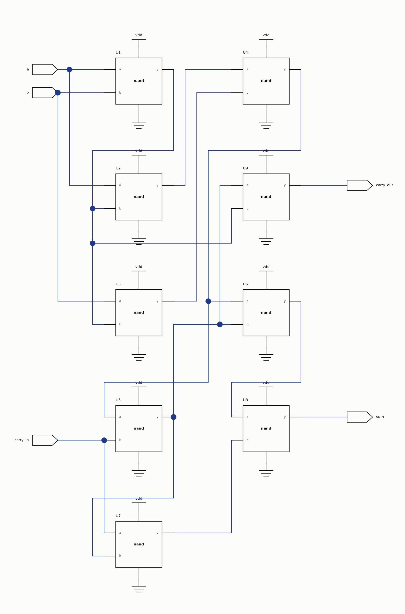

# Fidelity

A component defined by its circuit is exact by definition, and as costly as its circuit.
A plan's fidelity simulates chosen component instances with cheaper models instead: logic cells characterized from their components' own circuits, which the [event scheduler](logic.md) runs at event speed.
The circuit stays as it is; only the plan chooses.

## Choosing models

A plan's `fidelity` maps scopes, patterns of instance paths, to `jolty.Characterized` settings:

```python
def plan() -> Plan:
    return Plan(
        {"count": Transient(stop=16 * ns)},
        fidelity={"adder/*": Characterized(3.3 * V, spot_checks=2)},
    )
```

In a scope, `*` matches within a level of the hierarchy and `**` across levels.
An instance within another that a scope matches takes the outer one's model, and a scope that matches no component instance is an error.
The models stand in at the plan's own conditions, at each corner, and on each Monte Carlo sample, where they stand for their circuits' nominal parts.

## Characterization

A component characterized as a logic cell has ports that are inputs (`Role.INPUT`), outputs (`Role.OUTPUT`), one supply and one ground.
The supply is held at the setting's `supply`, the devices at the run's temperature, and the cell is measured as a standard cell library measures its cells:

- its truth tables, from an operating point at each combination of its inputs, each output within a tenth of the supply of a rail;
- each input's capacitance, its mean small-signal capacitance over the combinations;
- for each change of one input that changes an output, its arc, the output's delay and transition over a grid of input transitions and output loads, from transients.

The delay runs from the input's crossing of half the supply to the output's, and the transition is the time an edge at the output's rate there takes to swing the supply.
The grid's scale is the cell's own: its loads are `fanouts` times its mean input capacitance, `(0, 1, 2, 4)` unless given, and its transitions `slews` times its outputs' mean transition at a fanout of one, `(0.5, 1, 2, 4)` unless given.
Transients at the midpoints between the grid's points measure the error of interpolating it, which the report states.

A characterization needs the transistors' capacitances: an input with no capacitance gives the loads no scale, and a node joined only by Meyer's gate capacitances stalls a transient, in ngspice as in jolty.

In the event scheduler, a cell's output changes the arc's delay after its input crosses half the supply, its tables read at the input's transition and the load the output drives, linearly between their points and held at their edges.
A logic net's load is its inputs' capacitance; an electrical net's, which a logic driver drives, is its whole small-signal capacitance at the operating point, transistors' gates included.
An output that turns back before its edge reaches its rail has less to swing, and crosses half the supply sooner.

## Spot checks

Each run, `spot_checks` of the instances a scope matches, drawn with its `seed`, run the plan again at their circuit's own fidelity, their neighbors still models.
Each output's changes must reach the same levels in the same order as the model's, each within the model's measured error plus `tolerance`, 0.1 unless given, times its mean delay; at an operating point and over a sweep, each output must hold the same levels.
An output that does not violates the contract, and the report states where:

```text
fidelity:
  nand: a logic cell of 4 arcs for adder/U1, ..., adder/U9, over transitions from 67.09 ps to 536.7 ps and loads from 0 F to 19.86 fF; interpolated within 4.092 ps of its delays and 16.18 ps of its transitions
  error[contract-violated]: adder/U6's model diverges
    count: output y changes to 1 at 10.52 ns in its circuit and at 10.57 ns in its model
```

A violated contract fails the simulation, as a failed spec does.

## Validity and dependence

A characterized cell's timing holds where it was measured: between its least and its most input transition and load, at its supply.
The engine watches every analysis for a cell read outside that domain, a supply further from its own than the relative tolerance included, and the report states each one at the rule `outside-validity`, a warning:

```text
warn[outside-validity]: X1's load reads 500 fF in step, outside the 0 F to 19.86 fF its model was characterized over; first at 1.05 ns, once
```

Outside its domain, a cell holds its tables' edge, and its timing is a guess.

When the plan defines specs, each spot check measures them again, with its instance at its circuit's fidelity.
A requirement whose verdict changes there depends on the model, and the report states it at the rule `fidelity-dependence`, a warning:

```text
warn[fidelity-dependence]: first falling crossing of 1.65 V by mid in step ≤ 2.37 ns: passed, reading 1.198 ns, with every model, failed, reading 3.542 ns, with X1 at its circuit's fidelity
```

## Limits

A cell's arcs each measure one input changing alone.
Where a gate's inputs change within its delay of each other, as inside an XOR built of NAND gates, its output may turn back before reaching its rail in ways no single arc measures, and the gate follows its cell less closely; the spot checks measure how closely.
A cell draws no current from its supply, and stands for its circuit's nominal parts, whatever their tolerances.

## From transistors to a full adder

The example [`full_adder.py`](https://github.com/maxencefaldor/jolty/blob/main/examples/full_adder.py) builds a full adder of nine NAND gates of four transistors each, runs it on characterized cells, and holds them to half a mean delay:




