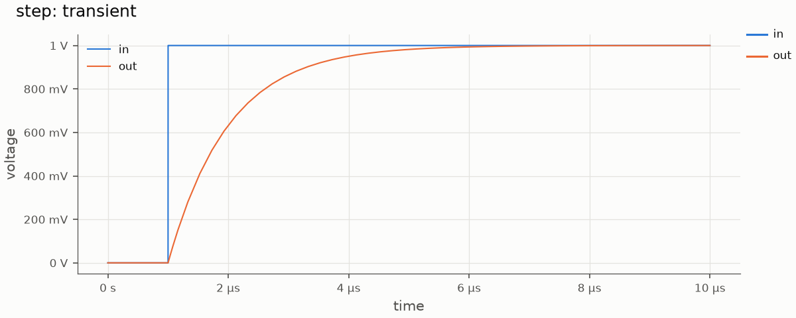

# Results

`jolty simulate` reports what each analysis found, and saves every value to a results file.

## The report

A report states facts, one section per analysis in the plan's order:

- an operating point lists every unknown's value and every logic net's level, and the strategy that found it;
- a search for operating points lists every unknown's value at each DC solution it found, the operating point first;
- a sweep, a frequency response or a transient lists each unknown's first, lowest, highest and last value, and each logic net's first and last level and how often it changed;
- a sensitivity analysis lists, for each output, its value and its derivative with respect to each parameter, in the circuit's order, or, along another analysis, each derivative's largest and where;
- a stability analysis states the loop gain at its lowest frequency, its crossover frequency and phase margin, and its gain margin;
- a pole-zero analysis lists each pole and zero, a conjugate pair once, with its natural frequency and damping ratio;
- a noise analysis states the noise density at its lowest and highest frequencies, the RMS noise over them at the output and referred to its input, and the noisiest sources with their RMS noise and share of the output's noise power;
- a failed analysis says why it failed.

A frequency response lists magnitudes per unit excitation: volts per volt, for a voltage source.
A report lists the first unknowns, then the first logic nets, up to the setting `listed_unknowns`, and a sensitivity analysis as many parameters; the results file holds them all.
With `--output-format json`, the command prints the same report as data.

## Plots

`jolty simulate` plots every analysis but operating points, searches for them and sensitivities beside its results, as `<script>.<analysis>.plot.png`, and the MCP server sends the images with its text.
A transient plots over time, a sweep along its source's levels, and a frequency response as a Bode plot, as is a loop gain, against 0 dB and -180°, where its margins are read; a noise analysis plots its output's noise density, with its noisiest sources', and the noise referred to its input on log axes; and a pole-zero analysis plots each pole and zero at its natural frequency and damping ratio, against the line at zero below which a pole grows:




Voltages, currents, temperatures and devices' states never share an axis: each quantity has a panel of its own, and a frequency response has two, its magnitude in decibels and its phase.
A legend names the series, and up to four are also labeled at their end:


Logic nets share a panel of their own, one lane each, with unknown levels hatched (see [Logic](logic.md#levels-in-results)).

By default a plot draws the nets the top component names, voltages then logic nets, up to eight.
The option `--probes` chooses other unknowns, such as `X1/mid` or `V1:current`, and `jolty plot` draws a saved results file again, with other probes, without simulating:

```sh
uv run jolty plot rectifier.results.npz --analyses ripple --probes out --probes V1:current
```

The option `--no-plot` leaves plots out.

## Unknowns

Every result holds the circuit's unknowns, named by path:

- the voltage of a net, such as `out` or `X1/mid`, relative to the ground;
- the temperature of a thermal net above the ambient, in kelvins, such as `junction`;
- the current through a voltage source, inductor or voltage-controlled voltage source, such as `V1:current`;
- the junction voltage of a diode with a series resistance, such as `D1:junction`.

## What a result records

Beside the unknowns, a result records what its plan's `record`, or its analysis's own, names of the circuit's devices and component instances, at every point it solved:

```python
Plan({...}, record=["M1", "X1"])  # the transistor M1, and the ports of the instance X1
Plan(
    {...}, record=["X1/**", "!X1/bias/**"]
)  # everything inside X1 but its bias network
Plan({...}, record=["**"])  # every instance
Transient(stop=1 * ms, record=["D1"])  # this analysis records D1, whatever the plan's
```

Each entry is an instance's path, or a pattern of paths as a plan's [fidelity](fidelity.md) scopes are written, where `*` matches within a level of the hierarchy and `**` across levels.
An entry after `!` takes back what the entries before it named, and the last entry that matches an instance decides, as in a `.gitignore`.
The plan's record holds for each of its analyses that records, an operating point, a sweep, a small-signal response or a transient, unless the analysis names its own; left out, it records nothing.
A device recorded keeps its terminals' currents and charges, its own small-signal model and its variables.
A component instance or a logic device recorded keeps its terminals' currents and charges, each summed by the engine from the device terminals behind it, which it keeps no further.
An analysis fails when its record names a path the circuit does not have, saying the closest paths it has, or holds a pattern that matches no instance.

Whatever the record names, an operating point and a transient also record the instances rated for a current or a power, whose currents the [checks of ratings](checks.md#on-analyses-results) read; specs, plots, schematics and the operating point's rules read the unknowns alone.
A plan's corners, Monte Carlo samples, worst-case runs and spot checks record no more than that, since only specs read their results.

Recording costs memory at every point: a transistor recorded keeps 45 numbers, or 111 where its gate oxide adds three unknowns, while its nets hold a few unknowns, and the `memory` option bounds them all (see [Options](simulation.md#options)).
Reading what a result did not record raises a `KeyError` that suggests the closest names it holds and how to record the instance:

```text
KeyError: the result recorded no terminal named 'R1.a'; close names: R2.a; record its instance, as an analysis's or a plan's record=['R1'] does, or every instance, as record=['**'] does
```

A name mistaken for one of a recorded instance's says so, and suggests the closest names alone, such as `'R1', which the result recorded, has no terminal named 'R1.aa'; close names: R1.a`.

A result's `recording` says what it holds: `devices`, each with its `path`, `terminals`, `internals` and `variables`, and `composites`, such as `X1.vdd`.
`terminals` names the columns of `currents` and `charges`: each device's terminals, then each composite.

## Terminals

A recorded terminal's current is exact: the engine evaluates each recorded device alone at the solution, each terminal on a node of its own, so terminals that share a net, or join the ground, keep their own currents.
In a transient, a current includes its charge's derivative, taken by the very integration formula the step was solved with, so the currents into a net sum to its equation's residual, which Newton iteration drives within tolerance.
A frequency response holds each recorded terminal current's phasor.

A component instance's terminals, its ports such as `X1.vdd`, sum the device terminals inside it that join each port's net there, at any depth.
Ports tied together outside keep their own currents.
A logic device's pins on electrical nets, and its supply and ground, carry the currents of its connect elements: the threshold detector that loads an input with its capacitance, and the driver that holds an output at its level's fraction of the supply.

## Devices' own models

At every point it solved, a result holds each recorded device's small-signal model exactly: the derivative of each of the device's equations with respect to each of its unknowns, taken at the solution as Newton iteration takes them.
A device's unknowns are its terminals, each on a node of its own, and its internal unknowns, such as a transistor's internal drain behind its series resistance, `M1:drain`, or a source's branch current, `V1:current`.
`conductance(equation, unknown)` reads the derivative of an equation's residual, and `capacitance(equation, unknown)` that of its charge.
Between two terminals, the first is the current into the first terminal, the second the voltage at the second: a transistor's transconductance is `conductance("M1.drain", "M1.gate")`, its output conductance `conductance("M1.drain", "M1.drain")`, and its gate-drain capacitance, where a charge describes it, `-capacitance("M1.gate", "M1.drain")`.
An internal unknown's equation is its own: Kirchhoff's current law at an internal node, or the branch equation that holds a source's voltage.
The columns of `conductances` and `capacitances` hold, for each recorded device, every pair of its terminals and internal unknowns, row by row, so a device's block reshapes into its square matrices.

A device's variables are the quantities it computes on its way to its currents that neither its terminals, nor its unknowns, nor their derivatives show.
`variable(instance, name)` reads one, and each recorded device's `variables` names its own.

| Model | Variables |
| --- | --- |
| `mosfet` | `threshold_voltage` and `saturation_voltage`, in the transistor's own polarity; Meyer's `gate_source_capacitance`, `gate_drain_capacitance` and `gate_bulk_capacitance` |
| `voltage_controlled_memristor`, `current_controlled_memristor` | `resistance`, the one its state sets, and `rate`, how fast its state moves, toward off when positive, in full ranges per second |

```python
point = simulation.run(OperatingPoint(record=["M1"]))
point.conductance("M1.drain", "M1.gate")  # gm, in siemens
point.variable("M1", "threshold_voltage")  # von, with the body effect, in volts
results["step"].variable("M1", "saturation_voltage")  # one per time point
```

## The results file

`jolty simulate` saves the results beside the script as `<script>.results.npz`, or where `--results` says.
The file holds the analyses that ran to their end; when none did, the command removes an earlier results file at that path, so it never describes another circuit.

`jolty.files.load_results` reads it back as a dictionary of results by analysis name:

```python
results = load_results(Path("filter.results.npz"))
point = results["op"]
point.voltage("out")  # a float, in volts
point.current("V1")  # a float, in amperes
point.current("R1", "a")  # the current into the terminal a of R1, if recorded
point.charge("C1", "a")  # the charge on the terminal a of C1, in coulombs
results["step"].voltage("out", reference="in")  # an array, one value per time
```

| Result | Arrays | Each value is |
| --- | --- | --- |
| `OperatingPoint` | `values`, `currents`, `charges`, `conductances`, `capacitances`, `readings` | a float |
| `Sweep` | `levels`, and the operating point's arrays | one per level |
| `Response` | `frequencies`, `values`, `currents`, and the `operating_point` | a complex phasor, one per frequency |
| `Waveforms` | `times`, the operating point's arrays, and the step `statistics` | one per accepted time point |
| `OperatingPoints` | `points`, an `OperatingPoint` per DC solution | read with `voltages(net)`, one per solution |
| `Sensitivities` | `parameters`, `derivatives`, and the `result` differentiated | one per output and parameter, at each point |
| `LoopGain` | `frequencies`, `gains`, and the `operating_point` | a complex loop gain, one per frequency |
| `NoiseSpectrum` | `frequencies`, `densities`, `contributions` per noise source, and an `input` with its `gains` | a density, one per frequency |
| `PolesZeros` | `poles`, `zeros`, and the `operating_point` | a complex frequency, one per root |

`voltage(net, reference=None)` reads a net's voltage, relative to another net when given, `rise(net)` a thermal net's temperature above the ambient, `state(name)` a device's dimensionless state, such as a memristor's `M1:state`, `current(instance)` reads the current through an instance, `current(instance, terminal)` and `charge(instance, terminal)` read a recorded terminal's, the current into a thermal terminal being the heat that flows in, in watts, `conductance`, `capacitance` and `variable` read a recorded device's own model, and `level(net)` reads a logic net's level.
Each finds its column by name in a dictionary, so a read costs the same however large the circuit.
A name that is not an unknown, a recorded terminal, derivative or variable, or a logic net raises a `KeyError` that suggests the closest names.

The file is a NumPy archive: a JSON header names the unknowns and the logic nets, lists each recording the analyses made once, however many share it, as each recorded device's path, terminals, internal unknowns and variables, and the composites, and says what each analysis is and which recording it made, then each analysis's arrays follow under keys such as `step.times`.
Any program that reads NumPy files reads it.
The header is in version 3 of the format; a file of an earlier version, which recorded every device, is not read, and simulating again writes it anew.
