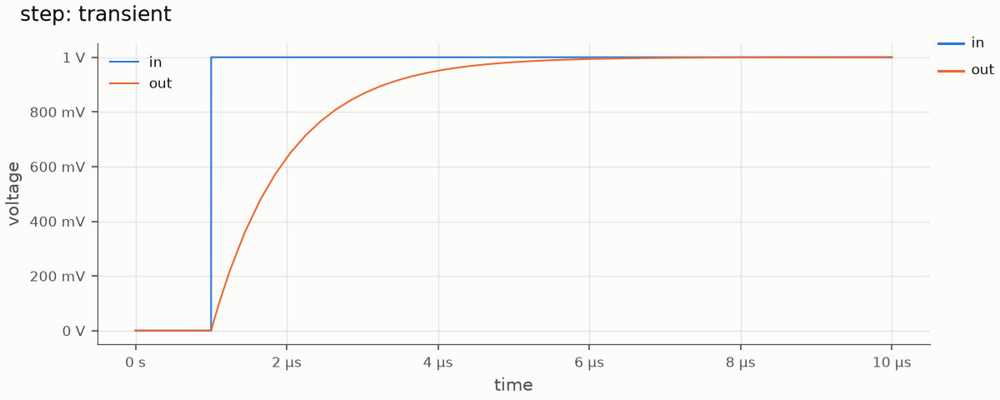
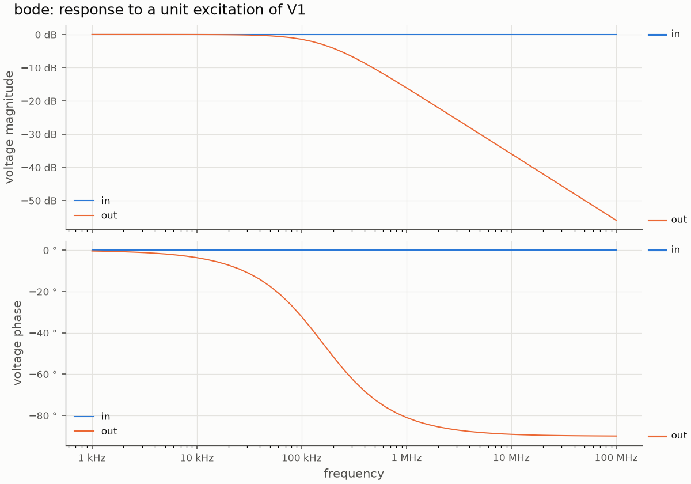
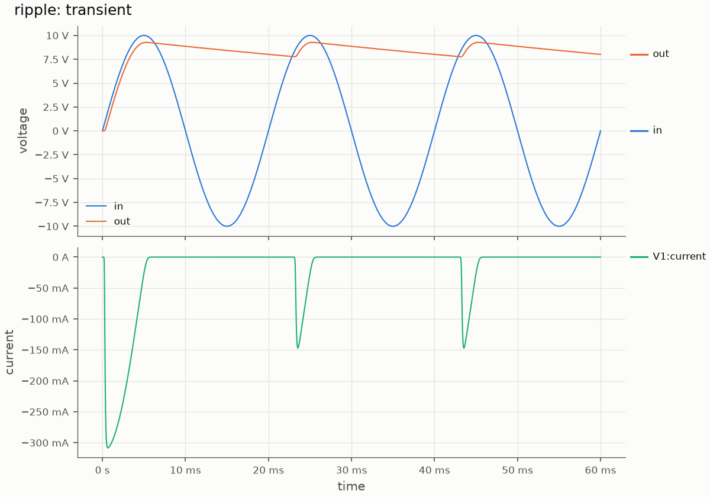

# Results

`jolty simulate` reports what each analysis found, and saves every value to a results file.

## The report

A report states facts, one section per analysis in the plan's order:

- an operating point lists every unknown's value, and the strategy that found it;
- a sweep, a frequency response or a transient lists each unknown's first, lowest, highest and last value;
- a failed analysis says why it failed.

A frequency response lists magnitudes per unit excitation: volts per volt, for a voltage source.
A report lists the first unknowns, up to the setting `listed_unknowns`; the results file holds them all.
With `--output-format json`, the command prints the same report as data.

## Plots

`jolty simulate` plots every analysis but operating points beside its results, as `<script>.<analysis>.png`, and the MCP server sends the images with its text.
A transient plots over time, a sweep along its source's levels, and a frequency response as a Bode plot:





Voltages and currents never share an axis: each quantity has a panel of its own, and a frequency response has two, its magnitude in decibels and its phase.
A legend names the series, and up to four are also labeled at their end:



By default a plot draws the nets the top component names, up to eight.
The option `--probes` chooses other unknowns, such as `X1/mid` or `V1:current`, and `jolty plot` draws a saved results file again, with other probes, without simulating:

```sh
uv run jolty plot rectifier.results.npz --analyses ripple --probes out --probes V1:current
```

The option `--no-plot` leaves plots out.

## Unknowns

Every result holds the circuit's unknowns, named by path:

- the voltage of a net, such as `out` or `X1/mid`, relative to the ground;
- the current through a voltage source, inductor or voltage-controlled voltage source, such as `V1:current`;
- the junction voltage of a diode with a series resistance, such as `D1:junction`.

## The results file

`jolty simulate` saves the results beside the script as `<script>.results.npz`, or where `--results` says.
The file holds the analyses that ran to their end; when none did, the command removes an earlier results file at that path, so it never describes another circuit.

`jolty.files.load_results` reads it back as a dictionary of results by analysis name:

```python
results = load_results(Path("filter.results.npz"))
point = results["op"]
point.voltage("out")  # a float, in volts
point.current("V1")  # a float, in amperes
results["step"].voltage("out", reference="in")  # an array, one value per time
```

| Result | Arrays | Each value is |
| --- | --- | --- |
| `OperatingPoint` | `values` | a float |
| `Sweep` | `levels`, `values` | one per level |
| `Response` | `frequencies`, `values`, and the `operating_point` | a complex phasor, one per frequency |
| `Waveforms` | `times`, `values`, and the step `statistics` | one per accepted time point |

`voltage(net, reference=None)` reads a net's voltage, relative to another net when given, and `current(instance)` reads the current through an instance.
A name that is not an unknown raises a `KeyError` that suggests the closest names.

The file is a NumPy archive: a JSON header names the unknowns and says what each analysis is, then each analysis's arrays follow under keys such as `step.times`.
Any program that reads NumPy files reads it.
