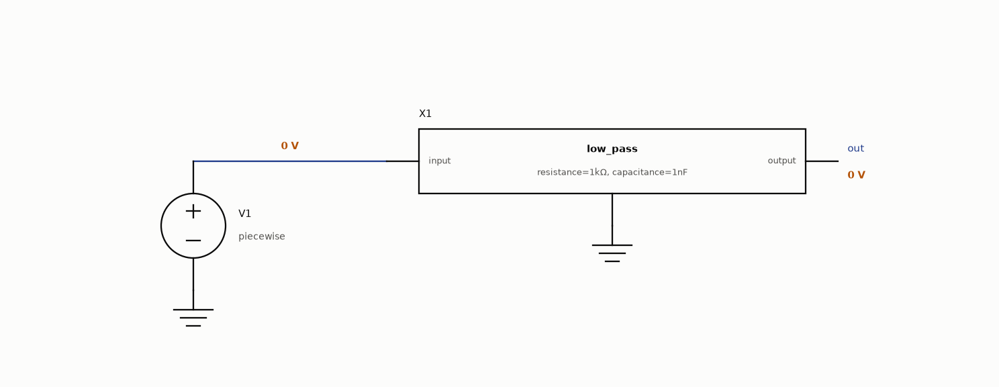

# Schematics

`jolty build` and `jolty simulate` draw the top component's schematic beside the circuit, as `<script>.schematic.png`, and the MCP server sends it with its text.
A script holds no coordinates: jolty lays the schematic out from the connections alone, the way an engineer draws one.



## How it reads

Signal flows from left to right.
Each instance takes a column by its distance from the sources, or, in a component without sources, from its first signal port.

- A two-terminal device between two signal nets lies across.
- A device between a signal net and a rail hangs from the signal: down to a ground, up to a supply.
  Devices that hang from the same net stand side by side along it.
- A controlled source keeps its control leads on its left, and flips upside down rather than stand on its ground.
- A placed component is a box, its function and arguments inside, its signal ports on its sides, its supplies on top and its grounds below.
- Each instance carries its name, and each device its value.

Ground and supply nets draw no wires: a ground symbol, or a bar with the supply's name, marks each of their pins.
A net is a ground or a supply when a port on it is one, of the component drawn or of a component it places.

Every other net is a wire, routed around the symbols.
Wires of two nets cross at right angles but never meet, so a wire touches only its own net; a dot marks where three wires of a net join.
A net the router cannot fit carries its name at each of its pins instead.

The component's own signal ports stand at its edges as flags pointing the way signal flows: inputs on the left, outputs on the right.

## Facts on a schematic

A schematic carries what the build and the simulation found:

- `jolty simulate` writes on each net its voltage at the plan's first operating point;
- an instance a listed diagnostic names is drawn in red, its name marked with `!`, and a box holding such an instance is marked too.

The option `--no-schematic` leaves the schematic out.

## Inside a component

`jolty draw` draws a saved circuit's top component, or, with `--instance`, the component an instance places, as `<script>.<path>.schematic.png`:

```sh
uv run jolty draw examples/rectifier.jolty.json --instance X1
```


The component's ports become flags, and the option `--results` writes the voltages of a results file's first operating point; a port net takes the voltage of the net it joins outside.
