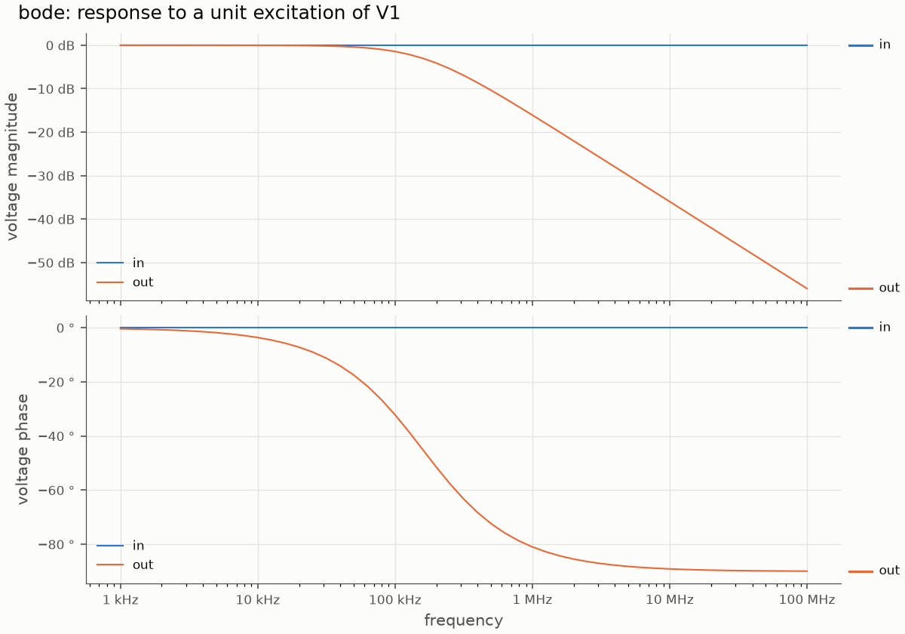
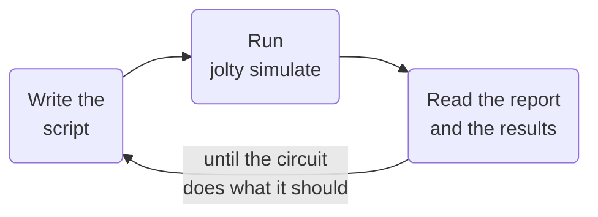

<div class="jolty-hero" markdown>

# jolty

A compiler and simulator for electronic circuits, built for AI agents.
{ .jolty-tagline }

An agent writes a circuit as a Python script of reusable components.
Each build checks every device and connection, reports each problem with the script line behind it, and simulates the circuit with a native engine written in Rust.

[Get started](get-started.md){ .md-button .md-button--primary } [Guide](guide/index.md){ .md-button }



</div>

<div class="grid cards jolty-links" markdown>

-   📘 **[Guide](guide/index.md)**

    One page per concept: components, units, devices, checks, schematics, simulation and results.

-   🤖 **[Agents](agents/index.md)**

    Connect an agent through the command line or the MCP server, and why jolty works like a compiler.

-   📚 **[Reference](reference/index.md)**

    Every command, setting and Python function.

-   🛠️ **[Contributing](contributing.md)**

    The checks a change must pass, and the rules for changing jolty.

</div>

## How it works

A script describes a circuit and a plan says how to simulate it.
jolty saves the circuit, simulates every analysis of the plan, saves the results and reports what each analysis found.
The agent reads the report, edits the script and runs it again.



A component is a Python function that declares ports, places devices and other components, and connects their terminals:

```python
@component
def low_pass(c: Builder, resistance: Quantity, capacitance: Quantity) -> None:
    source = c.port("input")
    output = c.port("output")
    ground = c.port("ground", Role.GROUND)
    resistor = c.place(devices.resistor(resistance), id="R")
    capacitor = c.place(devices.capacitor(capacitance), id="C")
    c.connect(source, resistor.a)
    c.connect(resistor.b, capacitor.a, output)
    c.connect(capacitor.b, ground)
```

The engine solves the circuit's equations as SPICE does, and its results agree with ngspice's on a corpus of reference circuits.

## Install

jolty builds from source with [uv](https://docs.astral.sh/uv/), which installs Python 3.14, and a [Rust toolchain](https://rustup.rs/):

```sh
git clone https://github.com/maxencefaldor/jolty
cd jolty
uv sync                                        # builds the engine and installs jolty
uv run jolty simulate examples/rc_filter.py    # builds the filter and runs its plan
```

The [Get started](get-started.md) page walks through a first circuit.
